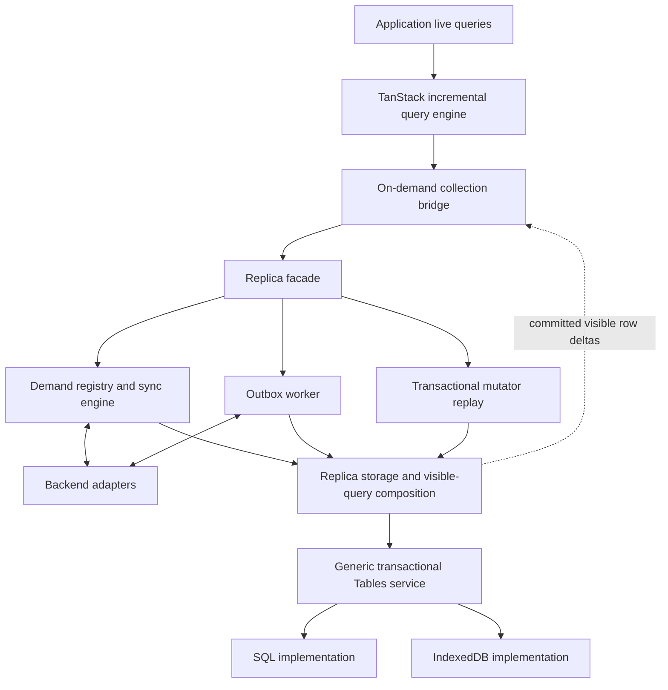

# Transactional tables and the future Replica

## Purpose and sources

This is the implementation reference distilled from
[Compare TanStack DB RxDB](https://chatgpt.com/share/6ad5aa6e-39ac-83ea-a7b0-954ede5a9fd6)
and the follow-up discussion in this coding chat, as of October 19, 2026.
It is a summary of the architecture and its evolution, not a verbatim transcript
or a claim that the proposed APIs already exist.

The shared conversation exposes sixteen user prompts, including the final two
about obtaining a transcript. Its earlier architecture discussion and rendered
TypeScript examples were read through the browser. The conversation reader alone
returned only five recent turns and omitted code behind content-reference markers;
the public share supplied the missing context. The earlier assistant-generated
downloadable handoff was explicitly described as reconstructed and incomplete,
and is not the source of this summary.

The conversation contains third-party API and implementation claims. Those are
historical design context, not substitutes for verifying installed versions,
driver behavior, and actual TanStack demand propagation during implementation.
Illustrative Promise-based interfaces and mixed Effect syntax from the chat are
conceptual sketches, not production contracts to copy unchanged.

See [owned backend port checkpoints](./backend-port.md) for the subsequent plan
to retain TanStack query execution, add runtime-derived codecs and attachment
composition, port SQLite/DO backends, and introduce a durable commit journal.

See [owned runtime host](./runtime-host.md) for the subsequent coordination and
central ownership refinement.

See [migration status](./migration-status.md) for the current implemented/remaining
inventory, and [replicating replica state](./replica-state.md) for the October 20
parent/child Replica exploration. Historical checkpoints below are not the current
completion checklist.

See [coverage and replication progress](./replication-coverage.md) for the current
overlap rules, subset translation, and watcher repair behavior.

See [query IR direction](./query-ir.md) for correlated subqueries, relationship
helpers, and their connection to demand and retention.

## Intended outcome

Build a reusable transactional table-storage abstraction first, with SQL and
IndexedDB implementations. Build a storage-first replication runtime on top later.
Keep that runtime independent of TanStack DB, and expose its visible rows through
thin on-demand TanStack collection adapters.

The motivating use cases include large offline datasets, browser tabs sharing a
worker, mobile apps, Node services, and Durable Objects that persist or forward
replicated data without loading it all into JavaScript collections.

There are two independent demands:

- **Replication/retention demand:** which authoritative data belongs in durable
  local storage, including offline pins and dependencies of pending operations.
- **Materialization demand:** which locally visible rows an active application
  query needs in TanStack memory.

A device can retain 50,000 rows offline while materializing only 100. A storage
owner with no reactive consumers should be able to ingest bounded remote batches
without constructing TanStack collections.

## Responsibility boundaries



| Component                     | Owns                                                                             |
| ----------------------------- | -------------------------------------------------------------------------------- |
| Tables                        | Keyed resources, CRUD, subset reads, indexes, transaction execution              |
| Replica storage/composition   | Base/outbox/overlay layout and logical visible queries                           |
| Mutator replay                | Deterministic speculative execution and final visible changes                    |
| Demand registry / sync engine | Active source regions, coverage, upstream fetching and checkpoints               |
| Outbox worker                 | Durable command submission, retry eligibility, receipts, reconciliation workflow |
| TanStack bridge               | Demand translation, snapshot publication, routing visible changes                |
| TanStack DB                   | Incremental filtering, joins, ordering, aggregates, application top-K results    |

These are responsibilities, not a requirement for a service or class per row.
The public replication abstraction is **Replica**. Sync and outbox can be scoped
background workflows. Reconciliation and projection can initially be functions
used by its transaction path.

The generic Tables API must not know what an authoritative row, optimistic row,
outbox command, remote cursor, or demand lease means. Replica represents those
using ordinary logical tables/namespaces and composes the behavior above Tables.
In particular, do not put a replication-specific `view: "base" | "visible"`
switch into the generic storage interface merely because earlier proposals did.

## Current direction versus unresolved design

The recovered conversation converged on:

- One exclusive runtime owner/writer per Replica, with startup recovery.
- One portable transactional storage contract beneath replication.
- Authoritative base rows, ordered durable pending invocations, and sparse
  optimistic replacement rows/tombstones in one atomic storage domain.
- Arbitrary transactional mutator reads/writes from the start.
- Full ordered replay of a reasonably bounded pending outbox for the initial design.
- One global durable local revision and a post-commit visible-row change stream.
- On-demand TanStack source collections, with TanStack owning live-query maintenance.
- Small source-demand descriptors and ordered-prefix metadata rather than duplicate
  per-subset result maps as the main publication mechanism.
- SQL and IndexedDB as primary storage implementations; reuse the existing
  IndexedDB indexing/planning ideas without inheriting its persistence contract.

Still open: exact schema/query types, codecs, package layout, index lifecycle,
transaction nesting and scheduling, backend support matrix, reconciliation
policies, and public completeness/error APIs. Names remain provisional.

## Generic transactional tables: first implementation

The final storage discussion asked for an interface that can load subsets, ensure
indexes, and do its operations transactionally on IndexedDB and SQLite. Its sketch
used `CollectionStore`, followed by the proposed name `effect-tables`.

Required capabilities, without fixing exact signatures:

| Capability                           | Why it matters                                                             |
| ------------------------------------ | -------------------------------------------------------------------------- |
| Named, keyed logical tables          | Store application rows and higher-level metadata uniformly                 |
| Get, put, delete                     | Point reads and mutation primitives                                        |
| Subset loading                       | Predicates, ordering, pagination, and efficient indexed reads              |
| Ensure indexes                       | Declare lookup paths without coupling callers to storage internals         |
| Transactions spanning logical tables | Atomically update data, bookkeeping, and derived records                   |
| Transaction-scoped reads             | Mutators must see earlier writes and index updates in the same transaction |
| Explicit commit/rollback semantics   | Failed execution must not leave partial rows or index entries              |
| Resource lifecycle                   | Own connections and clean them up through the selected runtime             |

Index creation inside a transaction was suggested where it fits user-space
indexing. Native SQL DDL and browser version upgrades have different constraints;
the exact portable guarantee needs design and tests, not an unconditional promise.

A generic commit-observation facility could help Replica record changed keys, but
its placement and payload are not settled. Tables should provide enough atomic
read/write capability to implement revisions and checkpoints as ordinary records;
Replica-specific visible deltas and revision semantics remain higher-level behavior.

### IndexedDB reuse

The reference implementation is
[IndexedDBPersistenceAdapter.ts](../../packages/db-indexeddb-persistence/src/IndexedDBPersistenceAdapter.ts)
and its [README](../../packages/db-indexeddb-persistence/README.md).

Useful existing techniques include persisted index definitions and entries, fixed
native lookup indexes over those records, typed ordered encodings, equality/range
lookups, AND intersections, OR unions, supported string-prefix narrowing, and
ordered cursor scans with residual filtering before pagination. General or
unsupported query shapes use conservative fallbacks.

The new library may change the API and transaction machinery freely. It should
not inherit TanStack's managed-cache claims, physical generation lifecycle,
leadership terms, or persistence-adapter protocol merely to reuse the planner.

The critical refactor is to let all query/index/write operations use the caller's
existing transaction. Calling an old method that opens a separate read transaction
does not supply read-your-own-writes and can conflict with the active writer.

### SQL reuse and portability

Use Effect's SQL client/transaction abstractions where suitable, with the caller
supplying a concrete driver. A shared SQL client does not establish identical DDL,
upsert, value encoding, isolation, collation, or pagination behavior across every
supported database. SQLite is a concrete target from the original design; broader
SQL portability must be demonstrated with dialect handling and driver contracts.

Durable Objects were an intended runtime, but their native synchronous transaction
constraints need a separate compatibility check before promising that an arbitrary
Effect transaction program can run unchanged there.

## Replica state model

Let `B` be authoritative base rows, `P` ordered pending mutator invocations, `O`
the derived sparse overlay, and `V` visible state:

```text
V = Replay(B, P)
V = (B excluding every key present in O) union non-deleted rows in O
```

Overlay records contain complete replacement rows or tombstones, not simply
patches to be applied again at read time. The pending invocation stores replayable
intent: identity, mutator name/version, arguments, sequence, and execution status.
An increment must remain an increment, rather than becoming a saved resulting
value that overwrites concurrent changes.

Base plus pending intent is sufficient to reconstruct the overlay. Persisting
the overlay is attractive for fast startup and consistent reads; it remains a
rebuildable derived cache.

### One atomic rebase

For an incoming authoritative batch or settlement:

1. Apply authoritative changes and relevant checkpoint metadata.
2. Settle only operations whose outcome is established.
3. Clear the previous optimistic overrides.
4. Replay remaining mutators in sequence against base plus the evolving overlay.
5. Record the resulting visible-row differences and advance the local revision.
6. Commit; publish notifications only after successful commit.

All steps through commit share one storage transaction. Mutator B sees A's writes,
including inserts/deletes and query membership changes across multiple tables.
Failure rolls back the attempted transition. The policy for a pending mutator that
becomes invalid after a base update still needs definition so a bad operation does
not indefinitely block incoming sync.

Reset before replay is essential: replaying onto the previous optimistic state
would apply operations repeatedly. Local `mutate` similarly commits the new outbox
entry and its complete optimistic effect together, and returns after local
durability rather than waiting for the backend.

### Mutator execution constraints

Support arbitrary database reads and writes through a narrowed transaction facade.
Mutators must not edit authoritative base, checkpoint, or outbox bookkeeping.
Reads target the logical visible view, including preceding speculative writes.

Network calls, timers, UI work, and arbitrary scheduler yields stay outside replay.
Time, randomness, generated IDs, and implementation versions need deterministic
inputs/policies so durable invocations can be replayed after restart or deployment.

IndexedDB permits awaiting transaction-local requests; `await` itself is not the
problem. A later unrelated task can run after the transaction becomes inactive or
finishes. The Effect adapter must preserve request lifetimes and transaction
context rather than assuming every Effect scheduler boundary is safe. Include all
required physical object stores in the transaction scope at creation.

The final preferred baseline was replay inside one short-lived transaction, not
an external speculative workspace with revision-validation retries. Do not keep
an uncommitted transaction open indefinitely as an optimistic branch.

Cap more than operation count: a few arbitrary mutators can touch many rows.
Bound optimistic keys, speculative bytes, and replay work as appropriate. Selective
replay and copy-on-write branches are later optimizations, not initial requirements.

## Visible subset queries

The logical overlay query must be usable both inside mutator transactions and
outside them for application materialization. Application reads cannot substitute
TanStack's current in-memory collection for transactional storage reads.

For a subset `Q`:

1. Use storage indexes to find matching authoritative candidates.
2. Obtain overlay records and their complete shadow-key set for that table.
3. Remove all shadowed base candidates, even when the replacement no longer matches Q.
4. Add matching non-deleted overlay rows.
5. Apply final ordering, deterministic key tie-breaks, and pagination to the merge.

Do not independently apply the requested final limit to each side and concatenate.
Deleted/replaced early base rows can leave a short or incorrect page.

For a finite ordinary ordered window, the conversation proposed fetching up to
`offset + limit + M` matching base candidates, where `M` is the number of distinct
overlaid keys, then merging. This relies on equivalent predicate/order semantics
and a correct base prefix. It is not a universal cursor/tie/collation algorithm.
Boundary ties, cursor continuation, unsupported expressions, and incomplete local
coverage need explicit handling and regression tests.

Sparse overlay composition belongs above generic Tables. SQL may optimize it
through an anti-join/union or view; IndexedDB can use the existing planner for base
scans and merge the bounded overlay. Avoid forcing a general relational engine into
Tables merely to implement this single-table composition.

## Revisions, snapshots, and notifications

Use one monotonically increasing **local revision per Replica database**, allocated
atomically with a committed state transition spanning any number of tables.
It orders local application, not remote occurrence or causality across backends.

Keep these separate:

| Identifier                  | Meaning                                  |
| --------------------------- | ---------------------------------------- |
| Local revision              | Committed local database state           |
| Remote checkpoint           | Progress in one backend stream/snapshot  |
| Action ID / idempotency key | Identity and reconciliation of a command |

A bounded local change history is optional for efficient catch-up. It is not a
permanent event-sourcing requirement. Consumers can reload their active snapshots
after a gap, restart, or pruned history.

For precise visible deltas, collect the union of changed base keys, old optimistic
keys, and new optimistic keys. Compare their final visible values before and after
the transaction. A base change hidden by an unchanged tombstone need not publish a
visible row event. Settlement may advance bookkeeping without changing visible rows.

Snapshot loading and subscription must have no gap: install observation before
reading, capture a consistent snapshot/revision, buffer racing events, and apply
later revisions in order. Multiple concurrent loads must not publish stale versions
over newer rows. Cross-collection publication needs a batching strategy so joins
do not briefly observe mixed local revisions.

## Demand, completeness, freshness, and retention

Active leases and UI subscriptions are volatile. Durable state includes offline
pins, resumable remote checkpoints, and any completeness/baseline information
needed to safely reuse cached rows. Object-to-subset membership is conditional on
the deletion, overlap, and GC strategy; persisting every active query is unnecessary.

Local availability, authoritative completeness, and freshness are distinct. Ten
loaded rows do not prove a top-10 result is complete or current. Empty cached data
does not prove an empty authoritative result. A partial initial snapshot must not
be advertised as complete merely because one page and a cursor committed.

For ordered demand, record authoritative prefix coverage, boundary keys/ties,
exhaustion or `hasMore`, and backend-justified freshness. Do not derive remote
pagination progress solely from the last currently optimistic visible row.

Transactional consistency also does not imply remote completeness for mutators.
The discussion allowed executing against available local state with replay as more
data arrives, while some mutators may require complete coverage. Make that policy
explicit rather than silently treating absent cached rows as authoritative absence.

Conceptually:

```text
retain(base row) = active retained demand OR offline pin OR pending dependency
```

Pending commands survive the disappearance of every UI query. Moving an object
optimistically between subsets must not discard the authoritative row or other
data required to replay/reconcile it. An arbitrary query dependency includes rows
that might newly enter its predicate, not just IDs returned by an earlier read.

## Outbox and reconciliation

Sync and outbox are independent execution loops sharing transactional storage.
Targeted refresh/read-back is their narrow coordination point. Acknowledgment,
authoritative incorporation, and local durability are separate states.

The proposed action states were queued, sending, accepted, reconciling, confirmed,
failed, and uncertain. Exact transitions remain to be designed.

An action receipt can contain an operation identity, authoritative changes, or
affected object IDs. Foundry-style IDs may trigger targeted reads, including delete
confirmation. Stale/missing reads are not automatically sufficient proof that an
action is reflected locally, and older responses must not overwrite newer state.

An incoming base may already include an operation still pending locally. Blind
replay can double-apply a non-idempotent operation such as increment. Backend-specific
settlement evidence or selective conflict holds are needed where causal correlation
is unavailable. Avoid global wait-for-ack blocking as the default.

Ambiguous network failure is different from definitive rejection. Automatically
resend only when safe idempotency or an equivalent backend guarantee exists.
Dependent commands also need a policy if an earlier create or prerequisite fails.

## TanStack integration and the top-10 delete example

The eventual public Replica sketch separates `acquire`, local-only `query`, global
`subscribe`, durable `mutate`, and action-status lookup. Those method concepts are
settled more strongly than their exact types.

The collection bridge installs one commit listener, translates `loadSubset` into a
demand lease plus visible snapshot load, and releases demand through `unloadSubset`.
For changed rows already in the collection, publish their final update or deletion.
For unseen rows, admit relevant source candidates using active demand:

| Demand                  | Candidate routing                              |
| ----------------------- | ---------------------------------------------- |
| Primary key             | Key lookup                                     |
| Unique equality         | Indexed demand/value lookup                    |
| Ordinary predicate      | Before/after predicate checks                  |
| Ordered limited source  | Predicate plus authoritative prefix boundaries |
| Uncertain source window | Conservative bounded prefix repair             |

TanStack maintains application query results. The bridge should not primarily
cache and diff a separate full result map for every subset and reconcile their
union. Fine-grained memory eviction is separate; minimal key ownership may later
be useful, and `unloadSubset` alone must not be assumed to evict all source rows.
Publishing every predicate match indefinitely would also defeat bounded memory
for limited queries, so ordered admission cannot be ignored permanently.

For an optimistic delete in a top-10 task query:

1. Load/acquire the visible ordered source prefix.
2. Atomically enqueue the delete invocation and its tombstone; retain the base row.
3. Publish the committed visible deletion into TanStack.
4. Let TanStack request source refill/repair as needed; verify the exact installed API.
5. Answer locally if coverage suffices, otherwise extend remote demand when possible.
6. While offline with insufficient coverage, nine visible rows may be the honest result.
7. Execute remotely, obtain settlement evidence, atomically update base/settle/replay.
8. Publish only actual final visible changes; confirmation need not delete twice.

A small extra authoritative buffer can reduce refill latency without putting all
spare rows in TanStack memory. Upstream subscriptions or prefix refreshes must also
discover unseen remote rows that could enter the window; local commit routing alone
cannot discover data never synchronized.

## Design evolution: proposals not to mistake for final decisions

| Earlier idea                                                         | Later direction                                                                      |
| -------------------------------------------------------------------- | ------------------------------------------------------------------------------------ |
| Effect EventLog as a foundation                                      | Ignore for now; ordinary transactions and durable state suffice                      |
| Separate public manager/store/materializer services                  | One Replica facade, internal responsibilities, thin TanStack bridge                  |
| Persist all coverage and demand                                      | Volatile demand; durable resume evidence, pins, and necessary membership only        |
| Patches/key-scoped reducers first                                    | Full deterministic transactional mutators are required                               |
| Long-lived speculative transaction                                   | Short atomic rebase transactions                                                     |
| External speculative workspace and revision validation               | Replay within the same storage transaction when all work is transaction-local        |
| Fully duplicated visible table as first prototype                    | Sparse overlay after research and acceptance of bounded replay cost                  |
| Derived TanStack anti-join/union transparently drives storage demand | Do not assume outer demand propagates through a materialized derived collection      |
| Requery/diff every subset and union their results                    | Precise committed visible deltas, demand-based admission, TanStack query maintenance |
| Custom copy-on-write storage immediately                             | Ordinary IndexedDB/SQL plus sparse row overrides first                               |

The derived-collection pushdown conclusion was based on prior source inspection,
not a demonstrated regression test. Inline query fragments were mentioned as an
experiment, not selected as the foundation.

Other systems considered included RxDB, PowerSync, SQLSync, Corrosion, Graft,
Triplit, Evolu, cr-sqlite, and SQLite sessions. They supplied ideas about storage
ownership, replication, or observation; none was selected as a dependency. Claims
about their current licensing/support need fresh verification before adoption.

## Existing party-stack relationship

[OutboxProjectionManager](../../packages/ontology/src/live/outbox/projectionManager.ts)
orders projections and replays the suffix after the first divergence.
[createLiveOntologyActions](../../packages/ontology/src/live/actions/createLiveOntologyActions.ts)
currently constructs TanStack optimistic transactions and settles their completion
promises. These files were also inspected in this checkout.

The new direction moves durable optimistic ownership into Replica storage. Keep
ordered replay as a useful concept, but do not install the existing TanStack-owned
projection and the new Replica-owned projection for the same operation. First-
divergence replay is a potential later optimization after full replay works.

The earlier [ontology client/backend-adapter spec](../2026-09-25-ontology-client-backend-adapter/README.md)
is related historical context. Its broader refactor is not automatically part of
the initial Tables package implementation.

## Naming, Effect boundary, and packaging

Names remain open. The current recommendation is **`@party-stack/ontology-storage`**,
with a **Tables** service and **Table** resources. It distinguishes these durable
transactional resources from TanStack collections. `effect-collections` remains a
possible name but creates more vocabulary overlap; `tables` is concise but does
not communicate an Effect-based execution contract.

The latest user preference is compatible with keeping this infrastructure
Effect-only for simplicity and exposing non-Effect usage at higher party-stack
levels. This is the recommended initial direction, not a commitment to maintain
both Promise and Effect storage APIs. Plain query descriptors and data types can
remain ordinary TypeScript even when operations return Effects.

In that design, a service is the storage capability callers request; a layer
constructs its implementation, supplies dependencies, and scopes resource cleanup.
A SQL Tables layer consumes a SQL client supplied by a driver layer; an IndexedDB
Tables layer acquires the browser storage implementation. Business code depends
on Tables rather than constructing drivers at each call site.

The original conversation illustrated subpath exports. This coding discussion
also proposed separate core, SQL, and IndexedDB packages to keep backend dependencies
explicit. Neither packaging option is final. Packaging is independent of the
service contract; choose after the actual Effect dependency and driver footprint
are established. There is no requirement to make the name imply framework-neutral
usage before such an API exists.

## Implementation sequence and validation targets

1. Finalize the generic Tables contract, value/key model, query semantics, and
   transaction lifetime guarantees. Keep Replica concepts out of it.
2. Implement IndexedDB and SQL adapters with a shared behavioral contract. Reuse
   existing index/planner ideas; ensure queries and indexes see transaction-local writes.
3. Validate atomic cross-table rollback, read-your-own-writes, index maintenance,
   query ordering/pagination, reopen behavior, and the promised runtime/driver support.
4. Build sparse-overlay query composition above Tables and compare with a simple
   full-data oracle for inserts, shadowing, tombstones, moves, order changes, and pages.
5. Add durable ordered mutators and atomic full replay; test two dependent mutators,
   an intervening base change, first-operation settlement, and replay failure.
6. Add one writer, revision allocation, post-commit deltas, snapshot/event race
   handling, restart recovery, and status/coverage semantics.
7. Add sync/outbox workers and backend-specific reconciliation without assuming
   every backend supplies a transaction log or safe automatic retries.
8. Add the TanStack on-demand bridge and validate actual demand bounds, ordered
   refill, overlapping demand, unseen candidates, idle cleanup, and cross-table publication.

The original coding request authorizes the Tables foundation first. Replication
is the intended next layer, not a reason to implement its entire protocol in the
initial storage package. This reference preserves the constraints that foundation
must enable without prematurely deciding its whole API.

## First implementation checkpoint

The initial implementation now lives in `packages/ontology-storage`,
`packages/indexeddb-ontology-storage`, and `packages/sql-ontology-storage`. Read the
[Tables usage contract](../../packages/ontology-storage/README.md) for the concrete API
and current limits. It includes transaction-scoped CRUD/subset reads, persisted
field indexes, portable JavaScript/bigint/Temporal values without mandatory
schemas, and a separate sparse-overlay helper export.

SQL currently supports SQLite and PostgreSQL. The Effect build and TypeScript
presets are separate opt-in exports from build-config. Automatic migrations and
rewiring the existing TanStack persistence adapter are deferred; a table-version
mismatch currently fails explicitly. Computed/compound indexes and additional
SQL dialects are not part of this checkpoint.

### Indexing and API follow-up

The mini planner lives behind the optional core `/planner` export, shared by
IndexedDB and `/memory`. Neither the main entry point nor SQL imports it. It includes
count estimates, bounded batches, selective/empty AND handling, ordered ranges,
and JavaScript-lowercase companion indexes for ILIKE, porting the existing
persistence adapter's approach. SQLite/PostgreSQL instead own native JSON
expression indexes and SQL query planning. A sortable scalar projection preserves
bigint/Temporal order independently of the graph payload. Unsupported query
portions use exact residual evaluation before pagination; undeclared SQL fields
are currently residuals. Tests verify physical IDB reads and SQL EXPLAIN plans;
browser benchmarks compare both Tables paths with the existing adapter.

The public API has Effect-style `withTransaction(effect)` and
`withReadTransaction(effect)` combinators. Service operations inherit the current
transaction, making reusable Effect helpers composable. Explicit callback/handle
conveniences remain; nested transaction boundaries/savepoints are rejected.
Predicates have standalone function exports, including `inArray`, `like`, `ilike`,
`isNull`, and `isUndefined`, plus the optional `where` namespace. Errors use one
`OntologyStorageError` envelope with tagged reasons for Effect.catchReason handling.

An initial `/memory` backend now passes the same storage contract. It provides
copy-on-write atomic snapshots and ordered index arrays; a SharedWorker could own
one instance for cross-tab ephemeral state. Worker RPC/lifecycle wiring remains
separate, and worker termination loses the data. Keeping these as explicit core
subpaths avoids a new package without adding them to SQL consumers' import graph.

### Effect conventions audit

The repo now vendors the official `effect-ts` and `effect-v3-to-v4` skills at a
pinned revision and requires reading the installed Effect package's AGENTS guide.
The Tables error envelope remains, but all reasons are explicit schema-backed
error classes rather than tagged object literals inferred from operation names.
`catchReason`, `unwrapReason` / `catchTag`, schema serialization, and preserved
native causes have focused tests. Reusable Effect generators use `fnUntraced`.
Persisted graph values, overlay records, and index metadata are validated against
internal schemas, without requiring schemas for application data. The separate
Effect build preset integrates the official Vitest adapter with Vite+'s runner.

## Interactive branch review

The review contains fifteen focused topics, a source snapshot, per-topic notes
and review marks, seven executable examples using the actual memory backend,
and an inspector using the actual SQLite/PostgreSQL query compiler. SQL output
is a compiler preview; native SQL execution is covered by tests, not simulated
in the review. It makes no network requests and stores notes locally.

Build and type-check it from the repository root:

```sh
pnpm exec tsc -p specs/2026-10-19-effect-tables-replica/tsconfig.json
node specs/2026-10-19-effect-tables-replica/build-review.mjs
```

Open `review-generated/index.html` from this directory. It is self-contained and
works offline. Generated output is ignored; rebuild after source changes so the
embedded implementation and source snapshot remain current. The bundle includes
vendored dependency licenses. Effect documentation links open the official site.

The review is a teaching/audit aid, not an automated security proof. Export its
notes as Markdown to retain findings independently of browser storage.

### Public query and module cleanup

The public `/internal` export was renamed `/driver` for adapter authors. Core
source now groups query evaluation/validation, candidate planning, storage,
memory, overlay, and testing modules. Fields are tagged references, and comparison
operands are resolved independently in either position, including field-to-field
comparisons. `prefix` is removed; LIKE/ILIKE retain prefix range optimizations.

SQL values remain bound. Query operators/directions are runtime-whitelisted;
identifiers and partial-index constants use controlled encoding/quoting. Explicit
PostgreSQL escape strings handle nonstandard backslash settings. Hostile-input
regressions execute against SQLite and PGlite PostgreSQL. Backend authorization
and resource limits remain application responsibilities.

### Value scope and declared-schema direction

The default value codec is now a tagged tree using Effect's JSON schema codec:
nested JSON-shaped values, bigint, Temporal.Instant/PlainDate, Date, undefined,
Map, and Set. The graph prototype's cycles, shared-reference identity, binary
views/buffers, RegExp, and special numeric preservation were removed. Application
tag collisions remain impossible. Shared objects become independent copies;
unsupported values fail through CodecError. Storage format version 2 deliberately
rejects the unreleased version 1 prototype rather than silently misreading it.

See [declared schemas and migrations](schema-migrations.md) for the next possible
checkpoint: optional declared schemas, native SQL columns, portable precision and
null/undefined semantics, and explicit migration ownership. This is a proposal;
no native-column or migration API is implemented in this branch.

## Ontology specification extraction

The agreed schema source is the complete ontology model, including attachments
and object references. A new generic schema layer below it would recreate an
unhelpful abstraction. The reusable definitions now live in `ontology-spec`, while
`ontology` keeps its live runtime and re-exports the existing public spec APIs.
Codegen stays with the spec package behind a separate entry; self-hosted bootstrap
remains explicit and uses checked-in generated sources.

The future backend protocol will expose changes, actions, and receipts; its engine
owns lifecycle and replication concerns. An owned backend can use a smaller direct
storage transaction API underneath it. That API is not introduced by this package
extraction. The existing dynamic Tables implementation remains available while we
work through integrating ObjectTypeDef, lenses/casts, migration history, and native
SQL layouts. See [the updated schema/migration direction](schema-migrations.md).

## Ontology storage, attachment bytes, and retention checkpoint

The port now uses `ontology-storage`, `sql-ontology-storage`, and
`indexeddb-ontology-storage`. The public object API derives keys and queryable
paths from ObjectTypeDef and converts generated Effect models at storage
boundaries. The former dynamic Tables engine remains in explicit infrastructure
exports. Generated models expose their Effect API through `generated/effect.ts`.

This does not yet replace sqlite-ontology, introduce native SQL columns, or execute
migrations. The storage definition guard rejects drift instead of migrating it.
Attachment handles are supported; byte-store integration and collectors follow the
[attachment/GC design](attachments-gc.md). Owned/local rows and sole byte copies
remain durable; recoverable replica rows and cached bytes have independent future
retention policies. Eviction must preserve pending work, shared attachments, and
correct subset-coverage state, without producing remote deletions.
