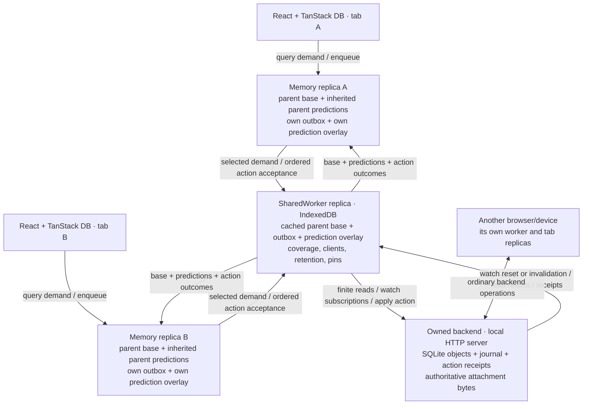
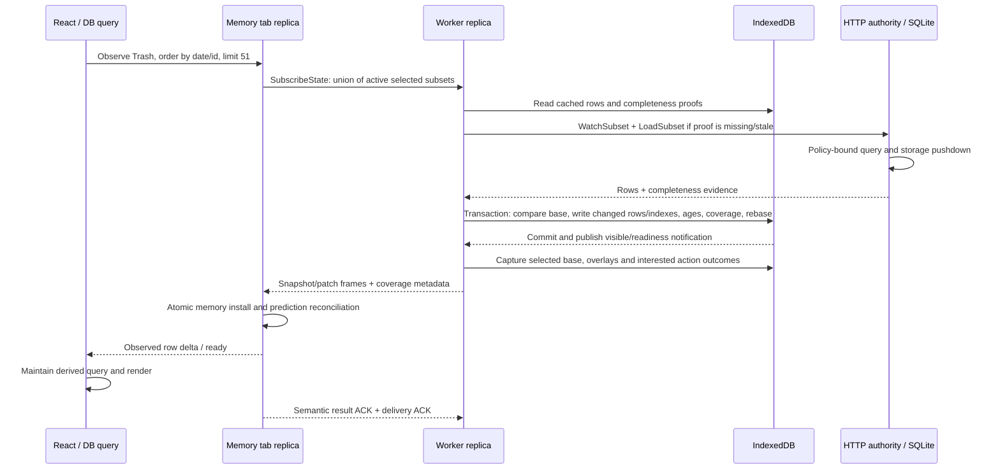
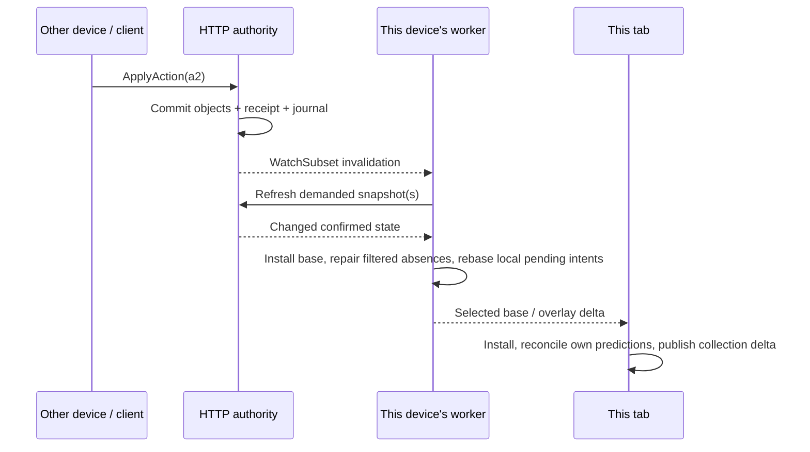
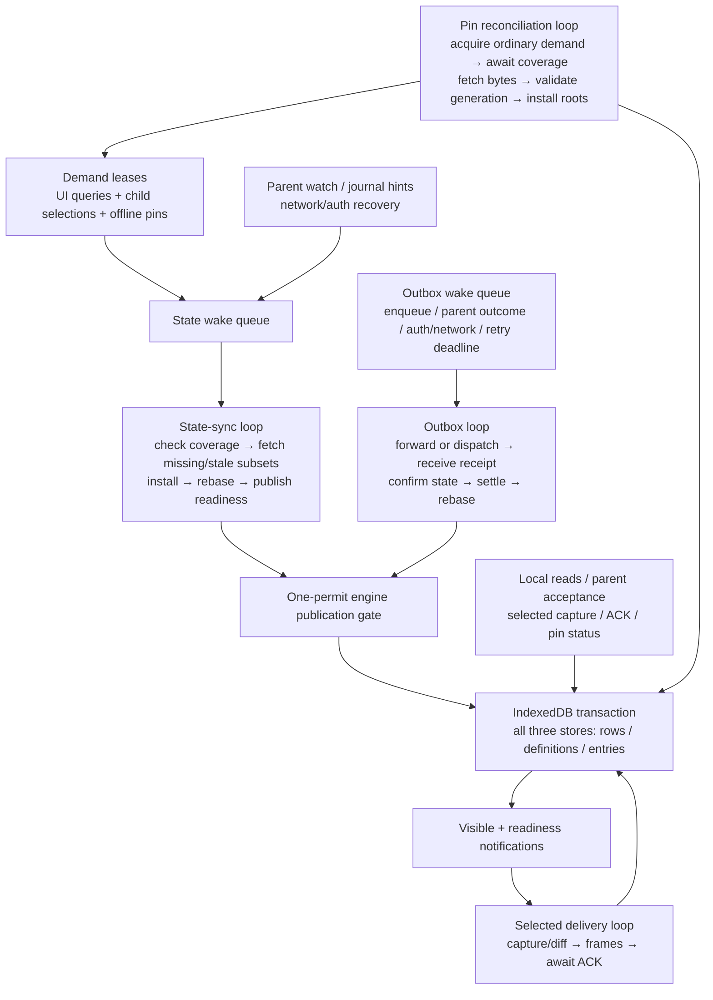
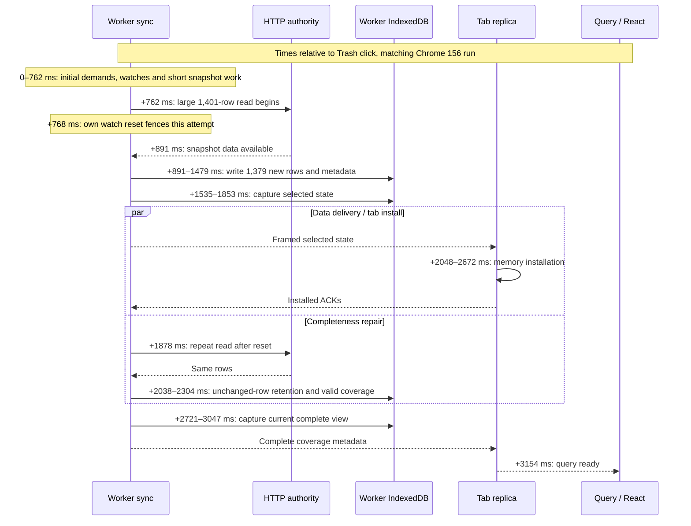
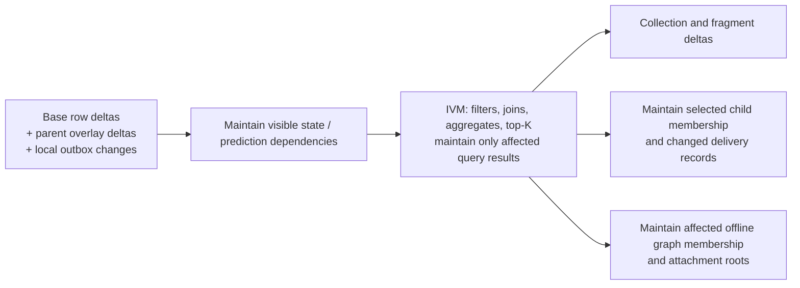

# Replica data flow and waits

Updated November 9, 2026. Current Notes implementation, with dated measurements
and future work marked explicitly.
The examples use an invented `Note n1`, initially `text = "hello"`, and an action
`a1` that changes it to `"hello!"`. They are not recorded user content.

## Actors and storage



The server happens to be local in Notes; it is still a separate authority and
storage copy. The worker's cache is not the authority's SQLite database. A fresh
browser context starts with an empty worker cache even when the server has rows.

| Location         | Persisted state                                                                                                                                                                    | State lost when that owner closes                                                                   |
| ---------------- | ---------------------------------------------------------------------------------------------------------------------------------------------------------------------------------- | --------------------------------------------------------------------------------------------------- |
| HTTP authority   | Objects, attachment records/bytes, action receipts, committed journal                                                                                                              | Active requests and watches                                                                         |
| Shared worker    | Base rows, outbox, overlay, coverage/cursor, client admission and result watermarks, retention roots/ages, pin intent/membership, cached bytes, small delivery session/ACK headers | Live demand leases and watch scopes, queues/gates, bounded delivery witnesses and prepared payloads |
| Tab replica      | None across reload: its tables use the memory driver                                                                                                                               | Base rows, inherited worker overlay, own outbox/overlay, installed delivery position, demand scopes |
| TanStack / React | No second application row cache                                                                                                                                                    | Source collections, derived query state, included fragment collections, editor state                |

The tab must hand an action to a persistent parent before treating it as durable.
Worker acceptance means the worker committed responsibility; it does not mean the
authority has executed the action. Delivery witnesses are recoverable data-view
state; action intents and outcomes remain durable.

## Cold query



The cache read can supply an early view while freshness catches up. Complete
readiness still requires a valid coverage proof; having `n1` cached cannot prove
that an arbitrary filter has no additional matches. A healthy retained covering
watch can supply that proof without another upstream read.

The unpatched DB RC can acquire every row tied on a composite ordering's first
field, despite the first request being limited to 51. A leading `favorite = false`
previously expanded this reproduction to about 1,400 rows. Trash no longer sorts
by pin status. The explicitly approved workspace DB patch also lets adapters
declare exact composite-order support and use the full tuple boundary; see
`packages/tanstack-db-patches/ordered-window.md`. Published consumers do not automatically
inherit workspace patches. These acquisition costs are separate from installing
the rows that were actually requested.

Incoming frames are now held as bounded, scope-owned encoded bytes, rather than
individual transport-staging rows. A completed batch installs data and its delivery
position atomically. Receipt evidence is checkpointed separately before applying
data, so an application failure cannot erase a known action outcome. Losing a
partial buffer requests replay from the installed position or a fresh snapshot;
it does not acknowledge unseen data or discard durable actions. A durable receiver
incarnation fences an older receiver after replacement.

Notes' HTTP endpoint is policy-bound. Its public projection excludes raw journals
and raw committed/speculative delivery, so this leg currently uses watch hints
and finite snapshot reads. Worker → tab uses selected incremental delivery.
It is not an end-to-end incremental journal path.

## Local action and another tab

```mermaid
sequenceDiagram
    participant A as Tab A
    participant W as SharedWorker
    participant B as Tab B
    participant S as HTTP authority
    A->>A: Enqueue a1 and predict hello → hello! in one memory transaction
    A->>W: Transfer new attachment bytes first, if any
    A->>W: Accept ordered submission a1 + staged attachment handles
    W->>W: Atomic durable outbox + prediction + client acceptedThrough
    W-->>A: Accepted responsibility
    W-->>B: Selected base hello + overlay hello!; pending a1 if observed
    B->>B: Compose inherited overlay; render hello!
    W->>S: ApplyAction(a1), preserving idempotency identity
    S->>S: Transaction: authorize, mutate n1, save receipt and journal
    S-->>W: Committed receipt
    W->>S: Read back affected state / catch up journal when available
    S-->>W: Confirmed n1 = hello!
    W->>W: Commit confirmed base, settle outbox, rebase remaining predictions
    W-->>A: Base + settled outcome for a1
    W-->>B: Base + relevant settled outcome
    A->>A: Drop superseded local prediction
    B->>B: Drop superseded inherited prediction
```

The base/overlay split prevents treating a parent's optimistic result as a
committed fact and then applying the same prediction twice. Another tab sharing
the worker can see its prediction before the HTTP action completes. Another device
cannot see this worker's pending intent; it sees the authority's committed change.

The normal SDK action Promise waits for authoritative confirmation. The outbox
enqueue API exposes separate acceptance/completion handles. Neither confirmation
wait should gate the initial optimistic render: enqueue/replay/notification is the
initial path. Sibling pending/results are included only when that child observes
the action or explicitly inspects the pending queue; row selection alone does not
grant access to every pending action.

## Action from another client



A filtered absence is not always a deletion: `n1` may have moved out of Trash or
out of a top-51 window. Snapshot-only parents require identity repair of cached
candidates before stale rows can safely be removed. A projected journal or an
explicit authoritative membership/delta capability could avoid some of this work.

## Loops and where they wait



| Loop / gate             | Wakes on                                                     | Work it can wait for                                                                      |
| ----------------------- | ------------------------------------------------------------ | ----------------------------------------------------------------------------------------- |
| Demand/root bookkeeping | Acquire/release, idle-retention expiry                       | Small root transaction; separate root gate                                                |
| State sync              | Demand changes, source notifications, recovery               | Publication gate, HTTP reads/repairs, snapshot transaction                                |
| Outbox execution        | Enqueue, outcomes, auth/network changes, retry deadline      | Same publication gate, execution response, confirmation/readback                          |
| Tab → parent handoff    | Pending intent / retry event                                 | Parent acceptance and its storage transaction; separate from data-delivery completion     |
| Selected delivery       | Selection generation, source dirty event, heartbeat          | Capture transaction, receiver ACK; its capture gate is released before waiting for ACK    |
| Pin reconciliation      | Desired pin command, visible state, coverage/recovery events | Normal demand/sync, coverage notifications, byte IO, final generation-checked transaction |
| Pin commands            | Set/clear                                                    | Desired-state commit only; separate command gate, not acquisition completion              |

There is no demonstrated deadlock in the captured case. There is demonstrated
head-of-line blocking: a long worker read/write transaction blocks other worker
storage operations. The publication gate is also held across upstream fetch and
snapshot installation, so outbox dispatch can wait behind state sync. Acceptance
does not take that gate, but still needs IndexedDB.

Normal work is notification-driven. Timers also exist for retries, lease/idle
retention, heartbeats, and cross-process ACK discovery. Their presence alone does
not establish that an initial operation is waiting on a timer.

## Measured critical path and browser correction

These are different test conditions, not an improvement series.

| Capture                               | User's existing browser cache |         Fresh bundled test browser |
| ------------------------------------- | ----------------------------: | ---------------------------------: |
| Click → Trash ready                   |                        5.61 s | 22.49 s without profiling/counters |
| Large upstream snapshot read          |                         99 ms |                   About 100–125 ms |
| Large worker installation transaction |                        2.59 s |                      About 15–16 s |
| Explicit native storage operations    |                        30,711 |                       About 33,300 |

The later bundled-browser diagnostic run took 19.01 seconds with instrumentation. Its phase spans
show the independent bulk path **was active**, with 125–128 row writes in flight.
Across the captured snapshot pages:

| Phase                                           | Total measured time |
| ----------------------------------------------- | ------------------: |
| Read previous rows                              |               40 ms |
| Compare/preserve rows                           |                5 ms |
| Prepare bulk values + validate unique ownership |        Under 200 ms |
| Put changed base rows and their indexes         |             12.98 s |
| Put retention ages and indexes                  |              3.04 s |

Native base index-entry writes reached 1,536 outstanding requests per page and
about 2 seconds maximum create-to-success latency. Reads and uniqueness probes
were only a few milliseconds. Zero-delay scheduler callbacks totaled about 220 ms
over the run. CPU sampling in the earlier 19.18-second run showed 17.91 seconds
idle. This locates that capture's cold-write bottleneck in native write completion,
not query CPU, missing parallelism, or a four-millisecond timer per row.

An isolated synthetic foreground-window fixture reproduces the slow writes
without Notes, React, TanStack, replica delivery, or a SharedWorker: 1,400 small
rows with six portable scalar indexes take about 16 seconds in one transaction.
Splitting transactions or using `add` does not remove the delay. Removing the
secondary index reduces it but leaves several seconds of native work. A raw IDB
control with exactly the same prepared data, without Effect or Tables in its timed
loop, takes 16.57 seconds too. These are diagnostic controls, not product changes.

The key measurement correction is the test browser. The bundled Playwright
headless-shell binary is version 149; installed Chrome is version 156. With the
same synthetic workload in fresh isolated contexts:

| Workload               | Bundled test browser | Installed Chrome |
| ---------------------- | -------------------: | ---------------: |
| Tables in Window       |        16.08–16.38 s |       445–596 ms |
| Tables in SharedWorker |              16.02 s |           472 ms |
| Raw native IndexedDB   |              16.57 s |           363 ms |

This proves a browser-binary/configuration difference in the measurement; it does
not independently distinguish a version change from a headless-shell/backend
configuration change. The 15-second harness gap must not be attributed to the
replica architecture or generalized to the user's browser. The probe now records
browser/version and can select installed Chrome in a separate temporary profile.

In matching installed Chrome, fresh Notes Trash takes **3.28 seconds** before the
scoped-reset fix: the large snapshot write takes 578 ms, worker selected capture
347 ms, and tab memory installation 603 ms. Repeated unchanged snapshot refreshes
precede the large demand, which begins around 1.25 seconds after the click. These
are the remaining app costs to investigate against a matched baseline.

Separate, proven redundant work remains: starting an uncovered new watch resets
unrelated healthy coverage, causing unchanged snapshot refresh and identity repair.
The scoped-reset fix passes 274 replica tests and the Notes build. Matching Chrome
cold runs after it take 3.15 and 3.18 seconds, versus 3.28 seconds before it. That
is not a major end-to-end speedup. It removes unrelated refreshes; it does not
eliminate the resetting subscription's own startup race below. No dependency patch
was added for this phase.

The full matching-browser navigation run measures Trash → Notes at 115 ms, return
to cached Trash at 146 ms, cached note clicks at 25–49 ms, and keyboard selection
at 24–41 ms. The first editor mount is still 674 ms. These are individual
development runs, not percentiles or proof that the user's session is fixed.

### Watch-startup duplication: baseline before scoped acquisition

```mermaid
sequenceDiagram
    participant E as Worker sync
    participant Q as Parent finite read
    participant W as Parent watch
    E->>W: Start subscription asynchronously
    E->>Q: Start initial snapshot at revision r
    W-->>E: Initial reset / subscription repair boundary
    E->>E: Fence revision r; earlier query may predate watch coverage
    Q-->>E: Rows arrive
    E->>E: Install rows, completeness remains fenced
    E->>Q: Read again after boundary
    Q-->>E: Same rows, now a usable completeness proof
```

In the measured fixed run, the large snapshot starts at +762 ms and its watch
reset arrives at +768 ms. The first write inserts the missing rows in 588 ms,
but a second unchanged 1,401-row refresh follows. This is conservative recovery,
not evidence those rows changed: without a watch/read ordering guarantee the
engine cannot prove that an update between the first read and subscription was
observed. Query issuance and watch acquisition are currently independent.

A clean watch-readiness contract acquires the subscription, establishes its
boundary, then issues one snapshot. It must preserve immediate cached/offline
reads, watch failures, adapters that only poll, and reconnect recovery, rather than
suppressing reset events or assuming every snapshot response was captured after
subscription establishment.

Before this change, RPC `WatchSubset` prepended a synthetic reset before consuming the lazy
underlying stream. That event is not itself proof that the underlying feed is
registered and buffering. Policy watches may merge several dependency feeds;
readiness has to establish all of them, not merely observe the first event from
one feed. The implemented replacement is an Effectful acquisition returning a scoped,
buffered stream. No separate RPC protocol is introduced.

```ts
watchSubset(subset): Effect<Stream<SubsetWatchEvent, BackendError>, BackendError, Scope> | undefined
changes.watch?: Effect<Stream<void, BackendError>, BackendError, Scope>
```

The acquisition Scope owns the registered feed. Quiet streams are valid: returning
does not wait for a data change. The remote client consumes the opening wire token
as acquisition readiness on the same live pull; subsequent resets and invalidations
remain events. Native setup runs in the demand's watch attempt, not under the
publication gate. Only required fresh reads await it, outside that gate. An
acquisition failure still permits an independent finite snapshot. Policy's existing
validation read remains after all dependency registrations, so it still adds a
separate read before the caller's snapshot; that cost has not been optimized away.

The fixed run's overlapping work is approximately:



Some phase boundaries contain scheduling/encoding/transport work between these
spans. They must not be added as if all spans were sequential. In particular the
second snapshot overlaps tab installation; ACK then gates the next delivery view.

### November 9: current single-tab capture

The user's latest recording measures **3,448 ms for Trash and 97 ms for the return
to Notes**, after scoped watch acquisition. Its initial route marker starts after
the provider opens and therefore does **not** measure full page startup. This
capture used an existing worker cache of roughly 1,400 notes and a fresh tab.

| Phase after Trash click | Observed work                                                                              |
| ----------------------- | ------------------------------------------------------------------------------------------ |
| 335–1,505 ms            | First 51-row snapshot: finite read, 1,381 cached-row identity repairs, installation        |
| 794–1,505 ms            | Installation transaction: 1,432 retention writes, only three changed rows                  |
| Around 1,633 ms         | DB requests the entire leading boolean-sort tie                                            |
| 1,718–2,043 ms          | Selected capture of 1,444 records; 1,378 changes                                           |
| 2,183–3,064 ms          | Larger snapshot refresh: 1,432 unchanged rows, including a 703 ms installation transaction |
| 2,267–2,913 ms          | Tab memory installation; overlaps worker refresh                                           |
| 3,108–3,400 ms          | Capture complete view, zero changed records                                                |
| 3,448 ms                | Query ready                                                                                |

These spans overlap. The table is a critical-path account, not additive totals.
Identity repair is worker cache refresh from the policy-bound, watch-only parent;
it is not incremental delivery to the tab. A limited result cannot prove what
happened to cached rows outside that result. The current fallback checks their IDs
before the whole cached base is used with speculative edits. Simply dropping those
checks is unsafe: a later optimistic deletion can expose an obsolete cached row.

The targeted retention fix preserves the checks but no longer refreshes cache ages
for unchanged rows fetched only for repair. Actual result rows, changed repairs,
and concurrently evicted/reinserted rows retain the existing access behavior.
The roughly 700 ms measurement is the whole write transaction; it is not an
exclusive timer around retention writes.

A separate installed-Chrome startup probe measured reload-to-visible at 1,850 and
1,811 ms. Both reloads included a 1,006–1,007 ms delay after `HistoryExpired` during
selection changes. Delivery supervision applied transport retry backoff even
though it could immediately rebuild a lost data-view baseline. The targeted fix
permits one immediate rebuild, preserves backoff for repeated failure, and rearms
the immediate attempt only after successful installation and acknowledgements.
Post-change app measurements belong below; passing regression tests alone does
not establish an end-to-end improvement.

### Cache availability versus freshness

The preceding refresh work was also incorrectly on the cached query's readiness
path. The worker already streamed cached rows, but opening a watch invalidated its
coverage proof. Delivery consequently advertised `complete: false`. Native demand
acquisition waited for fresh coverage; the TanStack adapter published those rows
but kept `loadSubset` pending, so Suspense still waited.

Coverage now distinguishes historical retained availability from current coverage.
Ordinary live demand accepts a cached confirmation; one-shot replicas and explicit
`resultType: "complete"` acquisition keep the existing freshness requirements.
Worker delivery carries `cached` separately from `complete`. Watch resets stale the
fresh proof; actual eviction removes the coverage record. No new row cache or
application rendering shortcut was added. Cached means previously confirmed, not
complete at the current upstream state. Internal action read-back and new pin
installation still use strict coverage.

Real native/adapter tests hold the upstream response indefinitely: cached demand
and the TanStack live query finish with stored data, explicit complete demand stays
pending, and release of the response updates the same query. Other tests preserve
unknown status for partial caches, verify confirmed empty results, and remove
availability after eviction. Combined checks pass: backend 141, replica 290,
ontology 143 tests; Notes build 46/46 tasks.

Installed Chrome 156, cached worker followed by a fresh memory tab, devtools closed:

| Version                                                | Trash first load | Return to Notes | Return to Trash |
| ------------------------------------------------------ | ---------------: | --------------: | --------------: |
| Recovery + retention fixes, before cached availability |         2,520 ms |          113 ms |          152 ms |
| Cached availability                                    |         1,467 ms |          136 ms |          153 ms |

A second run with full trace capture took 1,492 ms. The first 51-row acquisition
finished at **149 ms**, with the server refresh still pending. At **156 ms**, DB
requested the unbounded `trashed = true AND favorite = false` tie. That acquisition
finished at **1,389 ms**. Worker capture took 337 ms and tab record installation
446 ms. The 51-row server refresh ran concurrently: 1,385 identity repairs remained,
but its write transaction now touched only 51 retention rows and took 58 ms, not
hundreds of milliseconds rewriting every repaired row's timestamp. The remaining
first-page blocker is the leading-sort tie acquisition and its data movement.

Startup remains a separate measurement. After immediate snapshot recovery, the
recorded `HistoryExpired`→resubscribe gaps were 1.5–1.7 ms instead of about 1,007 ms.
With cached availability, full reload-to-visible measured 1,321 and 1,236 ms in the
development app; those times include module/worker startup and the boot transition.
These are individual controlled runs, not user-session percentiles.

Two API follow-ups remain explicit. Availability does not yet propagate through
TanStack into a frontend query result type. Background refresh failures are visible
in replica diagnostics but are not yet carried into query-scoped TanStack health;
do not report a healthy cached state as an error to simulate availability metadata.
The legacy snapshot-only source acquisition still waits for its initial demand
event; this cache-first delivery change targets the normal selected-delivery path.

### Idle delivery was recapturing unchanged data

A November 9 isolated Chrome 156 capture compared 25 seconds idle with devtools
closed and another 25 seconds with its Tracing panel open. Neither interval issued
new tab RPC requests. Both still produced `Delivery.prepare` / `Delivery.capture`
every 15 seconds. The delivery heartbeat was renewing its lease by running the
entire selection capture again.

With Recently Deleted open, one quiet heartbeat captured **1,450 records**, found
**zero changes**, and held a read/write IndexedDB transaction for **369 ms**, with
**2,013 storage requests**. This is real idle work, not a tracing-display refresh.
The correction separates lease renewal from capture: an idle timer checks the
producer fence and renews delivery/client headers; dirty notifications trigger
capture. Initial acquisition, reconnect repair, pending replay and ACK deadlines
remain. Tests cover change notifications racing the heartbeat and ensure renewal
does not fabricate a newer delivered revision.

After rebuilding and restarting Notes, the same isolated idle-Trash probe recorded
only `Delivery.renew`: **4 ms**, with a **3.2 ms / 16-request** IndexedDB transaction
and no capture. Backend (145 tests), replica (290 tests), and the Notes build
(46/46 tasks) pass. This demonstrates removal of idle work; it is not a measurement
of a faster first folder load.

The tab's earlier **446 ms** install is independently expensive despite using
memory storage. Its 1,385 incoming base rows become 4,155 table records after
delivery-membership and retention metadata: base writes 243 ms, membership 75 ms,
retention 79 ms. Within those operations, preparation costs 272 ms, uniqueness/
index proof 85 ms, and raw memory writes 27 ms (nested times, not additive to the
table totals). A prototype hoisting invariant table checks improved an isolated
Node benchmark only about 3 ms; it was not landed as a purported solution.

### What the Zero comparison establishes

At inspected Rocicorp source revision
[`fbdb27ed`](https://github.com/rocicorp/mono/tree/fbdb27ed5f4ed2b3ae33331ebed5a5033f010dd9),
the [bug tracker preloads](https://github.com/rocicorp/mono/blob/fbdb27ed5f4ed2b3ae33331ebed5a5033f010dd9/apps/zbugs/src/zero-preload.ts)
the latest 1,000 issues per project plus related data. Its subsequent query views
read indexed data already resident in the tab. Zero also
[defers pipeline hydration](https://github.com/rocicorp/mono/blob/fbdb27ed5f4ed2b3ae33331ebed5a5033f010dd9/packages/zero-client/src/client/context.ts#L46)
until persisted data has populated its memory sources, avoiding feeding initial
rows through every already-live query pipeline. The deployed demo's exact revision
and cold-start timings were not measured in this comparison.

Our equivalent today is retained native tab demand, or preloading a live query
against the tab's source collections. A worker offline pin retains device data;
it does not automatically hydrate all tabs. Bare source-collection `preload()`
starts our on-demand sync adapter but does not specify a whole-table query.
Preloading may improve navigation, but must not conceal an inefficient worker-to-tab
import. Neither IVM nor application preloading is a prerequisite for quickly loading
1,000 already-persisted local rows.

### Offline import: storage preparation and repeated index scans

The matched Chrome 156 run with downloads enabled, an already-populated worker,
a fresh memory tab and devtools closed took 1,478.5 ms to show Trash. Its first
51-row acquisition completed in 147.3 ms; the leading-boolean tie then requested
the larger unbounded region. This is local import cost, not a fresh-server gate.

Batching storage preparation reduced the tab's `Replica.delivery.applyRecords`
from 436.4 to 218.6 ms. The nested preparation work fell from 270.2 to 44.7 ms;
the raw writes stayed approximately 24.8 ms. The complete visible-load measurement
fell to 1,279.6 ms. This changes how the existing codec/index validation runs,
not what is validated or retained. No additional row cache or app workaround was
introduced. Both runs have the same tracing configuration; these are individual
matched runs rather than a latency distribution.

A separate deterministic planner regression explains another amplification:
1,436 matching rows read in 128-row pages returned 34,464 index entries, versus
2,872 for a single finite read. Every page rebuilt the candidate intersections
before applying its primary-key cursor. The old hydration-only test missed this:
the rows themselves were decoded once. The new regression counts index payloads
across the entire scan and compares the result with an independent filter/sort
oracle. The candidate streams a single equality-bound index in primary-key order
and evaluates all remaining predicates; other ordering/range shapes keep their
existing fallback. Browser validation of this candidate is separate from the
storage-preparation numbers above.

The adapter trace also contains 12 unaffected demands each receiving 1,390
conservative removal IDs. They are rows outside each observer's predicate, not
actual deletions from those views. The adapter now checks its existing demand
membership before marking a removal dirty, and skips later no-op publications.
First publication, actual resets, changed values and acquisition reconciliation
retain their readiness behavior. The regression asserts no additional
fingerprinting or DB commits for these foreign removals.

The next matched browser run, with the equality-index and adapter changes, took
1,072.4 ms. Its large worker capture fell from 371.5 to 196.3 ms; tab application
remained 217.4 ms. The index-count regression now reads exactly 1,436 entries in
12 requests, rather than 34,464 entries in 288 requests.

Incoming frames also staged each record with a separate table write. Using the
existing `putMany` transaction operation reduced ordinary 128-record frame
installation from roughly 15–20 ms to 5–7 ms. The frame hash, byte/record budgets,
numeric input ordering, duplicate detection and atomic apply remain unchanged.
A failed-partial-write regression verifies rollback and successful retransmission.
With this change the first offline Trash import measured 942.6 ms, then 937.5 ms
in a second run. In that second run, Trash → Notes took 119.1 ms and Notes → Trash
took 145.0 ms. Eight keyboard selections had a 28.2 ms median and 33.9 ms maximum;
eight clicked selections had a 41.7 ms median but one first-editor outlier of
524.9 ms. Do not describe these results as a 100 ms initial-import solution.

The next matched import took **827.4 ms**. The shared native query planner now
passes its already-decoded selected values through the table facade, avoiding a
second portable decode in that same query. Scalar `IN` evaluation resolves its
left operand once per row, rather than once per candidate. Batch index-entry
planning now uses the same pure helpers as individual writes without creating an
Effect chain per entry. This remains transaction-local work, with no retained
result cache. The large capture was **170.3 ms**, tab application **118.6 ms**,
and its index-entry planning **4.7 ms** (previously 66.1 ms).

The remaining final-install span was 237.7 ms: record application 118.6 ms,
snapshot repair 36.1 ms, visible-change calculation 25.0 ms, receipt preservation
21.6 ms, and roughly 36 ms of other bookkeeping. Membership and retention writes
within application total only 22.8 ms and represent different invariants; they
must not be conflated to remove writes.

A first-editor CPU/resource capture showed a separate code-loading waterfall:
the note route imports the editor, then TipTap and syntax-highlighting modules,
before its seven note queries run. All seven returned synchronously from the tab.
That run's first open took 172.3 ms, with query acquisition starting at 126.9 ms;
an earlier first-open profile had a much larger idle wait. Warm selection does not
show that module waterfall. Keep this code-loading cost separate from worker row
import and never add a row cache to hide it.

A controlled IndexedDB hydration experiment did **not** justify a driver change.
For 1,440 keys (including duplicates and misses) over 1,436 rich rows, the public
read and both native scheduling variants issued exactly 1,440 point reads, with
peak concurrency 128 and one keepalive sentinel. Six warm samples had medians of
28.45 ms for the public path, 25.5 ms for individual Effect callbacks, and 26.3 ms
for one aggregate callback per 128 requests. Results, order, failure, abort and
interruption checks agreed. No aggregate-read API or driver optimization was
landed from this experiment. See `/tmp/party-idb-batch-probe-results.json` for the
local diagnostic artifact.

The browser probes use a frozen rebuilt app, Chrome 156, downloads enabled,
an already-populated worker, a fresh tab, and closed devtools. CPU-profile runs
are kept separate from latency comparisons because profiling increased the
measured load. The generic fixes introduce no application cache or new dependency
patch. PostgreSQL-container tests could not start without a container runtime;
the SQL unit project passed 15 tests, including the local SQL implementations.

### November 9: bounded windows and independent bulk import

The current target is approximately 100 ms from an initialized application to
synchronized, rendered rows. Keep JavaScript/module startup, first native view
opening, data acquisition, and the splash transition separately measurable.

The approved `@tanstack/db` patch eliminates the unnecessary unbounded second
acquisition after a timestamp-ordered first page. In the matched populated-worker,
fresh-tab Notes probe, the first Trash navigation dropped from 753.9 to 218.1 ms.
The 51-row request completed at 132.7 ms; there was no subsequent full-source
request. Return navigation measured 104.5 and 114.9 ms. Warm note selections were
23–42 ms. These are folder-navigation measurements, not total page-startup times.

A separate query deliberately acquires **all 1,447 Trash rows**, with no order or
limit, into a fresh tab whose Note collection initially contains only two ordinary
notes. The original `queryOnce` probe takes 561 ms, **including query cleanup**;
the 1,447-row publication finishes at approximately 518 ms. The revised probe
records live-query readiness separately from cleanup, so a later lower readiness
number must not all be credited to an engine optimization. Worker capture accounts
for 139.3 ms; the final tab install
takes 213.8 ms, including 129.6 ms applying records and 36.8 ms repairing the
replaced view. This workload keeps the remaining bulk-sync cost visible instead
of declaring success based only on smaller first-page demand.

An offline-pin comparison keeps the worker cache populated in both conditions.
Immediate first Trash navigation measures 220 ms enabled and 217 ms after disabling.
After waiting 35 seconds for released demand retention to expire, a clean enabled
run measures 254 ms and a disabled run 288 ms. These samples do not reproduce a
pin-specific slowdown; they also do not invalidate the user's observed session.
Neither trace contains a worker pin-graph refresh during acquisition. Worker view
capture still costs 45–79 ms, including repeated captures with zero changed rows.
The composite storage planner scans full ordering indexes even for a 51-row window,
so resident cache size remains a separate candidate from active pin maintenance.
Artifacts: `/tmp/party-pin-on-idle-clean-*`, `/tmp/party-pin-off-idle-*`.

The first direct `/trash` boot probe also exposes a separate waterfall:
Preferences → Notebook → Note are acquired as their consuming ancestors mount.
It records worker construction, Describe/OpenClient messages, native open, demand,
row installation, mounted rows, and visible rows. In one development-build run,
rows mounted at 1,707 ms from navigation but the splash remained until 1,973 ms.
Do not attribute that presentation gap or module-loading time to IndexedDB. This
probe is deliberately not evidence that the 100 ms startup target has been met.

Artifacts: `/tmp/party-ordered-window-*`, `/tmp/party-full-import-*`,
`/tmp/party-warm-worker-boot.json`. The new DB patch is documented separately in
`patches/README.md`; published consumers do not inherit a workspace pnpm patch.

### Memory transactions: copy only changed paths

The memory driver now shares persistent row-map and sorted-index roots across
transactions. An edit copies changed paths rather than every entry in the touched
table or index. Its existing transaction gate and codec boundaries remain; this
does not add concurrent readers, remove prediction replay, or change IndexedDB.

In a separate 100,000-row/two-index synthetic fixture, a one-row edit fell from
38.77 ms to 0.142 ms, and initial population from 4.04 s to 2.72 s. Retained heap
increased from about 81 MB to 154 MB. These are storage measurements, not a claim
about Notes load time. The [memory audit](./memory-cow-audit.md) documents the
tradeoff, Map/sort property oracles, retained-root checks and reproducible benchmark.

### Matched browser check after COW and receiver buffering

Chrome 156, offline download enabled, populated IndexedDB worker, fresh memory
tab with two ordinary notes and no Trash rows, devtools closed. Unprofiled first
Trash navigation was 222.3 ms versus 219.9 ms before these changes. A separate
full 1,447-row acquisition was 553.9 ms versus 541.4 ms. These single samples
show **no end-to-end improvement** from the combined changes on these workloads.
They do not erase the separately measured one-row memory-edit improvement.

The full import spent less time staging nonfinal frames (about 74 → 29 ms), but
its final `applyRecords` rose from about 139 → 199 ms. Worker capture was about
140 ms versus 152 ms. Final installation, staging, publication and capture overlap;
their durations must not be added as independent critical-path costs.

For first Trash navigation, the main query was ready around 134 ms after the
click, while UI readiness was 222 ms. A separate profiled run took 249 ms, so its
wall time is not a matched latency comparison. In that run, the post-query-ready
interval contained about 83 ms of React rendering/commit work and 4 ms idle.
Closed row-menu setup was a meaningful part of rendering. The worker profile
also confirmed the composite-map fallback still ran on the real timestamp sort;
the earlier singleton-timestamp synthetic improvement did not cover this case.

Warm-worker boot exposes an additional presentation delay: rows mounted at
1,232 ms, but became visible at 1,549 ms. A hidden-workspace entrance transition
started at 1,069 ms and finished at 1,486 ms; the actual reveal began immediately
afterward. Preventing descendant animations while hidden removed the explicit
entrance animation but left the browser's default 250 ms old-root fade running.
The diagnostic captured that exact pseudo-element with no other active hidden
participants. The app now opts out of the root snapshot except for its explicit
mobile page slides, retaining the named React splash/icon transition. The assertion
that a hidden workspace has no running transition animation passes. Mounted-to-
visible was 122 ms in the follow-up sample versus 317 ms in the earlier baseline;
the remaining native transition/rendering delay is not claimed solved.

Artifacts: `/tmp/party-current-idb-navigation-*`,
`/tmp/party-current-idb-full-import-*`, `/tmp/party-current-idb-profile-*`,
`/tmp/party-current-idb-warm-boot.json`, `/tmp/party-boot-transition-details.json`,
and `/tmp/party-boot-no-root-animation.json`. The full-import harness hashes the
result after readiness/paint, so content equality checks do not enter the timed path.

The next checkpoint, after lazy closed-menu content, private index-map identity
holders and sparse portable folded indexes, was 221.3 ms for first Trash, 87.6 ms
back to Notes, and 103.4 ms on Trash reentry. Full 1,447-row import was 501.2 ms
with the same result hash. These remain above the target. In the full import,
worker capture ended at 125 ms, the first frame arrived at 146 ms, and the twelfth
frame arrived at 238 ms; final application then took 154 ms inside a 227 ms
installation. The apparent 125–238 ms gap is streaming and staging, not one long
wait before receiving data.

The bounded-query optimization had not reached delivery capture: delivery managers
intentionally use the raw Tables service for their session bookkeeping, and their
capture callback also received the raw transaction. Thus the real first-folder
probe still read 1,447 candidate keys and complete 1,458-entry timestamp/primary-key
maps. Artifacts: `/tmp/party-final-cow-{navigation,full-import,native}-*`.

### Bounded ordering reached the actual delivery read

`captureSelection` now applies the same object-query translation as ordinary
replica reads. Delivery managers and session writes still use raw storage; capture
does not publish an extra replica revision. The first real Notes capture now reads
one **128-entry leading timestamp page**, with no complete 1,447-key candidate set
or 1,458-entry ordering maps. Other selected subsets still perform their own bounded
reads; this is not a claim that the entire capture makes one storage request.

In the clean Chrome 156 populated-worker/fresh-tab comparison, worker capture fell
from **40.3 to 13.8 ms**, and the first 51-row query was ready at **117.0 ms** rather
than 144.1 ms after navigation. First folder UI readiness was **207.4 ms** rather
than 221.3 ms. Return to Notes took 76.1 ms and Trash reentry 66.9 ms. These are
single unprofiled samples, not a distribution or total cold-start measurements.
About 90 ms remains between the recorded query readiness and folder UI readiness;
these markers alone do not attribute that gap to storage or React.

The bounded read preserves these invariants:

- Only the final ascending declared-PK term is removed, and only for the exact
  registered replica base table. Replica installation enforces that this field
  equals the stored key, for finite numeric and string keys. A supplied cursor must
  have a matching final PK value and stored key; mismatched cursors retain the
  original query.
- A descending physical index also reverses key ties. Complete leading-value groups
  are reordered by ascending key in the bounded metadata page; an incomplete tail
  group is read through its exact-value bucket in ascending key order. Residuals,
  full cursors and offsets still apply before the result limit. A combined
  null/undefined group retains the existing evaluator fallback.
- Selected rows still pass through their canonical codec, and coverage, policy,
  action/result and frame-installation rules are unchanged. No row cache or weaker
  completeness proof supplies the result.

Generated scalar PK indexes also reuse the unique index installed during replica
initialization. This avoids new duplicate index copies; existing stored definitions
are not removed, and explicit index installation is unchanged.

Committed and speculative delivery regressions consume real frames with tied
ordering, check the selected 51 rows and underlying translated query, and verify
that committed capture bookkeeping leaves the object revision unchanged. The
replica graph passed 312 tests. Native IndexedDB contracts separately cover bounded
small ties and a 1,000-row tie without hydrating the whole group. Artifacts:
`/tmp/party-capture-fix-native-*` (request counts) and
`/tmp/party-capture-fix-clean-*` (unprofiled latency).

### Production rendering and fresh-tab startup are different measurements

The UI-only harness runs against either Vite development or the built production
preview without importing the development inspector or wrapping collection methods.
It enables the ordinary offline download first, then measures real folder clicks.
Two clean production runs showed first Trash DOM readiness at 108–113 ms and the
following paint opportunity at 113–133 ms. Warm Notes/Trash switches were ready at
33–55 ms. The equivalent development run was 213 ms for first Trash. These are
small samples, not percentile estimates; production also uses the normal worker's
`live` trace mode instead of the development `buffer` mode.

A separate production probe kept the populated worker alive and opened a fresh
memory tab directly at `/trash`. Worker acquisition started at 157 ms after
navigation, the rAF-based rows-mounted checkpoint occurred at 538 ms, rows became
visible at 594 ms, and the next paint opportunity was 611 ms. That 538 ms checkpoint
does not establish the actual DOM commit time: rAF can run later during the reveal
transition. Thus this fresh-tab sample still costs about 454 ms from worker
acquisition to paint, even though existing-app folder switches are near the target.
Describe took about 1.5 ms and OpenClient about 7 ms; a long handshake is not the
explanation. The 51-row frame arrived at 288 ms and source publication finished
around 330 ms. Later zero-change metadata completed by about 380 ms. The remaining
readiness/render/reveal interval needs attribution; acquisition completion alone
does not prove exactly when TanStack's availability race resolved.

The boot harness now records MutationObserver DOM changes and observes numeric
10–350 ms timers without changing their callbacks, arguments, delays, cancellation
or return handles. In a separate production diagnostic, worker acquisition began
at 132.7 ms, the first 50 row nodes were observed at 464.5 ms, and the rAF-based
rows-mounted checkpoint followed at 512.8 ms. The workspace became visible in the
DOM at 556.8 ms; rAF observed that at 563.2 ms, followed by a paint opportunity at
580.6 ms. These are different runs, not an improvement calculated against the
preceding sample. No long task was recorded in this diagnostic.

The timer evidence confirms a React Suspense retry throttle. Six scheduled retry
callbacks shared the same 438.2 ms deadline. The first was scheduled at 138.4 ms
with a 299.8 ms delay; the final one was scheduled at 330.7 ms with a 107.5 ms
delay and fired at 439.7 ms. Its captured production callsite explicitly computes
`globalMostRecentFallbackTime + 300 - now()` and schedules `completeRootWhenReady`
with the `Throttled` reason. The first observed row DOM commit followed 24.8 ms
after that callback fired. Main Note source publication had finished by 309.6 ms;
the later finite acquisitions completed by about 357.2 ms. Those source events
still do not identify the exact derived query promise resolution.

`ListLoading` returns null before boot readiness, so there is no fallback DOM node
whose first commit the harness can observe. The recorded timeout and its actual
callsite establish the throttle directly. This investigation adds only test-harness
observation; it changes no React behavior, dependency patch, public API or app row
cache.

Artifacts: `/tmp/party-prod-ui-{1,3}.json`, `/tmp/party-dev-ui-1.json`,
`/tmp/party-prod-ui-boot-wire.json`, `/tmp/party-ui-boot-traces.json`. The timer/DOM
diagnostic is preserved separately in `/tmp/party-prod-boot-timer-navigation.json`
and `/tmp/party-prod-boot-timer-traces.json`; its `boot.timeOrigin` aligns the wire,
DOM, timer and native trace timestamps.
Reproduce with `apps/notes/e2e/ui-navigation-latency.mjs`; add `PARTY_BOOT_PROBE=1`
for the fresh-tab measurement. Local HTTP previews need an HTTP/2 browser-facing
proxy: long-lived HTTP RPC watches otherwise exhaust HTTP/1 browser connections.
The [SQLite experiment](../../apps/notes/e2e/sqlite-opfs.md) documents that transport
constraint and the slower SQLite result. SQLite is not the default.

### Startup query ownership follow-up

A borrowed `OntologyProvider` used to wrap synchronous creation of its empty
attachment-resource container in an async function. That manufactured a Promise
and a Suspense fallback even when the caller supplied an already-open ontology
and ready query Collections. It now creates that container in its committed
owner effect and publishes the value directly. Abandoned renders allocate nothing;
StrictMode reuses the lease; replacement/unmount dispose it. Actual attachment
reads still suspend normally. This fixes the borrowed-provider path; the route
integration below moves Notes onto that path.

Changing Notes' boot-ready notification from a passive effect to a layout effect
did not improve the production sample: worker acquisition to paint was 440.8 ms
before and 448.6 ms after. The row DOM-to-visible interval was 83.4 ms versus
88.2 ms. Both retained the same React retry throttle. That experiment was reverted;
it is not a landed optimization. Artifacts: `/tmp/party-boot-effect-{before,after}.json`
and the corresponding `-traces.json` files.

Native `DbClient.preloadLiveQuery` was also tested before changing the app. Its
snapshot/hydration path is not sufficient for these live included Collections:
with one query ready substantially earlier than another, the preload graph can
become eligible for GC before the reader mounts. A retained snapshot is not
ownership of its included child Collections. The reproducible manual diagnostic
is `packages/ontology-react/e2e/native-preload-diagnostic.mjs`; no larger GC timer
or application row cache was added to hide this.

The successful ownership test instead retains each actual query Collection with
a native subscription during preparation, then hands that same Collection to its
React reader. The reader releases the temporary subscription after its own
subscription commits. This creates no second root graph or startup demand.
`prepareQuery` and `prepareListQuery` now implement that ownership in db-fragments
and are re-exported by ontology-react. They retain query graphs, not row snapshots.
The list helper preserves the authored page size separately from its sentinel row.
Descriptor binding uses DB's exported but explicitly unstable framework-adapter
boundary, contained in this package; no new dependency patch was added.

Fourteen native tests and seven browser cases cover descriptor binding, typing,
staggered readiness, nested includes, live updates, 50-to-100 pagination,
StrictMode, abandonment/failure and cleanup. Synthetic mount-to-row commits with
the production helper were 13–18 ms with no provider or data fallback. These are
small lifecycle fixtures, not a measured Notes startup improvement. See
`packages/ontology-react/e2e/leased-boot.md` for the test setup and exact samples.

### Notes route acquisition and measured result

Notes now owns one lazily acquired memory ontology per Router. Matching client-only
route loaders share that acquisition and prepare their root queries in parallel:
workspace preferences/sidebar, the selected folder or Trash list, and the selected
note (if any). Query factories remain beside their components and compose the same
fragments. Loader data passes the actual Collections to readers. There is no row
snapshot, application result cache, or second root graph for preparation.

The default folder has a pathless parent route, keeping its list query mounted
while selecting notes. Detail-route editor code loads dynamically. Active routes
retain their native preparation subscription even while a reader is temporarily
hidden (for example, during search). Layout commit detaches the loader abort signal;
route exit releases the preparation subscription, and existing React readers retain
the graph until they unmount. An unclaimed abandoned preparation is force-cleaned,
including a pending sibling of a failed query: native GC cannot collect an unresolved
preload. The ontology owner closes remaining graphs on real teardown. Router
preloading is disabled and successful route-cache retention is zero; enabling cached
route preloads later would require owning their cache lifetime explicitly.

Five actual Router/native-Collection browser regressions cover hidden/remounted
readers, aborts, source failure, a failing query with a never-resolving sibling,
uncommitted revalidation, parameter transitions and disabled intent preloading.
The shared helper also preserves root Collection utility types through
`useListFragment`, including unions with included child Collections. The affected
libraries passed 14 native tests and 57 React tests (plus the existing expected
included-health failure); the Notes build and focused five-case suite passed.

An exposed Router hydration edge is handled using its public first-commit signal:
`state.loadedAt !== 0`. Before that commit, an old dehydrated parent match can still
say `pending` after its new loader has succeeded and cleared their shared load
Promise. Rendering that old match throws `undefined`. Notes keeps the existing
splash until Router commits its first matches; later navigation remains mounted.
No delay timer or dependency patch was added for this.

Two clean Chrome 156 production captures, with offline downloads enabled, the
populated worker retained, a genuinely fresh memory tab and closed devtools:

| Measurement                                     |             Before route preparation |          After |
| ----------------------------------------------- | -----------------------------------: | -------------: |
| Worker acquisition → fresh-tab row DOM          | prior captures include the retry gap | 176.3–195.8 ms |
| Worker acquisition → fresh-tab paint checkpoint |                       427.7–451.4 ms | 246.6–268.0 ms |
| First Trash navigation → 50 rows                |                       102.5–104.4 ms | 117.1–118.2 ms |
| Warm Notes/Trash navigation → rows              |                         32.8–58.6 ms |   26.7–52.3 ms |

These are a few samples, not a statistical latency distribution. The first Trash
navigation did not improve; fresh startup did. The 100 ms fresh-tab goal is still
unmet. The 300 ms React retry timer is absent. In one capture, Preferences/Notebook/
Note demand began at +41.1/+46.8/+50.3 ms instead of +43.1/+67.3/+105.3 ms, and a
single 57-change frame replaced the three separate 1/5/51-change installations.
That frame arrived at +86.9 ms; final initial collection publication finished at
+141.4 ms; rows committed at +195.8 ms. No further worker data arrived before that
commit. The remaining handoff/render interval and the requested splash transition
are distinct from storage time. Later selection changes and zero-change deliveries
still occur; these traces alone do not prove those demands redundant.

Artifacts: `/tmp/party-route{,-final}-ui.json` and corresponding `-traces.json`.
The read-only reproduction is `apps/notes/e2e/ui-navigation-latency.mjs` against the
production preview through the local HTTP/2 benchmark proxy.

A separate clock-aligned CPU capture attributes 49.7 ms of the 59.7 ms
publication-to-row-observation interval to React rendering/commit work. Only
0.14 ms was idle. The largest individual UI call site was the sticky section
observer setup (10.6 ms including geometry reads). An experiment relying on the
existing ResizeObserver's initial notification instead of a synchronous mount
measurement reached row DOM at 167.3 ms but the paint checkpoint at 247.8 ms,
versus 176.3 / 246.6 ms in the preceding clean run. It did not demonstrate a
visible-startup improvement and was reverted. These are single samples, not a
claim that the geometry work is free or that the earlier DOM change is significant.

The same profile attributes 26.3 ms of initial visible publication to adapter
`writeRows`, including 25.9 ms in native DB commit/query maintenance. Those times
overlap. A later 26.9 ms zero-row publication overlaps 25.3 ms of React work; it
must not be described as 26.9 ms spent processing empty rows. Artifacts:
`/tmp/party-route-cpu-analysis.json`, `/tmp/party-route.cpuprofile`, and
`/tmp/party-observer-ui.json`.

Further attribution found that 13.5 ms of the native DB commit interval re-enters
our adapter's `loadSubset`: the correlated-include parent-key tap calls
`CollectionSubscriber.setDemand`, then `SubsetDemandController.requestSnapshot`.
The replica already pools identical region leases, but each adapter request starts
its own `observeSubset` and initial local read. Initial publication contains five
5-row Notebook snapshots and four 51-row Note snapshots despite only two actual
native demand acquisitions per type (one initial root region and one by-ID region).

An adapter-level sharing draft was abandoned before validation/shipping. Exact
subset identity does not prove an existing observer's current row map is fresh:
its next event may still be queued while an overlapping observer has advanced.
Appending a new logical lease can then regress a visible value or lose membership
when another lease closes. The current native row batch omits the visible revision
that produced it. Conditional key/value admission gates would add complexity
without an authoritative freshness proof. A future shared-observation design
should explicitly use native revision/commit ownership; no such cache or
heuristic was added in this pass.

The same harness now supports `PARTY_COLD_WORKER=1 PARTY_BOOT_PROBE=1`. It
populates downloads through the UI in a temporary persistent Chrome profile,
closes the entire browser, reopens that profile, and verifies zero SharedWorker
targets before navigating. No production profile or seeded row shortcut is used.
Two runs with the persisted offline cache reached 50 Trash rows at 303.4–311.5 ms
after worker acquisition and a paint checkpoint at 347.3–359.4 ms. Describe was
sent at +53.9–54.7 ms and returned at +117.2–118.3 ms, versus approximately +5 / +9
ms with the worker already running. Subsequent delivery/publication had a similar
shape. Cold worker startup is therefore still a separate outstanding cost, not
covered by the faster warm-worker results. Artifacts:
`/tmp/party-cold-worker{,-repeat}-ui.json` and corresponding `-traces.json`.

Code review also found an offline cold-start limitation in Notes setup:
`notes-server.ts` awaits `client.ontology()` (HTTP Describe) to obtain definition
and context before acquiring the persisted runtime, migrating it, or returning
the replica route. Server routing awaits that factory before `catalog.open`.
A failed Describe therefore prevents a new worker from opening downloaded rows.
An already-resolved worker route does not have that dependency again. The existing
partition registry stores partition addresses, not the definition/context needed
to bootstrap this route. This has not been changed or hidden by a fallback. A
proper solution needs explicit persisted replica-definition/context ownership and
schema-change handling; it is separate from speeding up reads of an open replica.

#### Cold worker attribution

A separate CDP capture starts sampling the SharedWorker before module evaluation.
The 55.2 ms acquisition-to-ready interval contains 10.6 ms before sampling began,
9.0 ms sampled idle time, 15.3 ms unattributed V8/program time and 16.6 ms module
evaluation, plus bootstrap/GC. Module evaluation includes 5.0 ms compiling the
self-describing IR codecs, of which 3.2 ms is nested-encryption validation. These
are nested costs, not additive. The 67 ms Describe interval contains 41.2 ms
attributed JavaScript, 23.2 ms idle time, 1.9 ms GC and 0.8 ms program time. Its
upstream HTTP Describe wait is about 9.4 ms; protocol IR decoding is about 3.3 ms.
There is no evidence here of a large row scan or a single long storage lock.
Artifacts: `/tmp/party-cold-worker.cpuprofile`,
`/tmp/party-cold-worker-profile-clock.json`, and
`/tmp/party-cold-worker-cpu-analysis.json`. Profiled times are attribution data,
not a replacement for the clean timing runs above.

An independent disposable-browser request probe records IndexedDB API calls and
worker-side `MessagePort.postMessage` times. On cold acquisition the replica's
initial transaction takes about 9 ms and issues 43 requests, including 19 index
metadata reads. Later background recovery/maintenance and restored pin demand
also issue storage work. This is real work, but the apparent 23 ms OpenClient
round trip is mostly outside it: in the send/receive capture the tab sends at
navigation +279.4 ms, the worker posts the reply at +283.0 ms, and the tab handles
it at +302.4 ms. The final 19.4 ms is delayed tab message handling during initial
query construction, not a worker response timer. Artifacts:
`/tmp/party-cold-idb-posts.json` and `/tmp/party-cold-idb-posts-clock.json`.

An earlier-open parent-session draft was not needed: the existing OpenClient
already overlaps the end of tab initialization. Its safe prerequisite is the
validated persisted source/schema and saved resume token. Starting before that
would complicate session replacement; moving it immediately after validation
would overlap only about 4 ms in these captures, not the full replica-open span.

The existing tab CPU capture corroborates the queued-reply interval: its 24.9 ms
OpenClient send-to-receive window has no sampled idle time. Prepared root-query
startup accounts for 15.3 ms, split into 3.0 ms native query compilation, 7.4 ms
adapter demand/observer acquisition and replica work, and 4.8 ms other query
startup/fragment construction. Only about 0.46 ms is subset translation and
0.76 ms is subset compilation/validation. The initial zero-row publication spans
overlap this construction; `writeRows` skips their empty changes and does not
perform native commits for them. See
`/tmp/party-route-initial-query-cpu.json` for the disjoint sample classification.

The measured schema-validation work led to one bounded change in
`ontology-spec/src/ir/encrypted.ts`. A structural pass checks every authored type
root without expanding named references. If no encrypted wrapper exists anywhere,
nested encryption is impossible and the old reference-expanding walk is skipped.
If any encrypted wrapper exists, the original walk runs unchanged, preserving
issue paths, ordering and cycle boundaries. There is no retained cache. The
self-describing IR is the expensive unencrypted case; Notes itself has encrypted
types and follows the original path. Twelve focused encryption tests include 300
generated graph comparisons against the original traversal and explicit coverage
of every root/structural wrapper. The compiler regressions also pass.

A paired nine-round warm Node 24 microbenchmark measured self-describing schema
compilation at 9.18 ms before and 0.72 ms after; Notes schema compilation stayed
approximately 0.27 ms. These are not browser timings. After rebuilding all Notes
prerequisites, two clean cold-worker runs were 303.2/303.4 ms to row DOM and
353.4/352.4 ms to the paint checkpoint. That is within the earlier 303–312 ms /
347–359 ms range: no material end-to-end improvement is established. Artifacts:
`/tmp/party-encrypted-bench.json` and `/tmp/party-schema-cold{,-repeat}-ui.json`.

#### Scalar validation and the rejected startup reveal experiment

Storage query validation used to encode every primitive literal, IN member and
cursor value as a physical index key, then discard that string. The profile
attributes about 0.9 ms of string encoding directly to validation. Validation
now checks the primitive scalar domain without encoding it; rich Date/Temporal
values still use the existing codec. Thirteen focused query tests pass, including
500 generated comparisons with the original encoder-based validator. This is a
small allocation reduction, not an explanation for the entire startup interval.

A separate UI experiment removed BootBoundary's hidden workspace and component
readiness signals, using Router completion to transition directly from Splash to
the prepared workspace. Real Router tests caught that `loadedAt` alone also
changes when a pending tree commits; `status === "idle"` was additionally needed.
That version passed four readiness/lifecycle tests, but failed the real editor
check: the workspace appeared at navigation +312 ms, while TipTap's editor arrived
at +770 ms. The previous implementation mounted its populated editor hidden at
+346 ms and revealed at +388 ms. These are separate disposable deep-link runs,
not a controlled whole-app speedup comparison.

Immediate TipTap construction plus initial content did not resolve it: that run
revealed at +277 ms and produced the editor at +732 ms. TipTap schedules instance
destruction after 1 ms until its passive mount effect claims it; React defers
transition passive effects until the animation finishes. The experiment and
editor changes were reverted. The old reveal gate has a presentation/lifecycle
job in addition to its redundant data-readiness check. Do not remove it solely
to improve the list's visible-time metric while delaying editor usability.
Artifacts: `/tmp/party-deep-{before,after,initial-editor}.json` and
`/tmp/party-boot-reveal-experiment/`. No dependency patch was added.

After restoring the prior UI and rebuilding all 46 Notes tasks, the full storage
suite passed 134 tests. Final unprofiled production checks with downloads enabled
and devtools closed measured 180.6 ms to row DOM / 248.6 ms to the paint checkpoint
for a fresh memory tab with a retained worker, and 300.2 / 360.1 ms after restarting
the entire worker/browser with its persisted cache. Warm folder switches were
27–54 ms; the first Trash switch was 123–134 ms. These remain in the earlier range,
so no material whole-app gain is attributed to the scalar validation change.
Initial publication still contains five Notebook snapshots and four Note snapshots;
post-storage publication took 27.8–29.2 ms. The 100 ms startup target remains unmet.
Artifacts: `/tmp/party-scalar-final-{warm,cold}-ui.json` and corresponding
`-traces.json`. The restored deep-link check confirmed the editor was populated
before reveal (`/tmp/party-deep-restored.json`).

### Receiver metadata and publication attribution

`IncomingDelivery` previously reconstructed every value in the final buffered
frame whenever a consumer needed a fresh metadata copy. A normal installation
does that for the receipt checkpoint, apply callback, saved position and returned
result, in addition to actual record traversal. The receiver now captures one
private canonical metadata snapshot in the same synchronous section that encodes
the retained frame. Each metadata consumer receives a fresh copy of just that
snapshot. Record traversals still decode the immutable frame strings independently.
There is no additional retained row representation or weaker mutation fence.

A regression is red against the preceding receiver: metadata-only access rebuilt
17 row timestamps. With the change it rebuilds none; two requested 17-row record
traversals rebuild exactly 34. Original input, receipt callback, apply callback and
returned metadata mutations cannot alter the installed position. The affected
full graph passed 158 backend tests and 57 React tests, with the existing expected
failure for included-source health. The Notes build passed all 46 tasks.

Clean production captures after this change showed first Trash DOM readiness at
102.5–104.4 ms, warm folder readiness at 32.8–58.6 ms, and fresh-tab worker
acquisition to paint at 427.7–451.4 ms. These few samples do not establish a
significant whole-app speedup from metadata copying. The fresh-tab React throttle
was still present in these pre-route-integration captures. Artifacts:
`/tmp/party-{metadata,phases,publish}-ui.json` and their
`-traces.json` files.

The final unprofiled 51-row receive took 33.3 ms. Its new phase spans identify:

| Phase                                                 |                 Time |
| ----------------------------------------------------- | -------------------: |
| Gate wait                                             |   approximately 0 ms |
| Read installed position                               |               0.1 ms |
| Validation, serialization and hashing                 | approximately 1.5 ms |
| Record application                                    |               7.2 ms |
| Capture visible changes                               |               2.3 ms |
| Publish visible changes after the storage transaction |              18.7 ms |

The enclosing `Delivery.install.transaction` includes the replica Tables wrapper's
post-commit publication. Its whole duration must not be described as a held storage
transaction. The publication resumes observers, including collection publication
and native DB query maintenance; moving it to another fiber would not by itself
remove the work needed to make data visible.

An optional CPU capture now uses `PARTY_BOOT_CPU=1` with the existing boot probe.
Its Chrome navigation-start metric anchors CPU samples to the trace wall clock.
In that separate profiled run, a 21.8 ms publication interval contained about
14.6 ms beneath the collection adapter's `writeRows`/commit path, which includes
native DB processing. No individual sampled function dominated, and GC accounted
for about 0.65 ms. This is CPU attribution, not a latency comparison against clean
runs. Files: `/tmp/party-ui-boot.cpuprofile`,
`/tmp/party-ui-boot-profile-clock.json`, and `/tmp/party-publish-cpu-traces.json`.
In those pre-route-integration captures, the largest demonstrated fresh-start
delay was React's retry throttle and serial query discovery. The route preparation
section above records their removal and the remaining measured work.

## Where IVM fits



This is future work. TanStack already maintains local derived queries; the missing
general engine would maintain Party Stack query/selection/graph results upstream
of the collection boundary as well. It could reduce full selection capture,
repeated graph traversal, join/top-K reevaluation and broad prediction replay.
It must preserve transactions, policy/context bindings, completeness and prediction
semantics. It does not remove the initial read/install of genuinely missing data.
An incrementally maintained top-K over a partial cache still needs upstream demand
when a removed row exposes an unknown next row. Opaque provider query functions
cannot automatically become incremental local plans. IVM complements demand and
coverage; it does not replace those contracts.

Other structural candidates have different jobs:

- Full composite-window acquisition avoids loading a large leading-field tie.
- Scoped freshness/coverage prevents unrelated subscriptions from forcing refreshes.
- A projected journal or safe selected-delta capability reduces snapshot refresh and
  identity repair across public policy-bound endpoints.
- Storage representation and native batching determine physical write amplification.
- Splitting the publication gate may reduce unrelated waits, but cannot make a
  single blocking IndexedDB transaction faster. Ordering/fencing needs proof first.

IVM is a major query-maintenance improvement, not a substitute for diagnosing IO.

## RPC audit

HTTP and worker transports use the same `OntologyRpcs` group and route resolver.
There is no separate installation-manager protocol in the current tree.

| Surface                                                        | Why it exists now                                                                           | Consolidation question                                                                                                                      |
| -------------------------------------------------------------- | ------------------------------------------------------------------------------------------- | ------------------------------------------------------------------------------------------------------------------------------------------- |
| Query / LoadSubset / WatchSubset / ApplyAction / QueryFunction | Ordinary backend data and behavior                                                          | Shared backend capability vocabulary is the natural base                                                                                    |
| Describe                                                       | Bootstrap schema, context, source identity and capabilities before opening a view           | Could return a smaller manifest; cannot simply be an already-open ontology query                                                            |
| OpenClient / Accept / Read / SubscribeState                    | Ordered durable handoff; parent base plus speculation and interested outcomes               | Could become an optional generic backend operation/replication capability; plain visible rows or final ApplyAction results are insufficient |
| Semantic ACK + delivery ACK                                    | First advances submission/result knowledge; second advances transport baseline/flow control | Can potentially share one wire call while retaining both invariants                                                                         |
| Snapshot Source + incremental delivery                         | Current fallback and A/B strategies                                                         | Two live state machines add maintenance cost; choose recovery/capability contract explicitly before removing one                            |
| Pins / outbox controls / status / traces / local cleanup       | Current native control plane                                                                | Strong candidates for a future system-metadata ontology; not ordinary optimistic domain writes today                                        |
| Attachment byte transfer                                       | Backpressure, bounded chunks/streaming, ownership before action acceptance                  | Keep byte streaming separate from JSON value payloads; share model and lifecycle across transports                                          |

Raw source state, pending action parameters, journals and internal controls are
privileged. Public policy projection still applies to normal operations even when
internal diagnostics are enabled; raw replica state is not safely projected yet.
Replacing the transport alone would not remove these authorization obligations.

## Code entry points

- App view/query ownership: `apps/notes/src/notes/owner.ts`,
  `preparedResources.ts`, `apps/notes/src/routes/_workspace*.tsx`.
- App topology: `apps/notes/src/notes/NotesProvider.tsx`,
  `apps/notes/src/notes/ontology.worker.ts`, `apps/notes/src/server/ontology.ts`.
- Collection demand and publication: `packages/ontology/src/tanstack/collections.ts`.
- Demand, coverage, snapshot install, enqueue, client acceptance, state/outbox loops:
  `packages/ontology-replica/src/engine.ts`.
- Parent handoff and delivery supervision: `packages/ontology-replica/src/parent.ts`.
- Visible before/after transaction events: `packages/ontology-replica/src/visible.ts`.
- Pin commands/reconciliation: `packages/ontology-replica/src/pins.ts`.
- Session admission and delivery witnesses: `packages/ontology-backend/src/clients.ts`,
  `packages/ontology-backend/src/delivery.ts`.
- Backend vs source contracts: `packages/ontology-backend/src/index.ts`,
  `packages/ontology-backend/src/protocol.ts`.
- RPC routing, projection and byte transport: `packages/ontology-server/src/rpc.ts`,
  `routing.ts`, `composition.ts`, `authorization.ts`, `attachmentTransfers.ts`.
- Portable index writes: `packages/ontology-storage/src/tables.ts`.
- Native transaction scheduling: `packages/indexeddb-ontology-storage/src/tables.ts`.
