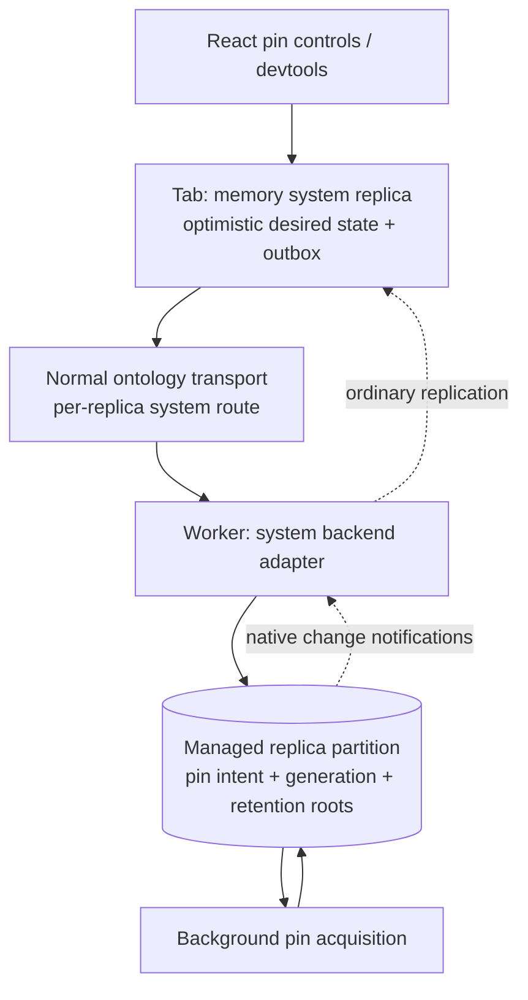

# Notes: API questions, fragments and performance

November 6, 2026. This describes the current working tree. The migration contains
earlier Connect/server work too, so a diff against HEAD is not a reliable timeline
of which change was caused by Notes.

## Current performance investigation: November 8

The earlier 1.77–3.57 second isolated Trash measurements below were taken after
enabling the full offline download. They do not measure the user's on-demand
startup path. The navigation probe now leaves downloads disabled unless explicitly
requested and records that precondition with its results.

The user's opt-in local trace captured a 5.61 second Trash load. Its largest block
was an ordinary upstream snapshot installation into the SharedWorker's IndexedDB
replica: 2.69 seconds, including a 2.59 second write transaction with 30,711 native
storage operations. The corresponding upstream read took 99 ms. This block comes
before selected replica delivery to the tab; it is not TanStack query execution or
the custom delivery protocol alone. The next folder loaded in 89 ms.

A fresh isolated browser without pre-downloading reproduces the slow path:
18.96 seconds with request counters/CPU profiling and 22.49 seconds without them.
The cold snapshot inserts about 1,400 rows and spends 15–16 seconds in IndexedDB
installation. A native capture counted 16,548 base index-entry writes, 4,159 base
row reads, and additional retention/index work. The portable bulk writer was
serializing any table with a unique index. A validated parallel path preserves
uniqueness, caught-error prefixes, and rollback, but did **not** materially improve
this cold-load capture. Follow-up phase spans prove that it is active with 125–128
rows in flight: prior reads/comparison/proof take under 250 ms, while base/index
writes take about 13 seconds and retention writes about 3 seconds. Native write
callbacks, not missing bulk activation, account for this delay.

An isolated synthetic fixture reproduces slow writes without React, TanStack,
replica delivery or a SharedWorker. Controls are investigating native index and
key representation, with no production atomicity change. Browser versions also
need matching: bundled test Chromium is 149; installed Chrome is 156. The probe now
records its browser/version and can select an isolated installed-Chrome instance.
See [the full flow audit](./data-flow-audit.md) for the topology, action paths,
loops, persistence, IVM placement, and current measured/unresolved costs.

The separate matched cached-read fixture below remains useful for measuring data
delivery after rows are present. Its approximately 50 ms storage read does not
include this cold installation cost. Keep cold/warm residency, offline settings,
and write/install phases explicit when comparing the two paths.

## Authentication failures

`withHttpAuthenticationErrors` is a pure decorator of native Effect egress, used by the Foundry,
Salesforce and Better Auth service connectors. Its Effect-returning fetch cancels an HTTP 401 response
body and fails with the shared `Unauthenticated` backend error. It does not refresh
tokens, retry the request or update a React query itself.

The service integration can handle refresh first. Salesforce, for example, tries
one OAuth refresh/replay before the wrapper classifies a remaining 401. Foundry
obtains current credentials through its token provider; Better Auth supplies its
external session selector. The wrapper's HTTP status handling does not classify
arbitrary asynchronous WebSocket failures.

Connect's acquired access catches that error and transactionally changes the saved
connection to `needs-auth`. It compares the credential version first, so a late
401 cannot overwrite a newer login or resurrect a disconnected connection. The
ordinary backend journal/watch path updates both account queries and the acquired
authentication monitor. There is no direct notification to a particular UI query.

Before this fix, only the acquired monitor changed; the saved row could remain
`active`. Authentication state should be persisted at its owner and observed from
that state, rather than maintained as a second account inventory in a monitor.

## Object policy and implementation reads

The top-level rename is complete: `policy.objects` describes caller-visible
objects and properties. There is no remaining top-level `policy.read` contract.

An individual action or query-function rule can have `additionalObjects`. That is an
additional grant for that operation's native implementation, combined with the
ordinary object grants. It is not another public collection and it does not
change the caller's ordinary query permissions.

For example, a public quote function could read a private pricing rule:

```ts
queryFunctions: [
    {
        queryFunctionType: "quote",
        check: q.eq(q.context("role"), q.literal("buyer")),
        additionalObjects: {
            select: [
                q.sub("pricing", {
                    from: { source: { objectType: "PricingRule" }, binding: "rule" },
                    where: q.eq(q.field("rule", "id"), q.input("product")),
                    select: [
                        q.selectField("id", q.field("rule", "id")),
                        q.selectField("discountPercent", q.field("rule", "discountPercent")),
                    ],
                }),
            ],
        },
    },
];
```

Here `quote` is an existing function definition with a `product` parameter, and
`role` belongs to the trusted context. `check` decides whether the call is allowed.
An owned handler's transaction can then read the selected rule and return a public
total. Without that additional grant, its reads are restricted to `policy.objects`.
Omitting the function's policy rule denies the function on a policy-bound endpoint.

This is an explicit privileged computation: a handler that returns the private
discount would disclose it. Its output is not automatically redacted. For a proxy,
our server gates the invocation; it cannot impose a local transaction reader on a
remote provider's function implementation.

## Action return values

The owned backend validates/encodes a mutator's result against the action's
`returnType` inside its transaction, saves it in the durable receipt and returns
the same result on an idempotent retry. The SDK decodes that result with its
advertised action return schema.

Policy projection currently forwards the receipt's result unchanged. It projects
object reads, visible action parameters and client computations; it does not
recursively intersect arbitrary returned structs with object-property grants.
An object reference is a key, not permission to load that object afterward.

A bug found during this review omitted named types referenced only by an action's
return type from the public definition. The named-result RPC regression failed
with `InvalidConfiguration` before the fix. Projection now retains those type
dependencies, including transitive dependencies through the shared collector.

The remaining design choice is whether a declared return type is deliberately the
public output contract, like a function response, or whether endpoints need a
separate result projection. The current recommendation is explicit public result
types and deliberately constructed values. Automatic row redaction cannot infer
the provenance of a plain `{ total, message }` struct. No new output-policy API or
automatic redaction was added in this review.

An optional operation-result projection is a useful next design. A possible rule
shape is `result: { type, expression }`, evaluated over a dedicated result binding
plus the authenticated context and invocation parameters. A simple field selection
could infer its public type; a shape-changing expression must still produce a known
public return schema for Describe, generated types and SDK decoding. This is a
proposal, not an implemented policy field.

Projection must cover query-function results and every public action-result path:
the initial receipt, idempotent retries, result lookup and allowed delivery paths.
Keep the canonical receipt at its owner and project per authenticated view rather
than caching one caller's projected result globally. Projection does not itself
grant additional implementation reads. Tests must cover nested values, named types,
changed policy/context, missing fields and consistent errors across those paths.

## Attachment arguments

`attachments.create(input, { target })` stages bytes and can validate them against
the target's attachment constraints. `target` is optional; action calls infer it
from their parameter definitions.

Action calls now accept `File`/`Blob` inputs at IR-declared attachment positions:

```ts
await ontology.actions.addAttachment({ note: noteId, file });
```

Generated `*Input` types widen those positions; `*Parameters`, stored intent and
return types remain canonical handles. Native Replica resolves nested named types,
optionals, lists, maps and union/result variants, validates the actual attachment
constraints, and stages bytes before enqueue. It never looks inside encrypted
values or guesses that an arbitrary object is an attachment.

Content and metadata contribute to stable per-invocation/path IDs. Repeating the
same file under an idempotency key reuses its handle; changing the file produces a
conflicting invocation. Existing scoped byte reads protect staging until durable
outbox roots take over. Failed enqueue leaves ordinary collectible staging, not
new durable manifests. Pending-action edits hand bytes to their parent before
editing intent, reusing the existing transfer operation. Repeated explicit-ID
handoffs verify existing bytes rather than overwrite referenced content. A failed
upload leaves the parent's accepted intent unchanged.

Explicit `attachments.create` still matters for reuse and editor embeds: Notes
needs an attachment ID to insert into Markdown before the subsequent document save.

## Notes' vault workaround

The app currently calls its `sealSecret` query function before enqueueing a vault
edit. This keeps plaintext out of that pending action, but sealing needs access to
the server and is not a general outbox-encryption design. Revealed plaintext is
held in the editor's component state. No first-class encryption policy for action
parameters or the entire outbox was added. Offline vault editing and where keys
should live still need the separate design discussion requested earlier.

## Fragments today

`@party-stack/db-fragments` defines `defineFragment`, `FragmentRef` and
`FragmentData`. Its React export adds `useFragment`; `ontology-react` re-exports
them. It uses TanStack DB 1.0 RC's native `include` and generated collection
descriptors. It adds no fragment store, entity cache, fetcher or sync engine.

```tsx
const preview = defineFragment(objects.Note, (note) => ({
    title: note.title,
    updatedAt: note.updatedAt,
}));

const { data } = useLiveSuspenseQuery((q) =>
    q.from({ note: objects.Note }).select(({ note }) => ({
        id: note.id,
        preview: preview.include(note),
    }))
);

// In a child receiving FragmentRef<typeof preview>:
const { data: value } = useFragment(notePreview);
```

- The parent owns membership, ordering and the included collections' lifetime.
  `.include` accepts a same-row binding or an explicit correlated query.
  Ontology descriptors carry the declared primary-key field for indexed correlation.
  Generic collections use their existing `$key` identity; an optional selector can
  choose a different correlation field. Fragment aliases are internal.
- `useFragment` subscribes directly to the included collection with Suspense.
  Its `data` is a selected value or `undefined`; multiple matches are an error.
  Native includes still lose their single-result marker in the current RC, so the
  hook checks cardinality without constructing another query or keeping row state.
  Plural collections use native list readers.
- The unused public `fragment.select(row)` was removed. It was an inline
  projection, not TanStack's `materialize` operation. The public composition method
  is `.include`; no `materialize` method was added speculatively. The unused public
  key-lookup shortcut was removed; custom correlations use explicit native queries.
- Selected-field changes update the child. Unselected-field changes do not change
  its data. Relationship changes, deletion/reinsertion and separate DbClients are
  covered by tests.
- A fragment reference is an in-process collection, not a serializable Relay ID.
  Type selection is not authorization. Selecting fewer fields here also does not
  promise fewer columns or bytes fetched from a provider.

There is real overhead per included row and per mounted subscriber. A page with
many nested includes can create a large incremental query graph even when source
rows are shared. Source demand may coalesce; separate derived queries still have
their own execution and readiness work.

`defineListFragment` and `useListFragment` now compose parent-bound lists with
typed arguments. A list definition receives a native query with the `row` alias;
it adds filters, ordering, limits and per-row child fragments. `list.include(scope,
args)` includes it, while `list.query(scope, args)` builds an ordinary root query.
The reader subscribes directly to the included collection.

Singular fragments accept arguments directly on the selection callback's second
parameter. Defaults such as `(row, { includeBody = false })` infer optional
argument types without an outer `= {}`. `query = undefined as string | undefined`
declares an optional argument with no default. A parameter annotation such as
`(row, args: Args)` supports required arguments and constrained types. No curried
constructor, `FragmentContext` wrapper or argument schema is needed.
`.include(rowOrQuery, args)` requires all required argument properties.
Each include captures its own bindings. Tests cover two differently bound refs
to the same row, nested forwarding, selected-field isolation, optional defaults,
compile-time invalid calls and a React update that rebinds without changing the
object or remounting its list. No fragment cache was added.

Notes now uses the complete model: a folder route query includes its folder
fragment; that fragment includes the note list through
`objects.Notebook.links.notes(folder)`; the list selects preview/menu fragments.
`useListFragment` owns native infinite pagination, starting at 50 notes. Its parent
no longer manages page state or rebuilds its query for Load more. Trash and search
use the same list hook over root query builders. Fragment declarations stay next
to their consuming components; there is no central document query or row cache.

The implementation retains bound query recipes through one internal compatibility
adapter in db-fragments. Both singular and list include wrappers bring its runtime.
The adapter observes native materialization and per-facade scope, captures concrete
correlation values and additional parent projections, and associates the child
Collection with its original query recipe in weak maps. Published DB builds mangle
private method names, so the per-instance proxy observes native entry arguments and
results rather than naming private methods or parsing collection IDs. Metadata is
scoped by compiled edge, not field name, so nested repeated aliases do not collide.
Dependency files and the shared global include runtime are unmodified. Ordinary
singular-only query graphs pass through to the original native adapter.

The list hook suspends for its initial include, then opens a root query over the
original sources with concrete parent bindings and the same selection/order. It
uses DB's native infinite controller for subsequent pages. The live included page
remains visible until that root is ready. A weak readiness witness prevents later
page failures from reverting an installed larger window to the shorter included
page. Query identity and normal native subscription cleanup own the root; no app
hydration cache, direct Collection.get render path or paging timer was introduced.
The standalone useLiveInfiniteSuspenseQuery export is removed.

Tests cover nested row fragments, repeated child field names, unselected parent
filters and sort fields, empty lists, relationship moves, parent rebinding, separate
DbClient descriptor resolutions and old-reference isolation. Browser tests cover
initial Suspense, unchanged parent/query identities during paging, argument resets,
reader cleanup and a deliberately held root-acquisition promise while the included
first page remains visible. The real Notes regression creates a 55-note folder,
pages it, navigates folders, moves a note, checks keyboard focus, creates and edits
offline, and checks delivery between two tabs in one browser context.

The compatibility boundary is pinned to the current TanStack RC and must be tested
when upgrading DB. An outer native include selected before fragment includes can
bypass the decorator; a list reader with missing metadata fails explicitly. Trees
built from the fragment helpers select the decorated runtime regardless of sibling
field order. Native child windows could replace this adapter without changing the
public fragment call shapes. No dedicated open upstream feature issue was found;
related [#2326](https://github.com/TanStack/db/issues/2326) and
[#2151](https://github.com/TanStack/db/issues/2151) concern include/window readiness
and extra acquisition work, not independent child pagination.

Performance costs remain explicit: one independently owned query per mounted
included-list reader, plus the parent's retained initial include. Source data and
replica coverage are shared. Grouped includes do not currently push per-parent
limits into source acquisition, so initial acquisition can still overfetch. This
is not general provider-cursor pagination or a claim of full subset-overlap reuse.
Preview components are memoized around stable fragment refs and selection callbacks;
changing selection does not rerender every unchanged preview. Date formatters no
longer change merely because a tab becomes visible on the same calendar day.

The real ordered-list test exposed a shared Query IR type-alignment gap: boolean
sorting was allowed but ordered comparisons were rejected in validation and scalar
execution. Both now use false-before-true ordering. Query/action typing, the shared
operator evaluator, backend action execution and adapter boundary tests cover it.
The temporary adapter equality rewrite was removed; Notes has no sort workaround.
A focused editor also used to ignore remote changes even when clean. It now accepts
remote documents while preserving selection, deferring replacement only while a
local edit is dirty or its save is pending.

Relation composition is
`noteList.include(objects.Notebook.links.notes(folder), { search, sort: "updated" })`.
The parent-bound scope should come from generated metadata for the ontology's
existing link, not from a child `notebookId` argument or a second hand-written
foreign-key predicate. For Notes this lowers to the declared
`Note.notebookId = Notebook.id` correlation. Codegen writes typed link metadata
beside primary keys, and both normal and cached descriptors expose `.links`.

Ontology link traversal stays above generic `db-fragments`: translate the
existing declared links into ordinary TanStack query sources in `ontology/tanstack`,
re-exported through `ontology-react` or generated collection descriptors. The
fragment package should not know ontology IDs, link IR or provider adapters.
Native TanStack row proxies do not carry the source ontology type, so a helper
must receive that descriptor explicitly or be bound by generated link helpers.
The generated `.links` namespace keeps traversal on the collection descriptor
without colliding with its other properties or requiring another import.
An isolated native probe rejected putting a correlated query under another
`from` before including it: the include builder requires the correlation in its
own WHERE. Extending the already-correlated query directly passed, including a
note moving between folders. The helper should therefore return a native
correlated query for the list definition to extend, not a nested source that
hides its predicate. The parent passes a whole related set to the list fragment; it does not pass
an array of singular refs or a child `notebookId` argument. A reusable list
definition can own filtering, ordering and its per-row child fragment selection.

Earlier fragment correlation always used TanStack's virtual `$key`, which the
current RC does not automatically index. Our adapter also widened that unknown
predicate. Generated descriptors now supply the real primary-key field, so normal
ontology fragments use an indexed field and a recognized subset predicate. Generic
collections retain `$key` as their identity fallback, with its current RC scan cost.

The global `NoteDocuments` query and central `fragments.ts` were removed. They
preloaded editor fragments for every note to avoid navigation readiness delays;
that was an app workaround, not the requested component ownership model. Each Notes
component now declares and reads its own fragment. The list query composes preview
fragments, previews compose menus, and the selected-note route composes the editor's
fragment and its content/menu fragments. A selection change may still initialize a
new derived query; measure and discuss that cost instead of globally preloading
all editor fragments or bypassing live reads with `.get`.

The post-refactor isolated navigation probe reported about 2.35 seconds from
navigation to the initial workspace, then 474 ms from the first actual note click
to editor presence and 333–342 ms for three later switches. All four switches
showed an editor fallback; no stale note or missing-index warning appeared. The
larger 0.36–1.74 second automation timings also include actionability waits, so do
not confuse those with the captured click timestamps. This is development evidence,
not a controlled benchmark or a diagnosis of the remaining readiness delay.

The header also stays outside the suspended list tree. Its live count renders
through a portal, avoiding copied query state. Previously, completing a folder
load could replace the mobile header and close a newly opened New menu.

The larger real-app regression now creates a 55-note folder and checks child-owned
pagination, keyboard focus, relationship moves, argument/window resets, optimistic
offline creation and focused cross-tab delivery. It passed without paging fallback
remounts. One run measured 674 ms to an offline new-note editor and 1.19 seconds to
show a cross-tab edit, including the editor's 450 ms save debounce. Folder switches
in that run ranged from about 100 ms to 2.4 seconds including automation waits; this
remaining variability is not a solved performance problem.

A separate startup profile against a warm Vite server measured a fresh isolated
browser at 2.53 seconds to visible workspace and reloads at 1.34 and 1.31 seconds.
The fresh page requested roughly 23 MB of development modules; Lucide alone was
about 6 MB. These are development, not production, timings. Captured delivery
installs took 4–17 ms. The apparent failed state-subscription exits in that sample
were interrupts during selection replacement, not typed transport failures;
subscription/demand spans measure scoped lifetimes and cannot by themselves prove
a one-second retry or readiness stall. No replica retry change was made from that
observation. A production-only timing has not been verified.

## Core changes exercised while building Notes

### Pin status and download granularity

Public pin status is the desired `query`, optional `inputs`, attachment policy
(`none`/`all`), `ready`, optional `{ kind, message }` error, and the previous
completed `retainedGraph` during a definition replacement.
`previousGraphRetained` is a convenience flag for that predecessor. The internal
desired/installed generations are not public. There are no per-folder proofs,
byte/object progress counters or separate refresh-phase field.

The pin re-evaluates its query graph on visible-data, connectivity and authentication
changes. A refresh acquires candidate subset leases; the replica coalesces identical
demands and reuses coverage. After a successful atomic install it releases the old
scope. Membership and byte roots are diffed, so unchanged retained records are not
rewritten, but the graph evaluation and lease discovery are not IVM. Unrelated
visible changes can still trigger a full walk because the notification is coarse.

Notes currently exposes one “Download notes offline” switch in Settings, covering
all folders, notes, preferences and attachments. Its live status subscription stays
mounted with the workspace, so opening Settings doesn't restart status acquisition.
Existing folder selections expand to the whole-workspace graph. Folder-specific
controls are deferred until the pin API supports them more naturally.

Pin commands now serialize validation and desired-state commits separately from
acquisition. Live set/clear calls acknowledge durable intent and request cancellation
without awaiting the obsolete candidate's finalizers. One background owner processes
the latest desired graph; its generation fence prevents obsolete installs. Clearing
removes durable roots transactionally; scoped acquisition leases finish releasing
in the background. Tests hold a candidate finalizer while accepting set/clear/set.

The former five-second completeness deadline incorrectly persisted normal pending
coverage as an Unavailable error. Live candidates now await readiness notifications
without that deadline and remain cancellable. Retrying clears the previous attempt's
error; genuine provider/storage failures still use the failure/retry path. A test
advances virtual time by one minute before supplying coverage and verifies no false
error. One-shot finite refresh behavior remains explicit.

Notes formerly wrapped the pin status in its own `useOptimistic` boolean. When a
command resolved before its status notification, React discarded that temporary
value and briefly exposed the older downloading status. The switch now reads only
the pin stream; a browser test holds notifications after command completion and
checks that cancelled subscriptions cannot restore older state. This intentionally
does not provide tab-local optimistic pin writes: delegated controls still wait for
the device's durable commit/status delivery. Unlike ordinary actions, pins do not
currently travel through the tab's outbox and predicted overlay. Reusing that model
for desired pin metadata is a separate API design task, not another app cache.

Development worker tracing retains a bounded, sanitized history, with explicit
pin-status read timing. This makes reload-time failures inspectable after the fact;
it does not retain another copy of application objects.

Folder IDs remain reasonable query inputs. The awkwardness is one atomic desired
graph for every selected folder: one incomplete addition can hold back the entire
replacement, and Notes interprets completed inputs to infer per-folder availability.
`ready` describes a successful install of that desired definition, not a detailed
progress view of every later live-data refresh. Retained graph metadata is not a
frozen row snapshot. Independent named pins would let folders complete/retry
separately while sharing engine demand; alternatively the one-graph model needs
per-branch completion/freshness reporting. Neither redesign is included here.

The proposed taxonomy is a pin definition plus instances: a stable definition ID
owns a query and retention defaults; each instance supplies inputs and owns its
readiness/retry state. The same definition can have many input-bound instances,
and unrelated definitions can coexist. A proposed `definePin`/`pins.set(definition,
inputs)` API would identify instances by definition ID and canonical inputs, with
an explicit instance key if only part of the inputs should determine identity.
This is application metadata, not a new JS class or ontology acquisition manager.

The folder navigation probe first found 210–295ms cold and 30–95ms warm switches
that kept the old list visible. A keyed Suspense fallback removed that stale UI
but imposed React's 300ms fallback throttle. The final app defers query preparation,
shows the new heading immediately and keeps the previous list hidden/inert.
The latest isolated run recorded 11–46ms headings, 31–107ms later warm lists and
230–275ms first visits, with no old-folder rows visible after sidebar selection
committed. These are development timings, not a provider or production benchmark.

These are concrete changes in the current work, separate from app CSS/routes:

| Area                     | Changed behavior                                                                                                                                                                                                                             |
| ------------------------ | -------------------------------------------------------------------------------------------------------------------------------------------------------------------------------------------------------------------------------------------- |
| TanStack adapter         | Migrated to RC sync failure/health and full-row update contracts; reused known positive primary-key hits from successfully acquired demand; kept release work inside owned scopes. A missing key still needs coverage proof.                 |
| Replica coverage         | Readiness notifications no longer depend on unrelated selection work completing. Maintained whole-collection coverage can serve narrower local filters without another upstream selection. This is not general overlap/join/Top-K inference. |
| Snapshot installation    | Preserve unchanged base rows, indexes and attachment roots instead of clearing/rebuilding a complete collection; fence overlapping fetch invalidation.                                                                                       |
| Delivery replay          | Keep local selection fencing outside immutable provider batch bytes. Inspection roots do not replace committed upstream selection. Oracle tests cover reconnects, acknowledgments, stale frames and cross-client changes.                    |
| Outbox forwarding        | A parent-accepted action awaiting row delivery no longer blocks handing off the next queued action. Retry deadlines remain distinct from normal first attempts.                                                                              |
| Delivery storage         | Read previous fingerprints in batches; avoid per-record witness lookups and duplicate durable payload copies. Capture known base keys concurrently within bounded pages.                                                                     |
| Pending/result selection | Inspect pending actions without unrelated retained history. Follow previously observed pending actions to their outcome and keep requested outcomes in the existing local result store after releasing upstream interest.                    |
| Delivery expiry          | Delete disjoint expired witness/patch keys in bounded concurrent batches rather than serial IndexedDB round trips. Session expiry and atomic cleanup semantics are preserved.                                                                |
| Action-interest changes  | Preserve installed delivery witnesses when the row selection is unchanged. Reacquiring a producer after action-result interest changes now produces a patch; a changed row region or an uninstalled target still requires a snapshot.        |
| Pin graph refresh        | Diff membership and attachment roots instead of rewriting unchanged retention records. The graph still installs atomically and retains its previous complete generation on acquisition failure.                                              |
| Pin availability         | Expose the last completed query and inputs as `PinStatus.retainedGraph` during replacement. Folder download controls can distinguish an existing offline selection from folders still being acquired, without another app cache.             |
| Coverage checks          | Reuse complete collection proofs before reading individual primary keys. Batch independent remaining checks inside one snapshot, retaining invalidation-generation fencing.                                                                  |
| Lifecycle/network        | Release demand leases when either the consumer or replica closes; record a briefly observed offline state before reconnect so its wakeup is not lost.                                                                                        |
| Pins/devtools            | Reactive pin status uses existing notifications; React wraps native pin/attachment capabilities. Forwarding, parent acceptance and execution reconciliation now have distinct labels.                                                        |

The current React conveniences are `useAttachmentUrl`, `useAttachmentMetadata`
and `useOfflinePin`. URL reads own cancellation and object-URL revocation;
metadata accepts selected fields; pin status observes the owning replica's saved
graph. These wrap native capabilities rather than introducing another attachment
or offline-data manager.

Earlier work in the same uncommitted migration includes multi-ontology server
routing, Connect acquisition, provider constructors, CLI cleanup, generated
descriptors and React resource ownership. Those should not all be attributed to
the Notes performance investigation.

## What the performance investigation established

The actual path is a memory tab replica, an IndexedDB-backed SharedWorker replica
and an HTTP-owned Notes backend on the local Node server. A locally rendered edit
and authoritative outbox confirmation measure different parts of that path.

The observed costs include repeated delivery capture, selection replacement,
IndexedDB transactions and receipt read-back/rebase. The approximately 200 captured
records included objects; the earlier claim that they were mostly old action
results was not established. A sampled dataset had 195 notes, 180 in trash.

Outbox inspection previously selected all retained completed outcomes, seven days
by default, even through the app's ordinary status observer with devtools closed.
Only changed records were transmitted, but the broader selection was re-compared
and appeared in replacement snapshots. The first attempt to narrow this failed
the existing cross-client result-observation test and was not retained.

The subsequent fix keeps pending-queue inspection separate from result interest.
A child requests results for actions it already observed pending, then preserves a
received result in its existing completed-action store. It can release upstream
result interest without making that receipt disappear locally. Explicit result
IDs still support recovery; the parent's durable history is retained. Snapshot and
incremental delivery share this selection behavior. Tests cover unrelated history
being excluded and an observer retaining a completed result after releasing interest.

In one isolated comparison, create confirmation went from about 1.9 seconds to
0.56 seconds after batching. Two-tab tests still showed roughly one to two seconds
for confirmation and several hundred milliseconds for edits to appear in the
other tab. Twenty concurrently queued edits finished in about 9.6 seconds overall,
with no retry deadline set. That is backlog/throughput evidence, not a fixed delay
per action. These are development measurements with tracing and an extra SDK view,
not a controlled production benchmark or proof the user's five-second stall is fixed.

Retained traces from the user's long-lived Chrome tab subsequently showed parent
acceptance in approximately 20–50 ms, but local authoritative waits of 6–9 seconds.
Its worker also had delivery-expiry cleanup spans exceeding two seconds. This is
evidence from the affected session, distinct from the fresh-profile measurements.
Offline downloads were enabled in that session. Reproducing that configuration
with two isolated tabs exposed another cost: action-result interest changed the
subscription identity, replacing its delivery stream and writing a new snapshot
of all selected rows. About 200 records here were mostly selected objects, not 200
mutations caused by one action. Pinning all notes includes trash too.

This is separate from IVM. A full comparison can still emit only a small patch by
using the existing durable fingerprints. The fix retains those fingerprints when
only action interest/generation changes and the consumer reports having installed
the previous target. A lost acknowledgment is safe in that case; an uninstalled
pending target is not reused. It is never relabeled with new metadata. Stable row
selection is an internal delivery-construction distinction, not a new SDK option.

New snapshot witnesses and patches also write in bounded concurrent pages. Tests
cover unchanged witnesses, duplicates within/across pages, the concurrency bound,
lost acknowledgments and fallback to a snapshot after an uninstalled target.
The parent still retains durable action receipts, and observer result interests
still follow actions through completion.

The subsequent pinned two-tab run kept row streams alive across action-interest
changes, with 0–5 changes per delivery instead of replacement snapshots containing
over 200 records. Parent acceptance took approximately 110–280 ms. Create confirmed
in 1.7 seconds; three concurrent updates confirmed in 1.2, 1.9 and 2.4 seconds
from their start. The earlier pinned run measured 4.7 seconds for create and
3.2, 5.3 and 7 seconds for that update burst. The latest run displayed the created
note in the other tab after about 0.4 seconds and the latest burst edit about
0.5 seconds after the burst began. These are development measurements with two
app pages, an extra SDK view, tracing, and a changing local dataset; they are not
a controlled benchmark or confirmation that the existing Chrome session now has
the same latency. No retry deadlines were set in these runs.

Whole-snapshot refresh now batches independent baseline reads and retention-age
writes too. Changed object/attachment-root mutations remain ordered; access-age
semantics are preserved. A newly received receipt no longer runs attachment
bindings a second time after saving them atomically with the receipt. Recovery
still binds mappings before confirmation when necessary.

Remaining cost includes full selected-row comparison, subscription/control
transactions, receipt read-back and the queue/publication gate. IVM could reduce
that recomputation, but is not required to keep unchanged rows out of delivery
patches. Useful trace boundaries now include pin refresh/acquisition/install,
coverage checks, receipt persistence, attachment binding and status reads. The
temporary app recorder and development HTTP endpoint were removed.

The component-fragment regression exposed another boundary cost: a policy-bound
server discarded every affected object key in action receipts, including keys
readable under an allow-all object policy. An edit then confirmed by rereading the
whole type. Receipt projection now reads the affected keys through the caller's
base `policy.objects` view in bounded batches. It retains a type's keys only when
all are readable; hidden, deleted or unproven keys keep the conservative type-wide
fallback. Invocation-only `additionalObjects` grants do not authorize disclosure.
Proof failure cannot turn an already committed write into a failed submission.
This is an extra backend read (local SQLite in Notes); static proof from simple
policy predicates is deferred. Authorizing an action alone does not prove its
affected objects are readable. Action return-value projection remains separate.

Delivery now batches baseline reads through the primary-key index and skips
baseline reads for objects already emitted by an overlapping selection in the same
transaction. This uses the existing transaction-local emitted-key set, not a row
cache. Pinned rows also request only bounded key batches; an obsolete per-key
selection loop had duplicated those requests. Tests preserve base/overlay
distinctions and assert bounded pin selections.

IndexedDB transaction spans now record activation and body-completion events to
separate native transaction queueing, request processing and commit waits. They
identified the remaining nine-second receipt-save delay: many subset watchers
reported the same source change, and each rewrote every coverage proof of that
object type. Invalidation now skips already-invalid persisted proofs. Every hint
still advances the generation fence, so a fetch started before it cannot publish
complete coverage. A regression exercises 12 watchers over two refresh cycles:
each hint writes 12 proofs instead of 144. Repeated scans/control transactions
remain a possible future optimization; no coalescing timer or row cache was added.

The table planner also reads independent IN index ranges concurrently, bounded at 128. Native and fake IndexedDB tests count outstanding requests and compare the
result to the independent residual evaluator. Candidate arrival order never
determines result ordering. The web runtime no longer delays observed reconnects
by an arbitrary one-second stabilization period. Native events and explicit
connectivity reads update the monitor immediately; worker sampling remains only
as a fallback when the browser omits events. Request retries retain their deadlines.

The final 55-note fragment probe passed its unchanged 2.5-second cross-tab budget
at 2.415 seconds, down from approximately 22 seconds, including the editor debounce
and reconnect backlog. Offline creation was editable after 472 ms. The focused
`e2e/delivery.mjs` probe measured steady alternating edits at 551–584 ms, including
the debounce, without creating another large fixture. These are isolated development
browser measurements, not a production benchmark. Cold development workspace
startup was still 5.6 seconds; first folder acquisitions measured 1.5–1.9 seconds,
with repeated visits about 0.34 seconds. Those costs remain separate from the fixed
quadratic coverage writes and warrant further profiling rather than an app cache.

Useful practice is to measure app presentation, local enqueue, parent acceptance,
provider commit and local reconciliation separately. Keep query/resource owners
stable, share live demand where justified, retain notification-driven scheduling
and test changes against the snapshot oracle. Do not add a shadow row cache or
declare an arbitrary filtered cache complete to hide a loading state.

Reusable guidance lives in
[the app-performance skill](../../.agents/skills/party-stack-performance/SKILL.md).

## Validation for this review

The API follow-up passed Connect (39), replica (228), spec (127), backend (120),
SDK (130), server (114), Foundry (200), Salesforce (54), Better Auth (34), fragments
(3), and React (11) tests. The React tests use isolated real-browser profiles.
All four app builds passed (68/68 scheduled tasks). An isolated Notes smoke test
passed a File through the tab, SharedWorker and HTTP owner, read back its bytes
and filename, and repeated the invocation with the same idempotency key. It
removed its test attachment and archived only its disposable test note.

The earlier outbox pass passed 554 tests across storage, backend, replica, server
and devtools, including generated snapshot-oracle schedules. IndexedDB's six unit
contract/planner/lifecycle tests and the repository performance skill validator
also passed. The offline-pinned two-tab probe ran against the rebuilt preview,
creating and archiving only its disposable timing note.

The receipt/coverage follow-up passed storage (48), replica (233), server (121),
React (17), fragments (9), web runtime (19), Notes (12), and IndexedDB (6 unit and
3 native browser) tests. The final consumer graph passed 50/50 tasks and Notes
build passed 46/46. Real-browser probes passed the full fragment/pagination flow,
alternating cross-tab edits, optimistic offline deletion and global offline-pin
toggles/inspection/attachment reads. Offline deletion removed its row and returned
to the folder in 62 ms. These checks exercise actual live queries and replication,
without direct collection lookups or an application row cache.

## November 7: delayed deletion in included lists

The multi-note regression reproduced a 7–8 second delete delay after whole-library
loading, even after the offline switch had been turned off. The native worker
predicted `trashed: true` promptly. The tab's source Collection also had that value
and published the correct `false → true` update. The derived list nevertheless
retained the row because DB held publication during an ordered repair request.
A newly scoped acquisition waited for upstream completeness while the source
already held a fulfilled, live region containing that request.

The adapter now compares the regions it actually acquires, after translating
unsupported filters/order into broader native demand. It reuses readiness from
an existing fulfilled live demand when that region covers the request. It still
owns the new observer/lease and reports subsequent acquisition failures normally.
No result rows or optimistic list entries are copied into application state.
The regression holds all subsequent upstream acquisitions indefinitely and
verifies that an existing filtered live list still removes a changed row.

The native delivery engine also recognizes complete, installed, live filtered
regions as proofs for narrower requests, using the existing conservative
`coversSubset` rules. A regression holds replacement delivery open while a new
narrower demand becomes ready. This alone did not fix the app: the adapter also
needed to reuse its own fulfilled demand. Whole collections, conjunctions and
supported equalities/IN predicates can prove coverage; this is not arbitrary
predicate, join or Top-K overlap inference. Missing or invalidated proofs and
retired regions cannot certify readiness.

An isolated Notes browser run with downloads enabled and then disabled removed
rows in 119–326 ms online and 75–262 ms offline, through both keyboard and context
menus. A second run with downloads still enabled measured 133–254 ms online and
67–113 ms offline. It creates its own folder and empty/typed notes, then archives only those
fixtures. No TanStack DB dependency patch was needed. Parent refresh/outbox
latency is a separate remaining measurement; avoiding its unnecessary readiness
wait fixes the optimistic deletion path without claiming that refresh is faster.

For future investigations, compare the same object at four points: native
prediction, source Collection value, source change event (including previous
value), and derived query output. Correct source rows alone do not establish
that the event was delivered; correct events alone do not establish that the
query published. Record active acquisition readiness and requested versus
translated regions. A profile that once loaded everything can expose different
subscription paths from a fresh, narrowly loaded profile.

## November 7: authorization audit

The public Authorization guide now maps request authentication, definition
projection, object reads/cache hits, actions, query functions, attachment access,
receipts, errors, streams and internal controls. Operation-only object grants do
not authorize identifier disclosure or arbitrary returned values. A stream keeps
the context authenticated at opening; immediate session/context revocation must
close or replace that binding. Object rules run again on later reads.

Two boundaries needed code changes. A directly acquired projected backend now
sanitizes late watch/download-stream failures as well as failures that open those
streams. A projected watch also includes read-policy dependencies: changing a
Project administrator can revoke Form access without changing a Form row. A
global change watch is preferred; otherwise whole dependency types are watched.
Relationship expressions include the referenced link endpoints, and lookup
expressions conservatively include all local types. An incomplete watch falls
back to provider polling recommendations rather than inventing a refresh timer.

## System state through a memory replica (proposal)

A small system view can adapt the managed replica's existing native control
state. It should not introduce another durable database containing mirrored pin
rows, nor turn Connect into the owner of replica storage controls.



Only desired intent is optimistic. Availability, actual acquired rows/bytes and
errors come from native state. Results carry the desired generation so a late
ready/error event cannot override a newer off/on command.

This needs a transaction-aware native command primitive: command deduplication,
receipt and intent/generation change must commit together in the managed
partition. Wrapping the existing Promise `pins.set` in an arbitrary action
executor would not supply that guarantee. Retention installation keeps its
current generation checks; background acquisition starts after commit and does
not block accepting the next command. The separate memory control replica also
avoids putting an outbox-management command into the queue it must unblock.
Start with pins rather than moving transport acknowledgments, leases, cursors
or the entire managed outbox into a recursive system ontology.

Connect remains a separate reusable service-connection ontology. For the local
React facade, `AuthenticationProvider` / `useAuthentication` could be clearer
names for browser authentication commands and their saved-connection view. Keep
the distinction from an application's own Better Auth identity, and keep status
queries on the saved rows instead of adding another monitor inventory. The
current Connect provider acquires its command client and reactive view separately;
sharing their native acquisition is a useful cleanup before renaming it. No such
rename or system ontology is implemented by this proposal.

## November 7: local interaction performance

The idle generic memory-kernel benchmark (`ontology-replica/scripts/local-latency.mjs`)
measured enqueue/prediction medians of 0.26–0.44 ms, including a 1,000-row fixture.
This measures an idle kernel, not the full SDK, background sync, React or a paint.
It does not establish sub-millisecond editor focus in a real app.

The Notes CPU profile exposed portable scalar encoding in every in-process
comparison and repeated hydration of key-ordered scans. Shared storage now compares
same-type strings/finite numbers/booleans/bigints directly with the same ordering
as persisted index keys. Unfiltered key-ordered scans select encoded rows before
hydrating only their page. Property tests compare against the physical encoding;
invalid numeric inputs still fail. No row cache or persisted format change was added.

The SDK command runner and native stream adapter now start scoped local work
immediately. Closed scopes still reject before work starts, publishers remain
serialized, and positive primary-key snapshots can answer synchronously while
their scoped remote lease reports later failures. An empty local snapshot still
waits for actual coverage. Local storage collections retain their asynchronous
change-subscription startup semantics.

A separate tiny React/DbClient fixture reproduced a roughly 310 ms pause without
Notes, routing, TipTap or fragments. React DB started its Suspense graph before
preload marked demand. That parked an on-demand acquisition behind a Promise even
when the adapter answered synchronously, triggering React's fallback commit delay.
An experimental `@tanstack/react-db` patch started that graph from preload;
synchronous positive reads then committed in roughly 4–10 ms in the generic native
fixture. That dependency patch has been removed: workspace patches do not ship
with published PartyStack libraries. These measurements describe the experiment,
not the current unpatched integration. Real asynchronous acquisition still suspends; the patch does not change
React's handling of such a wait. Browser regressions cover eager/on-demand clients,
StrictMode, asynchronous readiness, native prediction, focus and lease cleanup;
the server regression retains preload admission and serializable snapshots.

In the final profiled Notes run, warm optimistic rows reached the source Collection
in about 2 ms. The list query saw them in 16–27 ms; editor mount took 93–132 ms and
actual focus 121–173 ms. A separate unprofiled run had a wider 146–333 ms warm focus
range. The first editor open was slower, with development module loading. These are
isolated browser measurements on disposable notes, not production guarantees.

Remaining work is measurable: shared portable value/schema decoding still dominates
the CPU sample, and query/render costs rise with successive graph acquisitions.
Locate which retained demands/reads amplify that decoding before changing retention
or adding caches. TipTap also mounts after the route and schedules focus on a later
frame. The create path is no longer waiting for parent acceptance, but full-app
near-instant focus is not achieved. Fragment correctness and pagination regressions
pass; that does not prove graph acquisition overhead is negligible.

## November 8: selection acquisition and row transitions

An experimental React DB patch gave committed, hook-owned Suspense graphs 1 ms
idle GC while preserving uncommitted retry grace and borrowed collection ownership.
It has been removed along with the preload patch. Upstream behavior remains;
retention and initial readiness need a solution through public APIs or upstream.

A subset RPC watch used to emit `invalidate` unconditionally at startup. Opening
a new folder could therefore mark a valid full collection stale and force its
snapshot back through IndexedDB. The protocol now distinguishes `reset` (repair
a newly started/restarted subscription) from a real invalidation. The replica
can reuse complete installed proof maintained by another healthy live covering
watch. Real invalidations still fence coverage. Retired, narrower, failed and
polling-only watches cannot exempt repair. The startup frame does not claim that
the underlying provider subscription has finished opening.

Coverage capture also recognizes that healthy covering watch directly. A new
child view need not wait for a sync pass merely to populate its `coveredBy`
diagnostic field before reporting already installed data complete. A selected
view now synchronizes its aggregate subsets once, instead of doing a full pass
per subset. Errors remain scoped to requested subsets. Native regressions cover
immediate proof reuse, invalidation, retired/narrower watches, and a multi-subset
selection alongside an unrelated failing demand.

Notes row animations use React ViewTransition and deferred presentation of live
fragment results. They do not introduce data acquisition or a row cache. Movement
is enabled when the rendered row/group layout changes, rather than on ordinary
selection changes. The context-menu component must not hide a row's trigger when
its own fragment disappears: the parent list owns removal and needs to capture
the outgoing row. An isolated browser check verifies actual row translation on
pinning and deletion, unchanged card widths, keyboard focus and reduced motion.

Base UI's animation-completion helper can call `flushSync` during React's
new-DOM capture, cancelling a row transition. An experimental dependency patch
coordinated that cleanup with ViewTransition readiness. It has been removed;
menu-triggered transitions may still be cancelled until this is handled through
our integration or upstream. No dependency patches are distributed.

### Composite sorting and dependency distribution

PartyStack's collection options now default to lexical string ordering through
TanStack's public `defaultStringCollation` setting. This keeps ordinary string
sorts compatible with native limit pushdown; explicit incompatible comparators
still widen acquisition for correctness.

A cold Trash trace showed an initial 51-row ordered acquisition followed by an
unbounded request for all 1,276 rows tied on the leading `favorite = false` term.
The direct backend read took 197 ms; the UI acquisition took about 10 seconds.
The tie request is TanStack's conservative composite-order loading, but its
volume alone does not explain that latency. An experimental full-tuple prefix
capability avoided that request in oracle tests. It was removed because it
required modifying TanStack. Further work must use public APIs and optimize our
own read/delivery/install path; do not require consumers to carry pnpm patches.

### Native paging and index maintenance, without dependency patches

Shared storage now applies implicit key cursors to indexed candidate keys before
hydration. It checks residual predicates before counting a row toward the page,
and stops after enough matches. Unfiltered key pages also select their encoded
keys before decoding values. The IndexedDB contract scans 1,000 rows in 128-row
pages with exactly 1,000 row hydrations total. Generated mixed numeric/string-key
scenarios compare with a full-scan oracle after index-stable and index-changing
writes.

Portable index maintenance now preserves entries whose encoded values did not
change, including multi-entry membership, and avoids clearing old entries for a
new key. Native SQL still receives its complete index-value record. Validation
precedes mutations; unique-conflict and caught-error transaction contracts remain
in force. Reading the previous row is a tradeoff: an update changing every indexed
field can add a read, while stable indexes and new indexed rows avoid work.

In an isolated unpatched Notes run, cold Trash took 11.4 seconds before these
changes and 10.6 seconds afterward. Delivery preparation fell from about 31,800
to 16,600 explicit IndexedDB operations for approximately 1,300 selected rows.
Warm Trash remained about 0.7 seconds; returning to small folders took roughly
0.28–0.37 seconds. These are separate development runs with small fixture-count
differences, not a statistically established latency improvement. Most elapsed
time remains idle in CPU profiles, with long serialized transaction work/waits.
The storage operation counter excludes keep-alive sentinel requests. The next
optimization should batch independent storage work while retaining ordering,
uniqueness and transaction boundaries; merely running guarded table calls in
parallel does not bypass their operation semaphore.

Validation: 52 shared-storage tests, 6 IndexedDB unit tests, 3 real-browser storage
contracts, 24 SQL tests (including PostgreSQL), 239 replica tests, 127 server tests
and 137 SDK tests pass. Notes builds and the isolated folder keyboard probe pass.
The unpatched React suite has 19 passing and 5 failing readiness regressions,
including an on-demand StrictMode timeout. Initial false suspension and committed
query retention still need a public-API integration solution or upstream fix.
Keep these failures explicit; do not restore dependency patches to satisfy them.

### November 8 follow-up: approved React DB patch and request scheduling

The user subsequently approved a temporary React DB patch to remove false initial
Suspense flashes. The earlier no-patch decision above is historical. All direct,
development and peer requirements for DB/React DB now use `1.0.0-rc.1.4`.
DB-IVM remains at its latest `1.0.0-rc.1.2`. The newer release improves nested-row
materialization but does not fix Suspense startup ordering.

There is exactly one active dependency patch: `@tanstack/react-db@1.0.0-rc.1.4`.
Browser Suspense graphs start through explicit preload before their first snapshot.
Failed initial graphs remain in the native retry registry until collection cleanup;
upstream's zero-delay removal could discard the error before React retried, causing
thousands of repeated loads instead of reaching an error boundary. See
`patches/README.md` for the distribution limitation and removal criteria. Flag every
dependency patch to the user. No DB core or Base UI dependency patch is active.

The public query hook in `db-fragments/react`, re-exported by `ontology-react`, is
a thin native wrapper that defaults owned query `gcTime` to 1 ms. Explicit retention
and borrowed collection ownership are preserved. A two-hook composition was
discarded; native Suspense owns retry identity, errors and hydration. `useFragment`
has not changed: it reads singular included collections, while roots use the query
hook. Compiler-enabled browser tests cover synchronous answers without fallback,
genuine asynchronous suspension, StrictMode, initial errors, SSR and hydration.

The list-fragment compatibility adapter now wraps rc.1.4's compiled value resolvers
for each include scope. This replaces interception of private facade methods.
Native materialization owns child collections, row memoization and publication;
the adapter attaches only a bound query recipe for re-rooted pagination.

IndexedDB now schedules a subsequent table request directly inside an active native
request callback. Real in-flight requests keep the transaction alive; sentinel reads
are reserved for Effect scheduling/async gaps with no real request in flight. Cursor
continuations participate in the same accounting. Tests cover sequential requests,
asynchronous pauses, interruption rollback and transaction reuse in fake IndexedDB
and a real browser. Snapshot baseline reads also use one indexed query per bounded
128-row page instead of guarded individual reads that serialized despite parallel
fibers. Neither change adds a persistent row cache.

The IndexedDB driver also batches a row's already validated portable index changes
and row write in one native request turn. Shared storage derives exact old index
keys from the previous canonical value; unchanged indexes are preserved. Drivers
without this internal capability retain the sequential path, while native SQL keeps
its native index implementation. Native tests assert concurrent index writes and
correct case-folded/multi-entry changes, plus the existing uniqueness and rollback
contracts. The transaction operation counter still counts native requests rather
than treating a batch as one operation.

New isolated measurements still show a large cold-sort bottleneck: Recently Deleted
went from approximately 12.3 seconds before row/index batching to 10.7 seconds after
it, with about 1,400 rows acquired for a 50-row view. These separate development
runs are not a statistical benchmark. Warm reopening took 0.46 seconds; subsequent
small-folder returns took 0.37–0.40 seconds. The principal amplifier remains DB's
leading-term tie expansion. A possible second DB-core patch for exact full-order
prefixes has been flagged to the user and is not applied.

The user confirms that new-note editing and cached keyboard navigation now feel
immediate with the React startup patch. The isolated app probe still measures warm
editor focus at roughly 100–210 ms and cached keyboard navigation at 27–57 ms;
the first development editor/module load is slower. Source prediction reaches the
collection in about 2–3 ms. One Cmd+Enter focus assertion failed in the first run,
then passed on repetition; diagnostics now capture focus and rendered row IDs if
it recurs. Do not paper over that intermittent failure with sleeps.

Base UI's public `preventUnmountOnClose`/manual unmount hooks did not eliminate
ViewTransition cancellation: the popup separately runs an animation-completion
`flushSync`, even for a no-op completion. That integration experiment was removed.
The real browser animation probe still exposes this failure; Base UI remains
unpatched and menu-triggered row movement is not claimed fixed.

### November 8: Zero CVR comparison

This comparison inspected Rocicorp's public main at commit
`fbdb27ed5f4ed2b3ae33331ebed5a5033f010dd9` (October 31, 2026). It identifies design
options, not optimizations implemented in Party Stack.

Zero's client view record describes a stable client group's union of queries. A
row record contains identity, upstream row version (`_0_version`), the CVR version
at which it was patched, and reference counts by query; a null reference map is a
tombstone. It does not contain copied row values. Comparing row versions avoids
content-hashing every selected row as the witness mechanism. Query-reference
changes can preserve the existing patch version when contents remain unchanged.
See the [record types](https://github.com/rocicorp/mono/blob/fbdb27ed5f4ed2b3ae33331ebed5a5033f010dd9/packages/zero-cache/src/services/view-syncer/schema/types.ts#L218-L233)
and [CVR updater](https://github.com/rocicorp/mono/blob/fbdb27ed5f4ed2b3ae33331ebed5a5033f010dd9/packages/zero-cache/src/services/view-syncer/cvr.ts#L1159-L1255).

Party Stack currently maintains a hash witness and durable replay payload per
selected-delivery stream. A changed row selection replaces its witnesses. This
supports replay of an exact pending target, but can repeat bookkeeping when
switching queries. A stable client-view identity with query membership, and
cheap row versions derived from committed changes, are possible longer-term
directions. Neither requires copying Zero's complete query language or protocol.

Zero also makes a different durability tradeoff. Its row-record cache uses
write-through for small updates and coalesced background write-back for large
ones. CVR/query metadata commits before completing the client poke, while a
separate `rowsVersion` tracks row-record persistence. Recovery waits for the
versions to agree; a crash before flushing can invalidate the CVR and require
resynchronization. Changed records use bulk SQL upserts, rather than independent
portable indexed writes. See the [write-back contract and bulk update path](https://github.com/rocicorp/mono/blob/fbdb27ed5f4ed2b3ae33331ebed5a5033f010dd9/packages/zero-cache/src/services/view-syncer/row-record-cache.ts#L40-L88).

Catch-up scans records newer than the client's CVR version and obtains put
payloads from the serving replica; tombstones produce deletes. It does not need
to retain a separate payload copy for every outgoing frame. Its CVRs live in
Postgres and serving rows in SQLite, so these persistence timings do not transfer
directly to our IndexedDB worker. See the [catch-up path](https://github.com/rocicorp/mono/blob/fbdb27ed5f4ed2b3ae33331ebed5a5033f010dd9/packages/zero-cache/src/services/view-syncer/view-syncer.ts#L3504-L3590).

Zero's IVM pipelines advance from source changes and emit affected query rows;
CVR updates consume those changes. This addresses repeated full-selection
evaluation after small edits. Initial hydration still reads and transfers the
initial result, so IVM would not itself remove our unnecessary snapshot refresh
or per-record replay-storage amplification. Zero also has a cost-based path that
can abandon incremental advancement and rehydrate when appropriate. See
[pipeline advancement](https://github.com/rocicorp/mono/blob/fbdb27ed5f4ed2b3ae33331ebed5a5033f010dd9/packages/zero-cache/src/services/view-syncer/pipeline-driver.ts#L1590-L1705).

Keep the decisions separate: removing redundant work or packing durable replay
records into bounded pages can preserve today's protocol. Deferring witness
persistence or reconstructing replay payloads changes recovery guarantees and
needs an explicit design. Snapshot-versus-incremental measurements should cover
both initial acquisition and one-row edits before choosing either direction.

### Measured snapshot/incremental comparison, November 8

The isolated Chromium comparison reused the same two fixture folders and eight
notes, HTTP parent, worker storage and query definitions. Offline coverage was
ready before the folder measurements. The only server setting changed was the
worker route's `deliveryStrategy`; the HTTP parent's strategy stayed unchanged.
These are development measurements, not production service benchmarks.

| Observation                                                                                        |          Incremental |             Snapshot |
| -------------------------------------------------------------------------------------------------- | -------------------: | -------------------: |
| First Trash click to DOM-visible rows                                                              |               6.43 s |               2.73 s |
| Repeated Trash visit, browser probe                                                                |               0.26 s |               3.01 s |
| Return to a four-note fixture folder, browser probe                                                |               0.38 s |          2.03–2.06 s |
| Three cross-tab edits with offline coverage and a large Trash view open, including editor debounce | 1.42 / 1.01 / 1.76 s | 0.85 / 0.55 / 2.86 s |

The first-page DOM observer and browser-probe readiness are separate endpoints;
do not compare their absolute values across rows. One pair of runs establishes
the bottleneck and tradeoff, not a stable percentile distribution. Both edit
cases used the same saved note and reset its content between runs. The snapshot
edit case failed the existing 2.5-second latency budget; the assertion was not
relaxed. An additional unpinned stress case loaded the background Trash view in
26 s with snapshots and timed out at 30 s with incremental delivery; it remains
an unresolved cold multi-tab case, not a result to exclude from the review.

Snapshot reception clears and reinstalls modeled cached tables. Incremental
snapshot repair preserves rows outside the replaced region. This explains why
snapshot first acquisition can win while repeated navigation loses; these are
the actual implementations, not a claim of identical cache retention.

The watch-reset race is independently fixed and covered by a deterministic
regression. A successful reused reset advanced a demand revision while a coverage
check was waiting, rejecting a valid covering result and starting a snapshot.
That bounded refresh then repaired cached rows outside the window by identity,
expanding a 51-row request to roughly 1,400 rows. The old code fails the regression;
the fix passes while a real invalidation still reloads and changes the ordered
result. A same-path first-load capture fell from 8.76 s to 6.43 s, with the
unnecessary snapshot absent.

After that fix, the incremental trace still shows 2.92 s preparing 1,442 delivery
records and 2.29 s in final tab installation. The latter divides into 1.58 s
applying records, 0.56 s repairing the snapshot, 24 ms preserving receipts and
34 ms comparing visible changes. Rebase is negligible. Native request counters
confirmed two persisted indexed rows per selected record, plus separate replay
cleanup; this cost is beyond merely querying IndexedDB and posting results.

The user approved reconstructing a lost **data-view** session from current state.
Action admission, outbox intent, receipts and outcome watermarks remain durable.
The implementation direction is an explicit source-scoped, bounded delivery
manager for witnesses and pending payloads, retaining a small durable session and
acknowledgement record so an ACK can still reach another HTTP process sharing
the database. Owner loss requires a fresh view snapshot. This is a deliberate
recovery-contract change, not an invisible cache or a relaxation of write durability.

Reproduce with `VITE_NOTES_DELIVERY_STRATEGY=snapshot` or `incremental` when starting
the Notes development server. `e2e/folder-latency.mjs` accepts a shared
`PARTY_FOLDER_FIXTURE` file and `PARTY_KEEP_FIXTURE=1`; `e2e/delivery.mjs` accepts
that fixture plus `PARTY_DOWNLOAD_OFFLINE=1 PARTY_BACKGROUND_TRASH=1`. Clean up
only the fixture's own folders after both modes. `e2e/storage-counters.mjs` uses
CDP/native request counters and reads the existing tab trace store; it opens no
extra replica or query. No new dependency patch was added for this investigation.

### View recovery, batching, and the remaining read-path cost

The source-scoped delivery manager is now implemented. It keeps bounded hash
witnesses and canonical pending payloads in the source's lifetime, with durable
session/acknowledgement headers. Losing that owner rebuilds the data view; action
admission, receipts and outcome watermarks remain durable. Resuming an installed
target can change query membership without reinstalling unchanged records.

The receiver keeps installed membership separately from its wider cache. A new
query must repair cached rows absent from that membership before claiming complete
coverage: otherwise A → B → A can resurrect a row deleted while A was not selected.
GC and legacy receivers force a new snapshot when their membership is no longer
resident. Regressions cover committed and speculative sources, empty membership
patches, actual deletions, lost acknowledgements, GC, and owner loss with accepted
but unexecuted writes.

In the isolated Notes fixture, first Trash improved from 6.43 s to 3.57 s after
removing durable per-record replay bookkeeping. The next bounded receiver changes
produced first-Trash captures of 3.10 s and 2.67 s. These are individual development
runs, not percentiles. Installation now buffers distinct base records in pages of
128, including visibility preimages and membership/retention metadata; overrides,
removals, duplicate keys and actions flush the page to preserve ordering.

| Tab phase                        |                  Before batching | After batching |
| -------------------------------- | -------------------------------: | -------------: |
| Apply incoming records           |                           1.53 s |    0.52–0.55 s |
| Repair installed membership      |                           0.59 s |         0.04 s |
| Reconcile final attachment roots | included in the two passes above |         0.19 s |

Attachment roots are reconciled once from the final base/inherited state, not
after each intermediate record. A transaction-local identity set deduplicates
that work; it is not another row cache. Static IR analysis can skip attachment
retention for object types which cannot contain an attachment handle.

A separate warm-click CPU capture identified approximately 129 ms in the TanStack
adapter's `writeRows`, mostly fingerprinting the entire retained union when one
point demand was added. All seven source reads were synchronous. Dirty-key
publication now limits comparison to observation/reset/release changes, preserving
the existing reload and overlap semantics without an additional row store.

The matched query-path fixture uses one already populated IndexedDB parent, shared
indexes, an identical aggregate subset union, and a pending accepted write. The
ordinary finite-read facet is test-only: production replica-server backend reads
currently delegate upstream and are not a local visible-state benchmark.

| Matched cached-data measurement                              |    Time |
| ------------------------------------------------------------ | ------: |
| Worker storage read for 51 rows                              | 26.9 ms |
| Worker storage read for 1,400 rows                           | 49.2 ms |
| Worker storage point read                                    |  2.4 ms |
| Ordinary query RPC, all three roots                          |  456 ms |
| Selected delivery, receive through the same worker transport |  520 ms |
| Memory receiver installation                                 |  693 ms |

The query transmits 1,452 rows before deduplication, versus 1,400 delivery records;
the fixture records both counts and encoded byte sizes. This is a data-path lower
bound, not a semantic replacement: the replica receiver also preserves base,
speculative overlays, action acceptance and outcome evidence. Assertions prove
that both visible results agree while authoritative state remains unchanged.
The small native read time locates most remaining cost in encoding, delivery and
installation rather than query planning. Reproduce with
`packages/web-runtime/e2e/query-path-ab.test.ts`; the exact run writes
`/tmp/party-query-path-ab.json`.

The attachment hooks now use `React.use` over view-owned stable request promises.
They have no TanStack collection and add no dependency. Settled inactive requests
expire after five minutes; view cleanup aborts pending requests and revokes URLs.
`useFragment` returns the value directly. A background-health hook is deferred:
TanStack's included bucket facade lacks the dependency edge to its source health.
An expected-failure browser regression documents that native gap.

### November 9: cached definitions, authentication, and readiness

Managed replica routes now retain their upstream description with the partition
catalog. Reopening that partition uses the retained IR and protocol description;
it does not wait for an upstream Describe or validation request. Native adapter
routes can similarly restore an IR through `route.definition`. Source and context
identity remain checked, and selected-delivery frames carry the contract hash.
Cosmetic IR metadata changes do not invalidate the data contract. Finite-only
backends still need a typed schema failure or explicit definition refresh to
discover a contract change; there is no metadata polling loop or live definition
stream in this pass.

`definition.onIncompatible: "rebuild"` can reset incompatible cached state while
preserving desired pins, attachment bytes/keys, and durable action outcomes.
Pending actions refuse an automatic reset rather than being discarded. A bundled
application contract is not silently replaced. Existing SDK views retain their
IR and must reopen after a contract change; live schema migration remains future
work.

The offline audit found two dependency mistakes beyond definition acquisition.
Snapshot coordinator construction waited for upstream watch acquisition, and
source demand acquisition waited for its first readiness event even when retained
coverage could answer the cached read. Upstream work now belongs to the scoped
background lifecycle. Cached readiness uses retained coverage, while explicitly
fresh reads still await acquisition and current coverage. Physical connectivity
does not disable a local parent transport.

Saved `needs-auth` connections can be acquired without decrypting credentials or
making provider requests. Authentication pauses upstream acquisition and action
forwarding, not cached reads or local optimistic writes. Reactivation wakes that
work through the authentication stream rather than a polling delay.

`sourceAuthentication.test.ts` covers both snapshot and selected delivery:
warm, close, reopen signed out, read cached data, enqueue an optimistic edit,
advance sixty virtual seconds with zero upstream calls, then reactivate and
verify progress without advancing retry time. The local visible row changes while
the confirmed row remains unchanged. A fresh read stays pending until activation.

The existing generated delivery oracle compares rows/actions against snapshots,
but it actively progresses acquisition before checking convergence. That cannot
prove cached-read liveness: both implementations can share an unnecessary wait.
The next generated suite should therefore model readiness independently, including
never-ready watches, cancelled leases, cold reopening, confirmed empty results,
authentication changes, and retention/GC boundaries. Assert that cached operations
finish **before** releasing an upstream `Deferred`, not merely within a generous
wall-clock timeout. Keep incomplete results pending, preserve local optimism, and
require convergence after release. Effect Arbitrary histories should shrink to
replayable failures, with TestClock controlling elapsed time and retry boundaries.

Final focused package verification: backend 164, replica 332, server 172,
Connect 41, SDK 184, React 57, Foundry 241, and Expo 25 tests passed. The existing
included-source health test remains an expected failure. Notes, docs, Foundry,
and Expo build graphs passed. The Expo guide examples were typechecked against
Expo SDK 57 and React Native declarations; they were not run on a native device.

`apps/notes/e2e/offline-startup.mjs` also passed against the production preview:
download through the normal Settings control, close the entire disposable
browser, and reopen the same durable profile with every ontology HTTP endpoint
returning 503. No SharedWorker survived the restart. The two default-folder rows
matched their saved digest, there were zero upstream Describe calls, and there
were no page or console errors. Application assets remained available; this is a
data/definition offline test, not a service-worker asset-installation test.
One Chrome 157 sample measured 286 ms from worker acquisition to row DOM and
337 ms to paint. These are a small-fixture sample, not a large-list benchmark.
Normal background refresh still attempted 67 requests while the browser reported
network connectivity; the endpoint failures did not gate cached rendering.
Artifacts: `/tmp/party-notes-offline-startup-retry.json` and its `-traces.json`.
The first online preview attempt had a generic SQL transaction failure; restarting
only that preview process made it succeed without code or data changes. The nested
cause was not captured, so no locking or engine diagnosis is established.

The pending-folder browser check passed with a disposable persistent profile:
the old folder heading and rows remain visible and dim together through rapid
selection, cancellation, and Notes/Trash navigation. The heading stays above the
shared glass surface; opacity is applied to its contents and the scroller instead
of an ancestor that would create a lower stacking context. The test removed its
three empty fixture folders and closed its browser/client resources.
