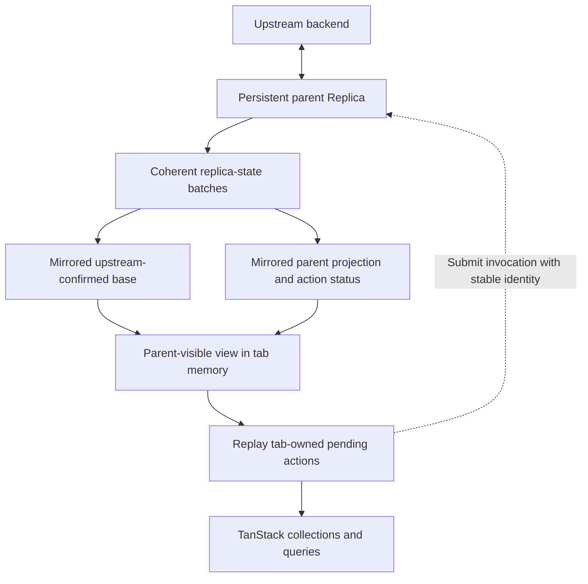

# Replicating replica state

## October 27 clarification: source paths and convergence

The SharedWorker is a replica server using the same OntologySource contract as
an intermediate cloud replica. Owned backends also expose that protocol. There is
no worker-specific row/outbox replication protocol: worker-specific code supplies
transport, principal/ontology partitioning and persistent platform storage.

Two acquisition paths remain in the engine: direct backend adapters use subset
snapshots plus optional committed changes.pull; protocol sources use Changes hints
plus Read/Submit selected-state snapshots. Changes itself carries no row payload.
The latter snapshots include base rows, inherited overrides, selected pending and
completed actions, and client delivery/acceptance progress. Their installation and
local prediction handoff are transactional. Repeated refreshes currently transfer
unchanged selected state too; this is a v0 transfer limitation, not a retained
incremental replica-state feed.

The committed backend journal cannot be forwarded unchanged by an intermediate:
an offline action changes its outbox/overlay before an authoritative commit exists.
Keep the parent's local state revision distinct from its upstream journal cursor.
The eventual common protocol should support initial/replacement selected state,
atomic incremental state updates and explicit reset after history expiry. Owned
sources have no speculative overlay; replica sources include it. The same receiving
machinery should serve both, with provider adapters normalizing into that model.
Result membership/removals, bounded history, authorization and action handoff must
stay coherent; a first implementation can reevaluate/diff selected results without
claiming server IVM. See subset-subscriptions.md for related query-feed work.

Design exploration from the October 20, 2026 discussion. Selected-state exchange
uses the existing Replica engine for parent and children, with scoped connections,
direct owned sources and initial Effect RPC/HTTP composition. Production application
placement, restricted-client projection and retained delta recovery remain unfinished.
This revisits the earlier preference for thin tab materialization; no permanent
separate host protocol should be assumed.

## Plain-language deployment and extra state

In the browser design being explored, "one Replica per client" means one memory
Replica per tab, plus one persistent parent shared by those tabs in a SharedWorker.
The worker is scoped to an origin and the relevant principal/ontology partition,
not a universal device-wide singleton. Both a thin tab and a memory-Replica tab
need RPC to this worker. Local prediction changes when the UI can respond; it does
not eliminate the message or make a memory-only action durable.

| Location              | State owned there                                                                                                        |
| --------------------- | ------------------------------------------------------------------------------------------------------------------------ |
| Authoritative backend | Committed application records and supported receipts/change history                                                      |
| Device SharedWorker   | Retained confirmed rows, durable shared pending actions and projection, sync/coverage state, retention and blob metadata |
| Tab memory Replica    | Relevant mirrored parent state, tab-owned actions not yet incorporated by the parent, and predictions for those actions  |
| Tab TanStack DbClient | Materialized collections and live query results from the memory Replica                                                  |

A Durable Object can be an authoritative database, or a persistent intermediate
Replica in front of Foundry. Its placement does not decide which role it has.

All clients need their own pending actions, stable invocation identity, and source
progress. Compared with an authoritative source, an intermediate source adds its
still-pending projection and action status, plus information saying which client
actions the received state already includes. "Revision-level handoff metadata"
meant only this: update 42 includes B, so installing update 42 also removes the
child's duplicate B prediction. The update number orders parent state; it is not
an upstream commit cursor and is not a sequence number attached to every row.

The same client engine can handle a source with no shared pending projection, or
one that has it. Authoritative commitment and intermediate durable acceptance are
different stages. The desired client interface can wait for either explicitly;
the final framework-facing wait API and worker integration remain unfinished.

## The proposed composition

### Standard source does not imply an intermediate Replica

Agreed vocabulary:

| Server role        | Responsibility for writes                                                                        |
| ------------------ | ------------------------------------------------------------------------------------------------ |
| **Owned server**   | Executes actions against the authoritative storage it controls.                                  |
| **Proxy server**   | Forwards writes upstream; does not independently accept durable pending writes.                  |
| **Replica server** | May durably accept a write into its outbox and expose its prediction before upstream commitment. |

A proxy may forward reads directly or use a Replica internally as a read cache
with maintained subscriptions. That does not make it a replica server: the server
role describes responsibility for pending writes, not whether its implementation
contains a cache or Replica component. Once it offers durable queued acceptance
before upstream commitment, it is a replica server. The same protocol can expose
all three roles. A SharedWorker sharing a persistent outbox between tabs is a
replica server; a Durable Object may take any of the three roles.

Keep **owned** for the backend implementation that controls storage, transactions
and mutators. **Protocol** versus **adapter** describes a Replica's upstream
connection: an ontology protocol source, or a direct backend adapter such as the
Foundry/Salesforce binding. A protocol endpoint may itself proxy an adapter, so
these are separate distinctions. "Native" is not another authority or server role.

A backend supplies ontology operations; a Replica owns local confirmed state,
pending intent and reconciliation; a server supplies access over a process or
network boundary. In the older architecture, these roughly map to the backend
adapter, the combined persistence/outbox/optimistic synchronization responsibilities,
and the server half of remote-ontology respectively.

All protocol clients implement a source interface, so they are adapters in the
general programming sense. Supplying a protocol source does not require also
supplying a provider backend adapter. `makeReplica` now accepts either `backend`
or `source` as mutually exclusive options; the separate sourceMode flag and dummy
backend requirement have been removed. `supportsIdempotency` is a boolean capability
of the binding, including a standard source that forwards to a weaker provider.

There are three intended server compositions:

| Composition                 | Business action execution                                                         | Upstream outbox |
| --------------------------- | --------------------------------------------------------------------------------- | --------------- |
| Authoritative owned storage | Mutator, client progress and change log commit in the owned database transaction  | None            |
| Thin provider proxy         | Forward to the provider and report its outcome; inherit its retry/snapshot limits | None            |
| Intermediate Replica        | Durably accept local intent/projection, then dispatch to an upstream source       | Yes             |

Client ordering, authorization and resumable query views do not require shared
optimistic state. An authoritative source exposes committed base with no pending
projection. A thin proxy must not advertise stronger idempotency merely because it
has a protocol endpoint; an external provider may commit before a reply is lost.
The admission helper lives below Replica in ontology-backend and accepts a storage
transaction plus a callback. Its authoritative callback can execute a mutation;
the intermediate integration enqueues an action. Owned and Replica sources are
implemented; the thin provider proxy composition remains unfinished.

### Intended construction at an endpoint

The following illustrates the intended composition, not a copy-paste API. The
`makeOwnedBackend`, `makeReplica` and `replicaStateSource` constructors exist;
the common `serveOntology` wrapper below has not been implemented. Authorization,
transport and storage acquisition are omitted.

```ts
// Authoritative DO or server: mutate its own database, without an upstream outbox.
const owned =
    yield *
    makeOwnedBackend({
        namespace: "issues",
        ir,
        tables: doTables,
        mutators,
    });
yield * serveOntology({ backend: owned });

// Thin DO proxy: use an already constructed provider binding, without a local queue.
yield * serveOntology({ backend: foundryBackend });

// Intermediate DO: persist accepted intent and its prediction before forwarding.
const replica =
    yield *
    makeReplica({
        namespace: "issues",
        ir,
        tables: doTables,
        backend: foundryBackend,
        execute: optimisticMutator,
    });
yield * serveOntology({ source: replicaStateSource(replica) });
```

These are alternative deployments, not three services sharing a namespace at once.
The endpoint implementation must preserve the owned backend's transaction boundary
when recording client acceptance; a generic wrapper cannot make provider IO atomic
with local client metadata. The client should connect through the same protocol
regardless of server role. Only the intermediate composition owns pending upstream
actions. Selected views and initial HTTP constructors now exist (see the implemented
section below). The proposed uniform wrapper, restricted projections and cross-host
blob transfer still need implementation before all these compositions are complete.

### Client identity versus connection session

The durable client identifies an ordered writer within a source generation. A
connection session is a temporary, fenced attachment to that client. Reconnect
rotates the connection ID while keeping the client ID, resume credential and
contiguous acceptance watermark. New clients start at submission 1. An admitted
sequence advances in the same transaction as the associated source work; gaps are
rejected rather than skipping unseen actions. Expired identities cannot be silently
recreated by an old request. Client expiry does not delete accepted pending work.

Zero similarly checks per-client mutation numbers transactionally and has separate
[mutation-result cleanup](https://github.com/rocicorp/mono/blob/main/packages/zero-protocol/src/mutation.ts).
Its [client-group garbage collection](https://github.com/rocicorp/mono/blob/main/packages/replicache/src/persist/client-group-gc.ts)
can preserve groups containing pending mutations. Its documentation's
[retryOn section](https://zero.rocicorp.dev/docs/mutators#retrying-mutators)
describes rerunning aborted database transactions; that is distinct from recognizing
a retransmitted mutation after a lost response. Our immediate browser topology
differs: tab memory children feed a shared persistent owner, with client/connection
identity bound to each immediate source rather than assuming Zero's full deployment.

The working model from the subsequent discussion is:

```text
Child replicated base:
    Selected parent base-row records
    Selected parent projection records
    Relevant parent action records and disclosed progress

Child local outbox:
    Own submissions not yet durably accepted by the parent

Child optimistic overlay:
    Predicted changes from those local submissions

Application view:
    Domain rows composed from the above
```

This treats a selected view of the parent's logical Replica state as ordinary
replicated input to the child. It does not mean copying the parent's complete
database or private storage formats. The base/projection/action record shapes
should be stable logical state derived from the ontology definitions. One
replication mechanism can carry those records across direct, worker and network
connections. An authoritative source can expose the same shape with no shared
pending projection; the client need not classify its placement or topology.

Submitting action B to the parent is itself an operation that can finish when the
parent durably records B. The child's submission can then settle while the
observed parent action B remains pending further work. Parent acceptance and the
corresponding projection/action records must be adopted coherently so B is applied
once. The current proof's separate forwarded/completed tables preserve these
facts, but they are not a requirement for the final physical layout. Action
records with lifecycle/progress fields may consolidate them; invocation identity
and sufficient receipt history must survive whatever compaction policy is chosen.

Partial replication is fundamental to this model. A child requests the parent
records needed by its domain queries, local pending work, and explicit inspection
queries. Its own action acceptance/status must remain available even if the
affected domain rows leave a requested query. Parent outbox inspection can be an
optional read-only collection rather than a prerequisite for mirroring all other
clients' pending parameters. A filtered stream can skip unrelated parent sequence
numbers; the sequence orders coherent source updates rather than counting only
records delivered to this child.

A persistent parent Replica owns upstream-confirmed base rows, its durable pending
actions, and their aggregate optimistic projection. A tab mirrors the relevant
slice of those three things into memory, then projects its own not-yet-handed-off
actions over the parent's visible state. TanStack materializes/query-executes the
tab's final visible rows.



The mirrored parent outbox is observed state, not the tab's dispatch queue.
Only locally owned invocations can be forwarded by that tab; the parent alone
dispatches its durable queue to its upstream. Parent overlays are imported
projections. The tab need not execute other clients' mutators to reconstruct them.

The existing overlay implementation stores aggregate sparse replacement rows and
tombstones, rather than a separately stored overlay per action. Mirroring that
aggregate plus relevant action records is sufficient for the initial design.
Local pending actions must replay when the imported parent view changes; retaining
old replacement values would lose their relationship to the new base.

An imported parent-visible view is the transaction read source beneath the tab's
local projection. Imported parent projection and locally generated projection need
separate ownership: today's rebase clears its overlay before replay, so simply
writing both into that same overlay would erase parent state.

## Handoff without double application

Example: upstream counter is 10, the parent already has action A (+2), and this
tab creates action B (+1). Parent projection below denotes the resulting value,
not the actual wire format.

| Event                         | Upstream base | Parent-visible value | Tab-only pending | Tab-visible value |
| ----------------------------- | ------------- | -------------------- | ---------------- | ----------------- |
| Parent has A                  | 10            | 12                   | none             | 12                |
| Tab predicts B                | 10            | 12                   | B (+1)           | 13                |
| Parent accepts/incorporates B | 10            | 13                   | none             | 13                |
| Upstream commits A            | 12            | 13                   | none             | 13                |
| Upstream commits B            | 13            | 13                   | none             | 13                |

The parent publishes B's incorporation with its corresponding projection/status
at one revision. The tab atomically installs that parent state, retires B from
its local speculative tail, rebases remaining local work, and publishes one result.
It must not show the parent B projection plus its own B projection, or remove its
own B projection before the corresponding parent state arrives.

A durable acceptance reply can identify the parent revision to wait for; a reply
alone does not establish that the tab's current mirror includes it. An authorized
state stream may also establish incorporation before the reply arrives. Exact
acknowledgment/compaction representation is still a design decision. Per-row
outbox sequence metadata is not an established requirement.

Parent confirmation similarly updates base, removes the parent projection, and
advances action status in one coherent batch. Multiple dependent actions can be
rebased together; consumers must never observe intermediate pieces of that update.

## Progress and failure semantics

Durability, application authority, and propagation are separate facts. Do not
encode a changing topology as fixed statuses such as acknowledged-by-level-1,
level-2, and so on. The ordinary child needs its immediate parent's durable
acceptance and the action outcome promised by that connection. Extra progress
can optionally identify a logical service/checkpoint, such as document-owner or
Postgres-copy, without exposing addresses or the full chain. Omitted progress
means unknown/undisclosed, not that the upstream step did not happen.

An application chooses its user-facing completion boundary. For a document owned
by a Durable Object, an authorized mutation durably committed there may be
"saved" even while its Postgres copy is behind. In that deployment Postgres may
be a downstream projection/archive, not a higher authority merely because it is
drawn above the DO. Delayed propagation during disconnection or an outage is
expected asynchronous behavior; stuck propagation still needs retries and
operational visibility.

If Postgres or Foundry can still reject the business operation, durable acceptance
by an intermediate only promises responsibility for processing/reconciliation.
It does not establish final business success. A parent must state the guarantee
it actually provides and acknowledge only after the required state is durable.
The UI may display accepted/pending and separately await the final decision.

Chains of caches or per-document/per-region owners can use the same immediate-hop
contract repeatedly. Each peer is responsible for its own durable accepted work;
optional action progress can describe further acknowledgments when disclosed.
The client does not need to enumerate the entire chain. This is an architectural
direction, not a claim that the proof implements multi-hop authority, consensus,
conflict-free collaboration, regional failover or global transaction guarantees.

Distinguish local speculative enqueue, parent durable acceptance, and ultimate
upstream commitment. Memory-only enqueue does not survive tab termination before
parent acceptance. A caller may show immediate feedback while awaiting durable
acceptance or upstream commitment separately. Canceling a waiter must not cancel
an already accepted action.

Stable invocation and payload identity must survive forwarding, retries, reply
loss and reconnect. Parent deduplication makes a lost acceptance reply recoverable
when the same durable parent storage survives. It does not establish deduplication
at an arbitrary external upstream. Host storage reset/source generation change
must not silently turn an uncertain external action into a safe resubmission.

After a parent rejection/rebase, the tab installs the corrected parent view and
replays its remaining local actions. A replay lacking required local data can
block or omit that prediction; it must not fetch through the transaction. The
parent may have more data or normalize parameters differently and remains the
authority for its shared projection. Deterministic defaults/now/UUID inputs need
to be frozen consistently.

## Scope and protocol requirements

This is subset replication, not copying all parent tables into every tab. Demand
must include relevant base/projection rows, deletions, action status, and local
replay dependencies. A projected row can enter/leave a predicate or ordered window.
Independently querying the top N base rows and top N overlay rows is not generally
sufficient. Membership/removal semantics and any additional candidate demand must
be explicit. Imported state and local pending dependencies participate in retention.

A replica-state batch needs source identity/generation, revision/progress, and
coordinated base/projection/action changes. Snapshot acquisition must be fenced
against stream startup. A gap/overflow requires catch-up or a fresh snapshot.
The parent's local visible revision and upstream journal cursor remain distinct.
The existing committed backend journal cannot silently become a visible-state log.

Remote authorization applies to every state component and subsequent update.
Plugins may see authorized projected rows and sanitized action statuses without
permission to read full pending parameters or underlying base records. Full
replica-state inspection is a capability, not an automatic property of row access.

Use one ontology/replication service contract across direct, worker and network
transports, with capabilities for confirmed-only sources and replica-state sources.
Effect RPC can carry it. The exact representation remains open. Typed state records
may support ontology-style inspection, but the protocol must not recursively
replicate its own transport queues, cursor bookkeeping, or imported mirror tables.

## Current action states and retained completion records

The source-mode flag has been superseded by mutually exclusive backend and
protocol-source options. Existing persisted source-mode markers remain readable,
so the API change does not require clearing existing data.

The capability is named `supportsIdempotency: boolean`. Here idempotency
means keyed request idempotency: repeating the same ID/payload returns its recorded
result, and a conflicting payload is rejected. It does not assert that arbitrary
action bodies are naturally idempotent. The current capability is a coarse promise;
bounded retry lifetimes need an explicit protocol before receipt expiration is safe.

The native outbox currently has five processing states:

| State        | Meaning                                                                                         |
| ------------ | ----------------------------------------------------------------------------------------------- |
| queued       | Waiting for ordered submission                                                                  |
| sending      | Submission is in flight, or an immediate-parent submission must be recovered using the same ID  |
| acknowledged | A backend receipt is persisted; journal/read-back reconciliation has not yet settled the action |
| blocked      | Replay failed or submission returned a non-automatic-retry error; explicit recovery is needed   |
| uncertain    | An external call may have succeeded and that backend cannot safely deduplicate another attempt  |

Blocked is a broad paused category, not proof that the remote made no changes.
The failure reason needs to accompany it. Uncertain is specifically the ambiguous
external-outcome case; ordinary durable parent enqueue can be retried by identity.
The legacy UI still maps these to queued/executing/failed.

`actionStatus(id).parentAcceptance` separately identifies the immediate source whose
installed state includes the action. It does not encode chain depth or imply
persistent durability for a memory parent. A parent can have accepted an action
whose business processing is still queued, blocked or uncertain. The receipt's
accepted/committed outcome is another fact, rather than another topology status.
There are no per-level statuses or named checkpoint progress records implemented.

Completed actions currently occupy a `completed` table in the same Replica storage
namespace; their full PendingAction-shaped record includes identity and receipt.
They no longer participate in replay. Retention supports duplicate-ID detection,
completion observation after restart, and lost-reply recovery. Keeping the complete
parameters and history forever is not required. The intended follow-up is compact
receipt/deduplication records, with an explicit supported retry/history window
before expiration. Merely deleting these records can permit resubmission of a
non-idempotent action. No compaction or safe expiration policy exists yet. A
separate completed table is a current physical choice, not a required protocol.

## Acknowledgments, bounded history and reset (next protocol slice)

The immediate deployment target is tab memory clients and a shared persistent
owner. General Durable Object chains and indefinite cross-session action retries
are not prerequisites. Keep the first retry guarantee scoped to a valid consumer
session/generation, with bounded detailed results and a submission watermark.
Unknown or expired sessions cannot be silently recreated by retrying an old action.
An unresolved submission whose session cannot be recovered needs outcome recovery
or an explicit uncertain result; tab death is not the only possible interruption,
since a reply may be lost while the tab remains alive.

Compaction is part of this milestone, not a deferred cleanup task. Inventory the
existing completed, forwarded and journal-receipt records as well as owned-backend
receipt/journal storage. Bound history and inactive consumer bookkeeping without
dropping pending work. Do not compact a source that promises unrestricted keyed
idempotency by simply forgetting arbitrary invocation IDs; first establish its
retry scope/old-request rejection contract. The public capability is now the
boolean `supportsIdempotency`. Source construction
uses typed backend/source options instead of separately selected mode names.

Implementation order: establish typed source/session contracts and bounded
acknowledgment/result retention; implement selected state batches and recovery;
then wire domain RPC, shared ownership and memory clients into the application.
The direct-blob-target extension follows the same owner/session boundary. Verify
bounded storage under repeated completions and expired clients, plus interrupted
handoff and resnapshot preserving local work, before claiming the path ready.

Client admission and applied-state acknowledgments now support selected snapshots.
Admission details compact after acknowledgment while a retained watermark rejects
old submissions. Client leases expire and connection IDs fence replaced connections.
Owned protocol result details also compact on acknowledgment/expiry; its journal
has a configurable commit bound (default 10,000), rejecting older cursors explicitly.
The raw owned backend's arbitrary-ID receipts and Replica completed/journal-receipt
history still lack safe bounds. Forwarded records retire after observed completion.
The broader history and result compaction below is still required.
The replay log and action retry records have distinct retention rules. A child
acknowledging a state update lets the source release replay history for that child;
it does not alone prevent an old action request from arriving again. Pending
actions remain live work even if every child has acknowledged their acceptance.

Each authorized consumer/view session should receive a fenced snapshot and ordered
state batches. A resume token binds source generation, view/subscription generation
and applied position. Batches identify both their preceding position and the
position reached, allowing filtered views to skip unrelated source updates without
silently skipping required updates. Changing demand or authorization requires a
new membership barrier; one view's acknowledgment cannot certify another view.

The child applies imported records, handoff bookkeeping, local rebase and its
resume token in one storage transaction. Only after commit does it acknowledge the
applied position. Acknowledgments are cumulative, monotonic and safe to repeat;
the source validates the authenticated session, generation and delivered position.
An acknowledgment for a memory Replica certifies its current session's applied
state. After memory loss it needs a fresh snapshot rather than resuming from an
acknowledgment whose corresponding rows no longer exist.

The source retains log history needed by valid consumer leases, with configurable
time/byte limits. When limits force removal of history needed by a slow consumer,
invalidate that consumer's resume position explicitly and require a fresh snapshot.
Expired leases cannot pin history indefinitely. Reconnecting within the supported
window should recover through the same valid consumer identity; duplicate live
sessions need fencing. This is analogous to replication slots with bounded log
retention, not a promise to preserve every disconnected client forever. PostgreSQL
similarly documents a [maximum slot WAL retention size](https://www.postgresql.org/docs/current/runtime-config-replication.html#GUC-MAX-SLOT-WAL-KEEP-SIZE)
that can make an excessively lagging consumer unable to resume from retained WAL.

Separately, action result retention needs a supported retry contract. A possible
compact form is ordered submission numbers scoped to a client generation, with
receiver-side acceptance/settlement watermarks and retained exceptional results.
After result acknowledgment, detailed receipts may be compacted while a watermark
still prevents old submissions from executing again. Retired generations must stay
rejected, or have expiring authenticated credentials that make their requests
invalid. Expiration cannot make an unknown old ID valid as a new action. The current
arbitrary-ID implementation needs this mechanism before deleting its identity
records. Admission fingerprints now use this mechanism; completion and journal
records do not yet have safe compaction.

Recovery should return a typed resnapshot requirement for expired history, view
generation mismatch or invalid cursor continuity. Source reset must remain distinct
from an ordinary reconnect. These detect an unusable history/cache relationship;
they do not detect arbitrary disk corruption. Schema validation and optional
integrity checks address malformed or corrupted stored data separately.

Resnapshot replaces only imported state and its cursor coherently. Preserve locally
owned pending actions, staged blobs and other local-only data. Reconcile their
acceptance/outcomes, then rebase; do not erase or blindly resubmit unresolved actions
merely because their old source view expired. An ambiguous action beyond the source's
idempotency guarantee requires outcome recovery or an explicit user decision.

## Direct blob transfer (next blob boundary)

Separate control operations from byte transport. The storage owner should reserve
an upload intent and grant a scoped write target. The tab may write directly to a
shared origin's OPFS byte store, or upload to a signed object-store URL, then ask
the owner to finalize the upload. A message-channel byte transfer remains a fallback
for targets without a direct-write capability. Direct OPFS grants are local platform
capabilities, not remote filesystem paths exposed as universal protocol identifiers.

The intent binds blob identity, a unique immutable generation/key, owner/session,
expiry and relevant size/type/integrity restrictions. Metadata remains owned by the
storage coordinator. Finalization checks the intent and completed bytes through
the configured trusted storage mechanism, then transactionally publishes the blob
record. Actions referencing staged bytes retain their roots transactionally with
the outbox entry. Writing bytes does not itself publish an attachment.

File close/finalization precedes attachment availability. A stale or expired writer
cannot attach bytes to a newer generation. Abandoned intents and partial files need
bounded recovery/cleanup, including writes that finish after an intent was abandoned.
Parent acceptance must establish access to required bytes before the child releases
its last staged copy. This extends the existing intent/generation/root machinery;
it does not require routing every byte through the owner's message channel.

## Smallest useful proof

Start with a memory parent and two memory children, using the actual engine's
mutators and projections before adding transport or IndexedDB placement:

1. A non-idempotent increment remains single-applied across local prediction,
   parent handoff, and upstream confirmation.
2. Another client's edit and a rejected parent action rebase a dependent local tail.
3. Acceptance reply loss/reordering, snapshot races and duplicate batches recover
   without duplicate dispatch or a transient incorrect visible value.
4. Parent restart preserves accepted work; source reset is distinguished from restart.
5. Predicate/window membership changes and deletions transfer correctly under demand.
6. Cancellation releases subscriptions while accepted work remains durable; restricted
   clients cannot inspect unauthorized replica state.

The first proof should determine whether a small extension to the existing Replica
can express imported state plus local tail cleanly. It does not authorize claiming
that a general multi-host engine or domain RPC rollout is already complete.

## Implemented source contract and limits

`snapshotState` captures base rows, sparse overrides, pending actions and completed
receipts in one storage read. A source identity survives reopen, changes after
storage reset, and has an update number advanced in the same transaction as
Replica state writes. This number is separate from an upstream backend cursor.

The `source` option opts into selected-state ingestion and an automatic scoped source
connection; it is mutually exclusive with `backend`. `receiveParentState` also
remains available for trusted manual inspection tests. The same `makeReplica`
implementation supplies memory clients.
Imported base/projection/action state is normalized into separate tables in the
same child storage transaction, with an imported-state head. The
parent-visible result is materialized beneath the child's existing local overlay.
Confirmed reads still expose the upstream-confirmed base. Import retires matching
local pending actions and rebases the remainder in the same transaction. Forwarded
invocation identities prevent a caller from re-enqueueing an already handed-off
action as a new local prediction. Parent receipt progress remains observable.

Automatic transfer selects the union of active query demands and precise pending
action dependencies. Selection evaluates composed parent-visible rows, including
window entrants/exits, rather than independently limiting confirmed rows and
overrides. It transfers requested action identities; broader action inspection is
an explicit trusted interest. Full `snapshotState` remains available for inspection.
Selected membership is replaced completely on refresh; retained delta batches and
cursor resume are not implemented. Protocol children still require disabled GC
and no blob service. They forward actions rather than calling a provider backend.

The transport-independent `OntologySource` contract lives in
`ontology-backend/protocol`. `makeOwnedBackend(...).protocol` exposes an authoritative
source without constructing a Replica or upstream outbox. Its ordered submission,
mutation, journal and client acceptance commit together. Per-client result details
can be acknowledged/expired without forgetting the accepted sequence watermark.
This path does not add arbitrary-ID records to the legacy raw receipt table.

Each selected view has a monotonically increasing generation. Changing membership
at the same source revision remains observable. Old responses cannot overwrite a
new view, and an acknowledgment for an older view cannot certify the replacement.
Membership identity and outgoing generation persist with child position state.

`replicaStateSource(parent)` exposes the trusted state/submit capability, and
`connectReplicaParent(child, source)` owns scoped subscriptions and a transfer
worker. It subscribes before reading the initial snapshot, refreshes before
forwarding, and claims only locally owned entries in order. Forwarding protects
the invocation from edit/removal while acceptance is ambiguous. Successful
installation retires that prediction and adopts parent state transactionally.
Transient errors retry by stable identity; lost replies recover by observing
acceptance before attempting another submit. Scope shutdown interrupts the worker
without deleting local or accepted work. A parent is an ordinary Replica; no
nested engine or duplicated dispatcher is instantiated inside the child. Memory
acceptance has memory lifetime; persistent guarantees require persistent parent
storage. Demand acquisition forwards to the source. Retryable initial offline reads
preserve cached state and continue background retry. Failed change streams reacquire
their subscription and refresh after the gap; closing the scope stops both paths.

`ontology-server/rpc` supplies schema-first Effect RPC for description, clients,
selected reads/submission/acknowledgment and scoped demand/change streams.
`ontology-server/rpc/http` supplies scoped Fetch handler/client composition with
NDJSON framing. Rich storage values use the shared codec at the schema boundary.
Authorization is mandatory per operation. Returned-state projection and the old
remote row/property policies still need integration before untrusted client use.

Five tests use one actual parent and two actual child Replicas to cover increment
handoff/confirmation, another client's optimistic update, lost acceptance replies,
duplicate/older updates, dependent local replay after shared removal, source
restart/reset, conflicting payloads, malformed row rollback and child reopen.
Connection tests additionally exercise automatic two-child transfer, a three-Replica
chain, transient failures, lost replies, non-optimistic submissions, scope closure,
offline startup and subscription gaps. Selected-state tests cover window membership,
deletion, changed views at one revision and dependencies after UI demand release.
The current suites contain 49 Replica and 16 backend tests. They also cover direct
owned sources, bounded protocol results/journals, wire value codecs, transactional
admission rollback, acknowledgment compaction, reconnect fencing and client expiry.
The worker transport now has actual MessagePort and Chromium SharedWorker coverage;
the browser proof combines one IndexedDB owner with memory tab Replicas and TanStack
collections. It survives closing the initiating tab and reloading the remaining tab.
The scoped `web-runtime` Layer constructs and cleans platform resources in
both window and worker environments. HTTP uses streaming NDJSON, not SSE framing.

Production application placement, restricted projections, terminal remote-rejection
policy, safe history reset and remaining completion compaction are unfinished.
