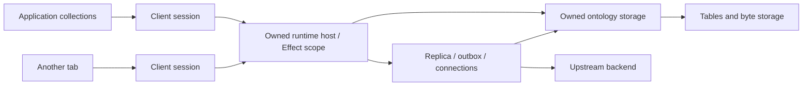

# Owned runtime host

This records the direction discussed in the coding chat on October 19, 2026.
It is an architectural target, not a claim that the central host is already wired
through the application. The Effect ports described below are implemented; the
remaining ownership and transport consolidation is explicit.

## The useful Durable Object analogy

One logical host owns a namespace's live services and their Effect scope. A
client connects to that host and acquires scoped handles. The host can execute in
the application process, in a SharedWorker, or in an actual Durable Object.
Durability comes from the storage implementation and its transactions. Keeping an
object alive in memory does not make its state durable.

This is a focused runtime ownership primitive. We do not need a general actor
framework, durable scheduling, arbitrary remote closures, or an actor per row.

## Separate three contracts

- **Owned storage** provides local reads, indexes, transactions, schema history,
  and byte capabilities. It neither elects a leader nor submits remote actions.
- **Runtime host** owns service acquisition, background fibers, subscriptions,
  and client sessions. It composes owned storage with Replica and backend services.
- **Backend** submits actions and receipts and supplies snapshots/change progress.
  An owned authoritative backend can use the same storage beneath its execution
  runtime. Hosting storage does not automatically make it a disposable replica.

Storage remains a local transaction capability inside the host. We should expose
operations such as submitting an action or acquiring query demand over RPC, rather
than trying to carry a transaction callback or an open transaction across RPC.

## A remote host can own shared optimistic state

The host and remote ontology should converge on the same ontology service exposed
through direct calls or a transport. Remote placement does not imply that every
visible row has already committed in an upstream system. An ontology host can own
its data authoritatively, or run a Replica against another backend. The latter can
serve a shared optimistic view to multiple clients while upstream actions are
pending. This is an architectural target, not behavior the current remote server
already implements: its action handler currently opens and closes an ontology per
request.

For example, two clients can connect to one persistent host in front of a slower
backend. The host durably accepts an action, projects its changes, and publishes
that projection to both clients. When the upstream action commits or fails, the
host updates its confirmed base and rebases remaining pending actions, publishing
the resulting visible changes and action status. The existing ordered-action and
rebase model is the starting point; shared optimism does not itself provide CRDT
merge semantics or collaborative text editing.

The service needs to distinguish three pieces of progress:

- A host has durably accepted responsibility for an invocation. Disconnecting the
  submitting client must not cancel that durable work.
- A revision describes the host's visible state, including optimistic changes.
  Another client's accepted action, its rejection, and its rebase can all change
  this revision.
- An upstream receipt/cursor establishes progress at that source. A local visible
  revision cannot be substituted for an upstream cursor or commitment.

The existing `accepted`/`committed` receipt outcomes are useful vocabulary, but do
not yet express this complete multi-host lifecycle. In particular, the source that
accepted responsibility must be identifiable, and acceptance needs a durable
action-status subscription/recovery path. A durable visible-state feed must record
optimistic updates and their later correction, or explicitly require a replacement
snapshot; the current committed-change feed cannot silently change meaning.

A downstream client may also have its own offline projection. Stable invocation
identity must travel with pending-action provenance so the client can recognize
its action when it appears in the host's shared projection. It must not apply that
action twice, and must be able to recover the same status after reconnect. The
first transport implementation should prove this with a non-idempotent operation
such as increment, with rejection/rebase and host restart cases as well.

Clients can subscribe to the visible view and action status; consumers that need
confirmed records can request that view explicitly. Shared pending parameters and
projections remain subject to the remote service's authorization policy. One
client's ability to submit an action does not automatically grant every connected
client access to its parameters or effects.

This keeps storage, engine ownership, and transport as distinct responsibilities
without introducing a separate remote execution engine. The next host protocol
should reuse the remote ontology boundary and add sessions and explicit progress,
rather than build an unrelated worker-only ontology API.

The same composition covers a SharedWorker with a cross-tab outbox and a Durable
Object with a cross-client outbox. Both have one engine and one pending-action
queue per host partition; clients contribute demand and actions. The Durable
Object's queue needs persistent storage to survive eviction. An authoritative
owned backend without an upstream can commit directly and needs no upstream
outbox. Transport authentication, placement, and restart behavior still differ,
but should not require separate Replica implementations.

Keep the initial consolidation small: attach multiple scoped client views to one
existing host, then carry those operations over Effect RPC. Do not add a general
multi-hop replication framework as a prerequisite. Shared optimistic publication
requires an explicit handoff/provenance rule before it can be enabled safely; it
does not require designing every possible chained-host topology first.

The earlier first-deployment proposal was thin tab materialization: query demand
acquires a host lease and streams visible snapshots into in-memory collections.
The subsequent October 20 discussion explores a stronger unification: a memory
Replica mirrors parent base/projection/action state and adds a tab-owned speculative
tail. See [replicating replica state](./replica-state.md) for the handoff, imported
state ownership, subset and failure semantics. Neither deployment is wired yet;
thin materialization is not a decided permanent second client protocol. Both
release client demand without discarding the parent's durable pending work.

An untrusted plugin iframe is another possible client of this service, with a
restricted ontology surface and principal-specific reads/actions. Authorization
must apply to subscription updates and pending-action information as well as the
initial snapshot; receiving an invocation ID is not permission to inspect it.
This transport/security reconciliation remains design work while adapter and
runtime migration continues. Per-row optimistic sequence metadata is not yet an
established requirement; coherent state revisions and invocation handoff may suffice.

## Identity, ownership, and lifetime

A host key must include installation/profile, principal partition, ontology, and
storage namespace. Two profiles with identical ontology names must not share
credentials or pending actions. Definition/source revisions must be checked when
opening a handle; they must not silently alias incompatible hosts.

The host scope owns storage handles, connections, the Replica, outbox execution,
watchers, timers, GC, and tracing. Child session scopes own client-specific demand,
materialized-query subscriptions, and in-flight requests. Closing one client
releases those resources without closing the host or another client's session.
A host shutdown interrupts session work before closing storage. Restart reacquires
services and recovers persisted state; it does not restore JavaScript closures.

Losing a client does not remove durable offline pins or pending-action roots.
Those have storage-backed lifetimes. A host may eventually use an idle grace
period, but it must not stop merely because a tab navigates away while durable
work is pending.

One owner is a lifetime and authority rule, not a requirement to serialize every
read. Commands that share mutable host state need explicit concurrency control;
short storage transactions enforce database atomicity. Fetching bytes, awaiting
OAuth, or calling an upstream API must not hold a database transaction open.

## Placement and election

For a SharedWorker, one worker owns the host and tabs use Effect RPC. In-process
embedding uses the same service acquisition directly. A Durable Object delegates
its request/socket lifetime to the same host composition and uses its native
storage transaction implementation.

Where a shared worker is unavailable or unsuitable, Web Locks can choose which
context runs the host. This is a placement concern, beneath the host interface.
Replica, outbox, and blob services should not each negotiate independent leadership
for the same durable parent queue. Child memory Replicas may own their own local
tails, while observing rather than dispatching the parent's pending work.
A replacement parent owner must acquire
exclusive ownership before recovering work. Durable invocation/receipt identity is
still required: election cannot prove whether a lost remote reply committed.

The current browser fallback's fenced broadcast protocol remains transitional.
Its retry guarantees must survive replacement; simply retrying an RPC against a
new owner could repeat a side effect.

## RPC and collection boundary

Use schema-defined Effect RPC operations and streams for the actual host API.
The generic coordination `Call(service, method, unknown)` envelope now runs over
Effect RPC in SharedWorker mode, but it is a compatibility bridge, not the final
ontology runtime contract.

The first domain operations should cover opening/closing ontology sessions,
submitting/editing/reconciling actions, scoped query demand, local persisted reads,
visible changes, action status, and bounded performance traces. Credentials remain
owned by the host; browser presentation can be delegated to the connected UI when
needed. A namespace supplied in a handshake is routing, not authentication.

A streaming query subscription owns its demand lease and provides a snapshot plus
revision/progress. Cancellation closes the lease. Publication needs a snapshot /
stream barrier so an update cannot fall between the initial read and subscription.
Bounded buffers must fail or request a fresh snapshot on overflow; they cannot
silently drop state changes or action results.

The local `ReplicaHostService.observe` composition now implements this subscription
boundary. `subscribeChanges` acquires the PubSub subscription as an Effect before
the initial read; converting a lazy Stream into a pull alone was insufficient.
Tests cover a commit during the first snapshot and cancellation of a persisted-only
reader without acquiring remote demand. These local streams are not yet the domain
RPC rollout or a shared worker host registry.

TanStack collections and their DbClient remain per application/client view. They
materialize locally visible subsets and forward demand. The host does not need a
TanStack collection for every persisted table. The public `.objects` facade can
remain unchanged while the host becomes the owner underneath it.

The user explicitly confirmed that existing TanStack DB persistence support is to
be removed completely. The host/Replica owns confirmed rows, optimistic overlays,
outbox state, persistence, and synchronization. TanStack is one demand/materialization
adapter. Preserving its persistence adapters, coordinator protocol, or persistence
peer dependencies is not a compatibility requirement of this migration.

## Transitional platform hooks

`RuntimeAdapter.actorLiveness` currently holds/query-checks per-owner browser Web
Locks so persisted query/read roots and interrupted blob writes can distinguish
a live owner from an abandoned one after a tab crash. It is process/session
ownership bookkeeping, not an actor execution framework. Central host/session
ownership should absorb it; any remaining fallback owner lease belongs inside
placement/recovery infrastructure rather than the application runtime contract.
Effect finalizers handle ordinary scope closure; abrupt process loss still needs
a recovery rule.

`storageNotifications` currently broadcasts an empty invalidation hint after local
commits so other contexts reread shared storage. It is not a durable change log,
receipt channel, or ordered replication protocol. Host query/change streams should
replace this app-facing hook when writes have one owner; transport-specific
fallback invalidation, if needed, remains private.

`encryptionKeyring` supplies the active encryption key and key lookup by ID for
local encrypted values and OAuth credentials. Ciphertext stores its key ID. The
browser implementation currently creates/reuses one nonextractable WebCrypto key
in a separate IndexedDB database; rotation is not implemented. Separating it from
ordinary table exports does not isolate it from same-origin code. This capability
belongs in the local encryption service's platform Layer; centralizing the host
does not remove the need to obtain encryption keys.

## Key custody and persistence consent

Browser key storage, ciphertext caching, and plaintext persistence are separate
decisions. An `Encrypted<string>` field describes an opaque encrypted value; it
does not authorize the browser to keep a decryption key or persist the decrypted
string. A credential and an encrypted SSN can have the same value type while
requiring different policies.

The current web implementation stores the WebCrypto `CryptoKey` in the
`party-stack:<owner>:<namespace>:keys` IndexedDB database. Encrypted values and
their handles live in the separate `:storage` database. A nonextractable key
rejects raw key export; same-origin JavaScript that can obtain the handle can
still ask WebCrypto to decrypt. This is not isolation from compromised app code.

The intended composition lets an application explicitly choose a credential key
provider and persistence policy. Persisting access/refresh credentials can be a
deliberate browser-local choice. Other encrypted ontology fields can retain only
ciphertext/remote handles, use a backend decryption endpoint, and return plaintext
briefly to the requesting operation without writing it to Tables or a collection.
Choosing the credential provider must not make it the decryption provider for
every encrypted ontology field. An offline requirement for a particular field
needs its own explicit policy.

The exact configuration API and defaults are still to be settled. The current
web adapter supplies its browser keyring automatically; the presence of this
implementation is not the final consent API. The old `dangerouslyPersistSecrets`
flag covers the plaintext OAuth fallback and must not silently become consent to
all encrypted-field caching. No decrypted-result cache is implied by these plans.

## Migration checkpoints

1. Remove the second concurrency library while preserving existing behavior.
   Completed: coordination and legacy outbox use Effect; their Effection helpers,
   exports, and dependencies are removed. SharedWorker uses Effect RPC and native
   worker transports, with schema-derived structured-clone codecs.
2. Separate the existing native Replica service composition from collection views.
   Implemented as `makeReplicaHost`: backend acquisition, Replica, attachment
   preparation, and blob lifetime are scoped independently of the application
   DbClient. Placement is injected. Connection ownership and sharing that host
   across contexts remain to be wired.
3. Define domain RPC schemas and session streams, then connect a second client to
   the same host. Prove cancellation, snapshot barriers, offline enqueue, recovery,
   and reconnect without duplicate dispatch.
4. Route browser collections and installations through those host handles.
   Consolidate legacy collection persistence and legacy outbox execution only after
   their remaining behavior is represented in the native path.
5. Audit runtime platform acquisition and connection/OAuth presentation against
   the host lifetime. Keep Promise and collection facades at framework boundaries.

The existing behavior is still protected by coordination, outbox, Blob, Replica,
HTTP, and owned backend tests. Full application and workspace verification remains
necessary after the host wiring changes.

## Remaining adapter and runtime migration

The October 21 checkpoint removes `makeAdapterBackend`, `backendAdapterFromEffect`,
the collection-oriented backend contract and the second LiveOntology executor.
Provider bindings now acquire a native backend service through scoped `open(context)`;
metadata, synthetic users, query functions and attachment helpers use SDK snapshots
or native services. See [native-actions.md](./native-actions.md) for receipt ordering,
retry/recovery policies, replay inputs and acceptance/confirmation waits.

Salesforce still uses polling repair in the native binding. Its existing CDC API
cannot yet report stream health and reconnect gaps to Replica; enabling watcher
hints must not silently disable the repair path. Native subset reads push down
primary-key equality/batches, but general filtering, sorting and windows still
use a complete paginated source read followed by portable query evaluation.

Remaining work includes Foundry cursor catch-up without inventing journal guarantees
from watcher hints, host/session protocol hardening, scoped Node/Expo acquisition,
private connection/installation records and blob facade consolidation. The collection
facade remains a demand and materialization adapter. The current inventory and limits
are in [migration-status.md](./migration-status.md).
