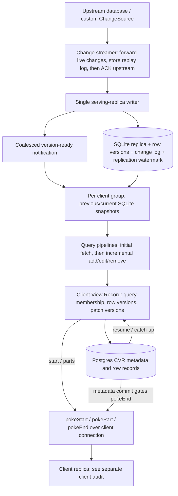

# Zero server data flow and the Party Stack comparison

Reviewed 2026-11-09 at Zero revision
[`fbdb27ed5f4ed2b3ae33331ebed5a5033f010dd9`](https://github.com/rocicorp/mono/tree/fbdb27ed5f4ed2b3ae33331ebed5a5033f010dd9).
The local source copies were checked against the Git blob SHA values in the
official repository tree, including the older `/tmp/zero-cvr-review` copies.
This describes that revision, not an assumption about every Zero release or
deployment. Configuration-dependent features are called out below.
No Zero deployment was benchmarked here; the performance comparisons below use
Party Stack traces and identify mechanisms, not matched cross-product timings.

## The main difference

Zero owns a continuous, versioned source-change stream, a local SQL replica, the
query compiler, and the incremental query runtime. It can maintain a query's
result from changed rows rather than repeatedly reacquiring the complete result.
Party Stack supports this richer path through native capabilities, but also has
to support backends that offer only finite snapshots and invalidation hints.
Those two input contracts cannot provide the same incremental guarantees.

Neither system avoids initial data acquisition. Zero initially hydrates a query
by fetching its pipeline, then maintains that pipeline. Restart, changed query
semantics, and some expensive advancements can require hydration again.

The arrows do not mean every box is a new durable write. In particular, query
operator state and outgoing changes have different durability from the upstream
database, SQLite replica, and CVR metadata.

## 1. Source changes, durable replay, and the serving replica

The change streamer's ordering is explicit: forward changes promptly to live
subscribers, store them for replay, then acknowledge them upstream. A subscriber
starting behind buffers concurrent live traffic while catching up; it does not
drop source transactions merely because it is slow. Watermarks coordinate live
traffic and replay. This is a durable CDC/replay service, not a periodic re-query.
Sources: [change-streamer.ts:38](https://github.com/rocicorp/mono/blob/fbdb27ed5f4ed2b3ae33331ebed5a5033f010dd9/packages/zero-cache/src/services/change-streamer/change-streamer.ts#L38),
[subscriber.ts:109](https://github.com/rocicorp/mono/blob/fbdb27ed5f4ed2b3ae33331ebed5a5033f010dd9/packages/zero-cache/src/services/change-streamer/subscriber.ts#L109).

Fresh startup reserves a snapshot and its replay position on the same WebSocket
that will later serve changes. The reservation remains until registration, so
there is no gap between restoring the backup and protecting the replay watermark.
A valid existing replica reconnects directly from its committed watermark.
[subscribe.ts:1](https://github.com/rocicorp/mono/blob/fbdb27ed5f4ed2b3ae33331ebed5a5033f010dd9/packages/zero-cache/src/services/change-streamer/subscribe.ts#L1)

The replicator batches source messages to a write worker and waits for commit
completion before consuming/acknowledging the commit. The writer applies rows,
row versions and the change log transactionally. A new readable version is
announced after the write result says the change log advanced.
[incremental-sync.ts:372](https://github.com/rocicorp/mono/blob/fbdb27ed5f4ed2b3ae33331ebed5a5033f010dd9/packages/zero-cache/src/services/replicator/incremental-sync.ts#L372),
[incremental-sync.ts:423](https://github.com/rocicorp/mono/blob/fbdb27ed5f4ed2b3ae33331ebed5a5033f010dd9/packages/zero-cache/src/services/replicator/incremental-sync.ts#L423),
[change-processor.ts:333](https://github.com/rocicorp/mono/blob/fbdb27ed5f4ed2b3ae33331ebed5a5033f010dd9/packages/zero-cache/src/services/replicator/change-processor.ts#L333).

The `ChangeSource` extension contract itself requires a stream after a specified
watermark and an upstream acknowledgment sink. It is stronger than our generic
`watchSubset` invalidation contract. Foundry or another adapter cannot gain the
same replay guarantees simply by being called a source.
[change-source.ts:7](https://github.com/rocicorp/mono/blob/fbdb27ed5f4ed2b3ae33331ebed5a5033f010dd9/packages/zero-cache/src/services/change-source/change-source.ts#L7)

## 2. Notification coalescing does not throw away the underlying changes

The replica's readiness subscription sends the current state immediately and
retains only the latest unread notification. A busy view syncer can jump from
version A to D without separately processing B and C notifications: the durable
replica/change log can still provide the net data changes it needs.
[replicator.ts:48](https://github.com/rocicorp/mono/blob/fbdb27ed5f4ed2b3ae33331ebed5a5033f010dd9/packages/zero-cache/src/services/replicator/replicator.ts#L48)

This is a useful distinction for Party Stack: a sliding wake queue is safe when
it says “reconcile against the latest durable version.” It cannot replace a row
change log if notifications themselves contain the only copy of changes. Our
current latest-state delivery coalescing is valid, but a full recapture on every
wake remains extra work; coalescing alone is not incremental evaluation.

## 3. Snapshot advancement and query hydration

Each client group has a view syncer and pipeline driver. The snapshotter uses two
SQLite connections that alternate previous/current snapshots. It can simulate
changes on the previous snapshot for IVM and roll those writes back; the
replicator remains the sole committed writer. A slow view syncer does not make
other client groups or the replica writer advance at its speed.
[snapshotter.ts:35](https://github.com/rocicorp/mono/blob/fbdb27ed5f4ed2b3ae33331ebed5a5033f010dd9/packages/zero-cache/src/services/view-syncer/snapshotter.ts#L35)

A pipeline is built from the transformed query AST, SQLite-backed table sources,
and operator storage. Initial `fetch` hydrates it and produces row additions.
Steady-state `advance` reads the relevant change-log interval, obtains old/new
row values from consistent snapshots, and pushes changes through the existing
operators. The normal input to this work is changed row identity/version, not a
fresh serialization and hash of every selected row.
[pipeline-driver.ts:1190](https://github.com/rocicorp/mono/blob/fbdb27ed5f4ed2b3ae33331ebed5a5033f010dd9/packages/zero-cache/src/services/view-syncer/pipeline-driver.ts#L1190),
[pipeline-driver.ts:1609](https://github.com/rocicorp/mono/blob/fbdb27ed5f4ed2b3ae33331ebed5a5033f010dd9/packages/zero-cache/src/services/view-syncer/pipeline-driver.ts#L1609)

On startup, a group does not hydrate against a replica older than its persisted
CVR state. It waits for the replica to catch up, then hydrates. Schema,
permissions, truncation, scalar-subquery changes, or advancement cost can reset
pipelines. Some paths retain reusable transformed query definitions; they still
rebuild the necessary operator state.
[view-syncer.ts:880](https://github.com/rocicorp/mono/blob/fbdb27ed5f4ed2b3ae33331ebed5a5033f010dd9/packages/zero-cache/src/services/view-syncer/view-syncer.ts#L880),
[view-syncer.ts:1024](https://github.com/rocicorp/mono/blob/fbdb27ed5f4ed2b3ae33331ebed5a5033f010dd9/packages/zero-cache/src/services/view-syncer/view-syncer.ts#L1024)

The optional worker-wide `SnapshotRowCache` shares exact old/new SQLite reads
between groups. Its keys include the SQL/arguments and the replica versions on
which the value depends. It is bounded (default 50,000 entries), FIFO, and shared
values must not be mutated. It is not an unversioned application-result cache.
[snapshot-row-cache.ts:8](https://github.com/rocicorp/mono/blob/fbdb27ed5f4ed2b3ae33331ebed5a5033f010dd9/packages/zero-cache/src/services/view-syncer/snapshot-row-cache.ts#L8)

Do not overstate cross-query sharing: the conservative query-coverage helper is
explicitly used for shadow logging at this revision. Identical IVM advancement
across client groups is also identified as duplicated work in eligibility
telemetry. The row-read cache above does not mean there is one universally shared
pipeline for overlapping queries.
[query-covering.ts:34](https://github.com/rocicorp/mono/blob/fbdb27ed5f4ed2b3ae33331ebed5a5033f010dd9/packages/zero-cache/src/services/view-syncer/query-covering.ts#L34),
[view-syncer.ts:194](https://github.com/rocicorp/mono/blob/fbdb27ed5f4ed2b3ae33331ebed5a5033f010dd9/packages/zero-cache/src/services/view-syncer/view-syncer.ts#L194)

## 4. What the CVR actually tracks

The CVR is the server's record of a client group's view, not another complete
copy of the application database. Its row records contain identity, source row
version, patch version, and per-query reference counts. A null reference map is
a view tombstone. Query/configuration versions are distinct from source state
versions. Multiple queries can reference one row without sending independent
copies of it.
[schema/types.ts:232](https://github.com/rocicorp/mono/blob/fbdb27ed5f4ed2b3ae33331ebed5a5033f010dd9/packages/zero-cache/src/services/view-syncer/schema/types.ts#L232)

IVM output is accumulated by row identity. Adds/removes adjust query reference
counts; edits replace content/version. Intermediate versions collapse to the
final row update before patches are emitted. The updater avoids patching an
unchanged source row version.
[view-syncer.ts:3590](https://github.com/rocicorp/mono/blob/fbdb27ed5f4ed2b3ae33331ebed5a5033f010dd9/packages/zero-cache/src/services/view-syncer/view-syncer.ts#L3590),
[cvr.ts:1133](https://github.com/rocicorp/mono/blob/fbdb27ed5f4ed2b3ae33331ebed5a5033f010dd9/packages/zero-cache/src/services/view-syncer/cvr.ts#L1133)

CVR flushes check version and owner while holding a Postgres row lock. Pending
writes are coalesced and unchanged row records are removed before writing.
Client `pokeEnd` follows the relevant CVR flush; an advancement with no observable
row change can skip constructing/flushing an updater. “No changed rows” need not
mean “persist every member again.”
[cvr-store.ts:1083](https://github.com/rocicorp/mono/blob/fbdb27ed5f4ed2b3ae33331ebed5a5033f010dd9/packages/zero-cache/src/services/view-syncer/cvr-store.ts#L1083),
[cvr-store.ts:1137](https://github.com/rocicorp/mono/blob/fbdb27ed5f4ed2b3ae33331ebed5a5033f010dd9/packages/zero-cache/src/services/view-syncer/cvr-store.ts#L1137),
[view-syncer.ts:3685](https://github.com/rocicorp/mono/blob/fbdb27ed5f4ed2b3ae33331ebed5a5033f010dd9/packages/zero-cache/src/services/view-syncer/view-syncer.ts#L3685)

## 5. Durable state, temporary state, and recovery

| State                                                                   | Ownership / durability                                                    | Recovery consequence                                                                                        |
| ----------------------------------------------------------------------- | ------------------------------------------------------------------------- | ----------------------------------------------------------------------------------------------------------- |
| Upstream application rows and mutation evidence                         | Authoritative upstream database                                           | Not stored only in a view-syncer heap.                                                                      |
| Change-stream replay log                                                | Separate change-store database; watermark coordinated                     | Reconnect replays from a committed position; unavailable history requires a compatible restored replica.    |
| Serving SQLite rows, row versions, change log, replication state        | Replica file, restored from backup when necessary                         | Committed watermark identifies applied source work.                                                         |
| CVR metadata, queries, desires, clients, row membership/version records | Postgres, with owner/version checks                                       | Supports catch-up from a client's cookie; not itself the source of full application-row contents.           |
| CVR row-record cache and pending flushes                                | Heap; small changes write through, large changes may write back           | A crash can leave durable metadata ahead of durable row records; this is detected rather than trusted.      |
| Query pipelines/operator storage                                        | Worker-owned, rebuildable; temporary UUID-named storage plus bounded heap | Rehydrate after loss. Its presence on a local disk does not make it an authoritative cross-restart journal. |
| Snapshot reads and outgoing batches                                     | Scoped/versioned in-process state                                         | Recompute/reconnect under the durable version and ownership rules.                                          |

The write-back distinction is deliberate. CVR metadata/query information is
committed before completing a poke, but a large row-record update can flush
asynchronously. Loading compares metadata and row-record versions. At this
revision it makes up to ten load attempts, 500 ms apart, then considers the CVR invalid
if rows never catch up. This is a rebuildable-view tradeoff, not permission to
lose an accepted application mutation.
[row-record-cache.ts:39](https://github.com/rocicorp/mono/blob/fbdb27ed5f4ed2b3ae33331ebed5a5033f010dd9/packages/zero-cache/src/services/view-syncer/row-record-cache.ts#L39),
[cvr-store.ts:180](https://github.com/rocicorp/mono/blob/fbdb27ed5f4ed2b3ae33331ebed5a5033f010dd9/packages/zero-cache/src/services/view-syncer/cvr-store.ts#L180)

Operator storage is created under a worker-specific temporary path. This
supports the “rebuildable” classification above.
[server/syncer.ts:131](https://github.com/rocicorp/mono/blob/fbdb27ed5f4ed2b3ae33331ebed5a5033f010dd9/packages/zero-cache/src/server/syncer.ts#L131)

Catch-up is not a blind dump of the source database: it reads CVR patches after
the client's version, checks that the expected CVR remains current, and obtains
current row contents from the pipelines. Pending row-record write-back must
finish before that durable catch-up read.
[view-syncer.ts:3485](https://github.com/rocicorp/mono/blob/fbdb27ed5f4ed2b3ae33331ebed5a5033f010dd9/packages/zero-cache/src/services/view-syncer/view-syncer.ts#L3485),
[row-record-cache.ts:348](https://github.com/rocicorp/mono/blob/fbdb27ed5f4ed2b3ae33331ebed5a5033f010dd9/packages/zero-cache/src/services/view-syncer/row-record-cache.ts#L348)

## 6. Scheduling and deliberate safeguards

Zero also has timers, budgets, and fallback rebuilds. They have explicit roles:

- Hydration budgets are soft, checked between queries; custom-query transform
  latency is discounted. A separate per-transformation circuit breaker can abort
  a slow hydration at yield boundaries and temporarily reject repeats.
  [hydration-budget.ts:5](https://github.com/rocicorp/mono/blob/fbdb27ed5f4ed2b3ae33331ebed5a5033f010dd9/packages/zero-cache/src/services/view-syncer/hydration-budget.ts#L5),
  [hydration-circuit-breaker.ts:5](https://github.com/rocicorp/mono/blob/fbdb27ed5f4ed2b3ae33331ebed5a5033f010dd9/packages/zero-cache/src/services/view-syncer/hydration-circuit-breaker.ts#L5).
- Deferred IVM writes reserve a worker-wide memory budget. Work that cannot fit
  writes through to the private snapshot, where SQLite can bound/spill it.
  [deferred-writes-budget.ts:11](https://github.com/rocicorp/mono/blob/fbdb27ed5f4ed2b3ae33331ebed5a5033f010dd9/packages/zero-cache/src/services/view-syncer/deferred-writes-budget.ts#L11).
- Optional batch pacing uses event-loop utilization and a group's processing
  cost. It gives new hydration priority, and waits outside the group lock while
  readiness notifications coalesce. A quiet/under-budget worker need not wait.
  [batch-pacer.ts:96](https://github.com/rocicorp/mono/blob/fbdb27ed5f4ed2b3ae33331ebed5a5033f010dd9/packages/zero-cache/src/services/view-syncer/batch-pacer.ts#L96),
  [view-syncer.ts:4105](https://github.com/rocicorp/mono/blob/fbdb27ed5f4ed2b3ae33331ebed5a5033f010dd9/packages/zero-cache/src/services/view-syncer/view-syncer.ts#L4105).

These are not reasons to add unexplained delays to a local happy path. Nor is
“Zero has no fallbacks” an accurate model. Its fallbacks distinguish expensive
derived work from authoritative data and durable mutation outcomes.

## 7. Applying this to the measured Party Stack path

| Observed Party Stack work                                                           | Relevant distinction                                                              | Practical implication                                                                                                                                                                  |
| ----------------------------------------------------------------------------------- | --------------------------------------------------------------------------------- | -------------------------------------------------------------------------------------------------------------------------------------------------------------------------------------- |
| A nominal first page triggered an additional large TanStack tie selection           | Zero owns its query/materialization/cursor contract end to end                    | This is a window-contract issue separate from IVM. Do not describe engine row throughput as fixed merely by avoiding overfetch.                                                        |
| A selected delivery capture read and hashed the selected row set after a change     | Zero's steady state starts from source row changes and maintained query operators | Native owned/journal-backed paths could maintain selection incrementally. A snapshot/hint-only backend still needs safe reacquisition.                                                 |
| Repeated index candidates during 128-row capture pages                              | Initial acquisition must still execute an efficient storage plan                  | We fixed a concrete implementation issue: 34,464 materialized index entries became 1,436 for the same 1,436-row paged equality selection, without a cache or dependency patch.         |
| Table rows decoded once for filtering and again when returned                       | Typed values already produced at the same storage boundary can be reused          | The query-local decoded result removed a measured duplicate pass; raw native results still validate. This is independent of adopting IVM.                                              |
| Every frame staged changes with individual table operations                         | Transport framing should amortize work over a batch                               | We changed staging to one `putMany` per nonempty frame, preserving atomicity, numeric order, frame hashes, and retry behavior.                                                         |
| Snapshot repair decoded installed cached rows only to inspect keys                  | Membership and row value are different operations                                 | A bounded key-only storage primitive can avoid unused decoding while still checking every wider-cache candidate. The missing-row repair cannot be dropped.                             |
| A proposed native aggregate callback tried to replace 128 individual read callbacks | Actual database work must be measured, not inferred from API shape                | The controlled Chrome 156 same-database test found peak concurrency 128, 1,440 gets and one sentinel in every arm. Aggregation showed no material benefit; no product change was made. |

Measured details and local traces are tracked in
[the data-flow audit](./data-flow-audit.md). The normal-path timer inventory and
the separate authentication recovery bug are tracked in
[the scheduling audit](./sync-scheduling-audit.md).

The architectural opportunity is to add incremental selection maintenance where
the backend supplies sufficiently strong change/version information, while
retaining an honest snapshot fallback elsewhere. It does not require another
application row cache. It does require defining which versions, membership,
pending actions, policy projections, and recovery facts each layer owns.
